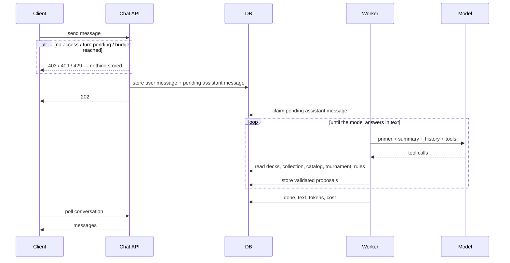
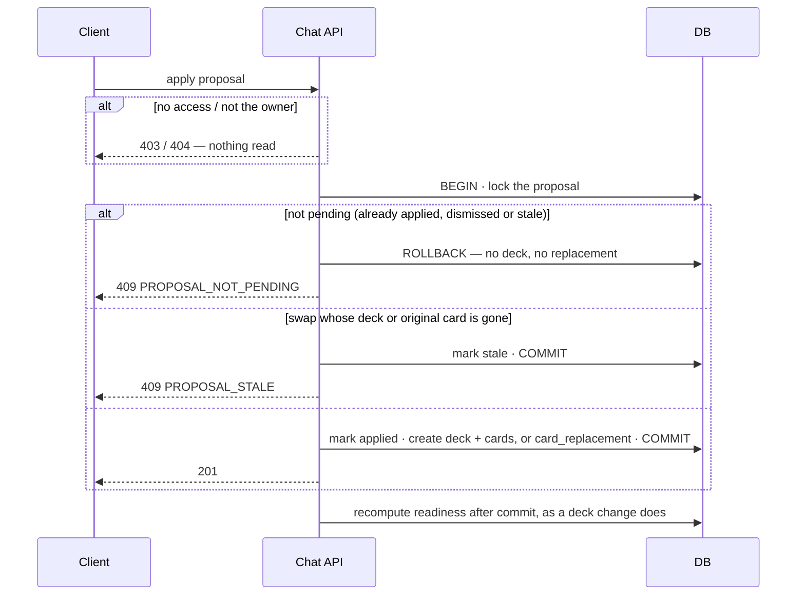

# AI chat

> Plan from this document. Each slice below carries its own shape - copy it, do not re-derive it.
> Status: confirmed by Rodrigo, 2026-10-11 - build for the owner and three friends; UI slices wait on mockups the owner picks from.

## Situation

- Project: in steady use by the owner; this feature opens to three friends.
- Decision: open at the start of the session, confirmed by Rodrigo on 2026-10-11.
- In flight: copies the worker job queue and the stored token usage of card recommendations (`.design/card-recommendations.md`), and the `card_replacement` pick of card alternatives (AD-009); recommendations themselves are not reopened.
- At stake: medium - five new tables, a new paid model loop and a new external data feed; being wrong costs a rewrite of the conversation loop and the chat screen, never user data.

## Problem

The owner looks for deck ideas and the competitive meta by hand: searching Fabrary for tournament decks of a hero, reading what they run, and sometimes watching YouTube deck techs.
That happens about twice a month, and the cause is the effort, not lack of interest: with a tool that already knew the owner's decks, collection and recommendations, the research would happen more often.
Two questions drive it, both live: how others build a hero the owner already plays and how the owner's deck differs, and which hero or deck to build next.
The same holds for the three friends who will get access first.
Nothing measures this today; the twice-a-month figure is the owner's own account.

## Success

- Worked if: within six weeks of opening it to the friends, the owner researches inside the site every week and no longer opens Fabrary to look for tournament decks, and at least two of the three friends come back in different weeks.
- Going wrong: users do not return after their first conversation, or proposals are mostly dismissed or ignored (read from `chat_proposal`); cost per active user per month approaching the budget is the third signal (read from `chat_message`), and it is the number that would set a price later.
- Review: four weeks after the friends get access - Rodrigo.

## Boundary

In: a chat tab with saved conversations; a conversation started from a deck page and bound to that deck; a model that reads the user's decks, collection, latest recommendations, the card catalog with legality, a local copy of Fabrary tournament decks with placement, and the comprehensive rules; proposals of a new deck or of a card swap that the user applies with one click; a per-user access flag and a monthly spend cap.

Out: the model changing decks without the user applying a proposal - a later step once proposals prove trustworthy. Out: charging for the feature - `docs/research/ip-posture.md` rules 1 and 3 forbid a paywall or a patron-gated feature that depends on card data without express permission from LSS; reopening it needs that permission or an ads/Patreon model that does not gate the feature. Out: hero win rates from Talishar online games - needs an API key obtained through Metafy and terms that allow product use, both the owner's to resolve; it becomes its own slice when the key exists. Out: YouTube content - no source. Out: fine-tuning and a name or brand for the assistant - copy and visuals, decided at any time; a working name is used until then. Out: opening to all Cúpula DT users. Out: a second model or provider fallback.

Unchanged: `recommendation_run` and its queue; the recommendations rail; card alternatives and their suggestions; readiness and its stand-in search; the Fabrary import. New cards still arrive only with a bump of `@flesh-and-blood/cards`; the model knows nothing a release added before that bump.

## Prior art

- Every community meta site (fabtcgmeta.com, fablazing.com, Fabrary's meta results page) builds hero win rates from Talishar online games, and Fabrary itself warns that Talishar mixes casual and competitive play - we take placement in official events first and leave win rates Out.
- Fabrary's tournament decks carry event and placement only in the deck name ("Calling: São Paulo 5th 🇧🇷"); 996 of 1,000 sampled names follow that pattern - Key decision 7 exists because it is a convention, not a field.
- The official fabtcg.com coverage publishes round-by-round results with each player's hero, which would give paper matchups; it is HTML behind a bot filter, with no event index - see slice Official coverage.

## Shape

A conversation is a saved thread of messages owned by one user, optionally bound to one deck; each user message is answered in the worker while the client polls the conversation.
The model reads but never writes; what it wants changed becomes a proposal - a new deck or a card swap - that the user applies.
The door is the proposal: applying it is the only write the feature makes to decks, so the rest of the loop (prompt, tools, model) can be rewritten without touching user data.
The heavier alternative answers on the request path and streams tokens to the screen; it wins if a whole answer after a polled wait feels broken in the owner's own use, and nothing in the repository streams today.

## Key decisions

1. **The model is called only in the worker, never on a request path; a chat turn is a queued assistant message.** This keeps the rule of recommendations (its Key decision 1): a turn survives restarts and deploys, an orphaned turn is reclaimed, and at most one assistant message per conversation is pending or running. Chat turns are drained apart from recommendation runs, so a turn never waits behind a minute-long recommendation.
2. **Context reaches the model through read-only tools over our own database, not by stuffing the prompt.** The prompt carries the game primer, the account summary (each deck's name, hero, format, status and readiness) and, for a bound conversation, that deck's list; decks, collection quantities, catalog search with legality, latest recommendations, tournament decks and rules sections are fetched by the model when it needs them. No tool calls Fabrary or any other site during a turn. Gemini 3.8 Flash supports multi-turn function calling (Gemini API docs, function calling).
3. **The model never writes; it can only create proposals, and a proposal exists only after the server validates it.** Every card must exist and be legal for the hero and format, copy limits hold, and a swap's original card must be in the deck; an invalid proposal is returned to the model as a tool error and is never stored.
4. **Applying a proposal happens once and atomically.** Marking the proposal applied and creating its effect commit together; a second apply, or a race between two tabs, leaves no second deck. A new deck is a `tracked_deck` with its `deck_card` rows and status `idea`, created in that same transaction - never an empty deck left behind by a failure. A swap is a `card_replacement` with `pickedFrom = 'chat'` that behaves like adopting a recommendation (recommendations Key decision 6), not like picking an alternative: it moves every copy of the original card in that slot, capped by the format's copy limit, and the "you now have the original" prompt never applies; protection from stand-ins and undo by revert are AD-009's. A swap carries no quantity, so partial swaps are not possible.
5. **Access is a server-side flag on `user`, enforced on every chat route.** Not `preferences`, which users write themselves through their settings, and not `role`, which is authorization. Hiding the tab is presentation, never access control.
6. **Every model call records its tokens and cost, and a turn is refused before any call when the user's spend this UTC month has reached the budget.** Cost is priced from configuration per model, because Gemini's list price doubles on 2027-01-01 (AD-010). The budget is US$5 per user per month; recommendation runs do not count toward it.
7. **Tournament data is a local copy synced daily from Fabrary, with the raw deck name kept beside the parsed event and placement.** A name that does not parse is stored with no placement rather than dropped.

## Work

| Slice | Delivers | Status |
|---|---|---|
| [Chat access](#chat-access) | the per-user flag, exposed to the client and enforced on every chat route | clear |
| [Tournament deck](#tournament-deck) | a daily local copy of Fabrary tournament decks with event, placement, date and full lists | open — 3 defaults taken |
| [Rules reference](#rules-reference) | the comprehensive rules stored as searchable sections | open — 2 defaults taken |
| [Conversation](#conversation) | saved conversations whose turns the worker answers with tools, within the budget | open — 4 defaults taken |
| [Chat proposal](#chat-proposal) | validated proposals of a new deck or a swap, applied or dismissed by the user | clear |
| [Chat screen](#chat-screen) | the third tab: conversation list, thread, proposal cards, spend line | design |
| [Deck chat entry](#deck-chat-entry) | "talk about this deck" on the deck page, opening a bound conversation | design |
| [Official coverage](#official-coverage) | an answer on whether fabtcg.com round results can feed hero matchups | spike |

Order: Chat access → Tournament deck and Rules reference (parallel) → Conversation → Chat proposal → Chat screen and Deck chat entry, after the owner picks from mockups. Official coverage runs any time and blocks nothing.

Already handled by existing code: a proposed deck's missing cards, readiness and shopping line → computed for it like any other deck; undoing an applied swap → revert of `card_replacement`; answer language → the locale sent with each request (AD-004).

Derivable from the repository, left to the plan: stable error codes and their client copy (AD-003), job claim and orphan reclaim (as `recommendation_run`), paced external calls (as the store catalog crawl), i18n of every visible string (AD-001).

### Chat access

**Delivers** the flag that decides who can use the chat. **Status: clear.**

| State | What should happen | Caller sees |
|---|---|---|
| user without access calls any chat route | refused before anything is read | `403` `CHAT_ACCESS_DENIED` |
| user without access loads the app | the chat tab and the deck entry are absent | no tab |
| owner grants access | the flag is set by a script run against the database; no admin screen | tab appears on next `/auth/me` |

Table `user`: adds `chatAccess` boolean, not null, default `false`; returned by `GET /api/auth/me`. Enforced by a `ChatAccessGuard` on every route of the chat controllers.

### Tournament deck

**Delivers** a local, daily-refreshed copy of Fabrary's tournament decks that the model can query by hero, format and date. **Status: open.**

| State | What should happen |
|---|---|
| daily sync finds a deck id not stored | its list is fetched, paced, and stored with event, placement and date |
| a format has more decks than one index query returns | the sync splits the query further (by hero) so no deck is silently skipped |
| deck name does not match "event placement" | stored with `placement` null and the raw name kept |
| Fabrary list fetch fails for a deck | that deck is retried on the next sync; the rest proceed |
| first sync on an empty table | backfills every tournament deck (about 1,950 at 2026-10-11), paced |

Table `tournament_deck`; no existing table changes.

| Column | Type | Null | References | Note |
|---|---|---|---|---|
| `id` | uuid | no | | |
| `fabraryUlid` | varchar | no | | unique |
| `name` | varchar | no | | raw Fabrary deck name |
| `eventName` | varchar | yes | | parsed from `name` |
| `placement` | int | yes | | parsed from `name`; null when it does not parse |
| `heroIdentifier` | varchar | no | | index with `format`, `deckCreatedAt` |
| `format` | varchar | no | | |
| `deckCreatedAt` | timestamptz | no | | from the ULID timestamp; the closest available proxy for the event date |
| `syncedAt` | timestamptz | no | | |

Table `tournament_deck_card`: `tournamentDeckId` (references `tournament_deck.id`, cascade), `cardIdentifier`, `quantity`, `sideboardQuantity`; unique on (`tournamentDeckId`, `cardIdentifier`).

Open, default taken:
1. Decks that disappear from Fabrary's index - kept.
2. Formats synced - every format the index tags; tools filter by format.
3. Sync time - once a day in the worker, outside the recommendation loop.

### Rules reference

**Delivers** the Flesh and Blood comprehensive rules as sections the model can look up. **Status: open.**

| State | What should happen |
|---|---|
| model asks about a rule | the matching sections are returned with their rule numbers, and the answer cites them |
| LSS publishes a new rules version | the owner refreshes the stored text with a script; the version and date are kept |
| no section matches | the tool says so; the model answers from its own knowledge and says it could not confirm the rule |

Open, default taken:
1. Source - the owner downloads the current comprehensive rules from fabtcg.com in a browser and a script splits it into numbered sections; no automated fetch, since fabtcg.com filters bots.
2. Lookup - keyword search over section text and rule numbers; no embeddings.

### Conversation

**Delivers** saved conversations, each turn answered by the worker within the user's budget. **Status: open.**

| State | What should happen | Caller sees |
|---|---|---|
| first visit, no conversations | empty list | `200` `[]` |
| user sends a message | the user message and a pending assistant message are stored | `202` |
| user sends while an answer is pending | refused, nothing stored | `409` `CHAT_TURN_IN_PROGRESS` |
| user's spend this month reached the budget | refused before any model call | `429` `CHAT_BUDGET_EXHAUSTED`, with the date it resets |
| worker answers | assistant message becomes `done`, with text, any proposals, tokens and cost | polled conversation shows it |
| model or tool fails | assistant message becomes `failed` with a stable code; the user message stays | failed bubble with retry |
| user retries | the same assistant message returns to `pending` | `202` |
| deploy or crash mid-turn | the turn is reclaimed and rerun | answer arrives later |
| bound deck is deleted | conversation stays, unbound | no deck chip |
| user deletes a conversation | it, its messages and its proposals are removed; applied effects stay | `204` |

`GET /api/chat/conversations` → `200` `[{ id, title, trackedDeckId, updatedAt }]`
`POST /api/chat/conversations` `{ trackedDeckId? }` → `201` `{ id }`
`GET /api/chat/conversations/:id` → `200` `{ id, title, trackedDeckId, messages: [{ id, role, status, text, proposals, createdAt }] }`
`POST /api/chat/conversations/:id/messages` `{ text }` → `202` `{ userMessageId, assistantMessageId }`
`POST /api/chat/conversations/:id/messages/:messageId/retry` → `202`
`DELETE /api/chat/conversations/:id` → `204`
`GET /api/chat/usage` → `200` `{ spentUsd, budgetUsd, resetsAt }`

Table `chat_conversation`: `id` uuid, `userId` (references `user.id`, cascade), `trackedDeckId` nullable (references `tracked_deck.id`, set null), `title` varchar, `createdAt`, `updatedAt`.

Table `chat_message`:

| Column | Type | Null | References | Note |
|---|---|---|---|---|
| `id` | uuid | no | | |
| `conversationId` | uuid | no | `chat_conversation.id` | cascade |
| `role` | varchar | no | | `user` \| `assistant` |
| `status` | varchar | no | | `pending` \| `running` \| `done` \| `failed`; user messages are `done`; partial unique index: one `pending` or `running` per conversation |
| `text` | text | yes | | what the screen shows |
| `modelContent` | jsonb | yes | | the model's own turn, tool calls and results included, replayed as history |
| `locale` | varchar | no | | from the request, so the answer follows the site language |
| `attempts`, `claimedAt`, `startedAt`, `finishedAt` | | yes | | as `recommendation_run` |
| `error` | varchar | yes | | stable failure code |
| `model` | varchar | yes | | |
| `inputTokens`, `outputTokens` | int | yes | | summed over every model call of the turn |
| `costUsd` | numeric | yes | | priced from configuration at write time; summed per user per UTC month for Key decision 6 |
| `createdAt` | timestamptz | no | | |

Alternatives considered: one large prompt with every deck and the collection - wins only if function calling proves unreliable on this model, at several times the input cost per turn.

Open, default taken:
1. History - replayed whole up to 30k tokens; older turns are dropped from what the model sees, never from the screen.
2. Conversation title - the first message, trimmed.
3. Tool rounds per turn - at most 6; past that the turn fails with a stable code rather than spending without bound.
4. Expected cost - every tool round re-sends primer, summary, history and tool results, and thinking tokens bill as output. At today's price (US$0.75 / US$3.75 per million input / output tokens) a typical turn of 2 to 3 rounds near 30k tokens each costs about US$0.08, and a long conversation at the caps about US$0.20, so the US$5 budget is roughly 25 to 60 turns a month, half that after 2027-01-01. Read the real figure from `chat_message` after the first week.

The existing Gemini client is single-turn with a JSON-schema answer and must not be copied as is: `modelContent` replays the model's own turns verbatim, thought signatures included, or multi-turn tool calling breaks.

### Chat proposal

**Delivers** a proposal of a new deck or a card swap that the user applies or dismisses. **Status: clear.** Holds the door (Shape).

| State | What should happen | Caller sees |
|---|---|---|
| model proposes a valid deck or swap | stored `pending`, attached to the assistant message, with owned and missing counts read live | proposal card |
| model proposes something invalid | not stored; the model gets the reason and may try again | nothing |
| user applies a deck proposal | deck created with its cards, proposal `applied` (Key decision 4) | `201` `{ trackedDeckId }` |
| user applies a swap proposal | `card_replacement` created, proposal `applied` | `201` `{ replacementId }` |
| user applies twice, or two tabs race | the second finds it no longer pending; nothing created | `409` `PROPOSAL_NOT_PENDING` |
| swap's deck changed and the original card is gone, or the deck was deleted | proposal becomes `stale`; nothing created | `409` `PROPOSAL_STALE` |
| user dismisses | proposal `dismissed` | `200` |

`POST /api/chat/proposals/:id/apply` → `201` `{ trackedDeckId }` or `{ replacementId }`
`POST /api/chat/proposals/:id/dismiss` → `200`

Table `chat_proposal`; `card_replacement.pickedFrom` CHECK gains `chat`.

| Column | Type | Null | References | Note |
|---|---|---|---|---|
| `id` | uuid | no | | |
| `messageId` | uuid | no | `chat_message.id` | cascade |
| `kind` | varchar | no | | `deck` \| `swap` |
| `status` | varchar | no | | `pending` \| `applied` \| `dismissed` \| `stale` |
| `payload` | jsonb | no | | deck: name, hero, format, cards with quantity and slot; swap: deck, original card, slot, replacement card |
| `reason` | text | no | | the model's explanation, shown on the card |
| `trackedDeckId` | int | yes | `tracked_deck.id` | set null; the swap's deck, or the deck an applied deck proposal created |
| `cardReplacementId` | uuid | yes | `card_replacement.id` | set null; set when a swap is applied |
| `decidedAt` | timestamptz | yes | | |

### Chat screen

**Delivers** the third main tab. **Status: design** - the owner picks from at least two mockups before it is built (project `CLAUDE.md`).

- Design: conversation list, thread and composer, on phone and desktop; must answer for the states empty, waiting for an answer (the polled wait, which decides whether streaming becomes worth it), failed with retry, budget reached with reset date, a deck proposal card (counts of owned and missing cards, apply, dismiss, applied, stale), a swap proposal card, a bound conversation's deck chip, and the month's spend line.

### Deck chat entry

**Delivers** a "talk about this deck" action on the deck page that opens a new conversation bound to that deck. **Status: design** - same rule as Chat screen.

- Design: where the action sits on the deck page beside the recommendations rail, and whether it lists the deck's earlier conversations.

### Official coverage

**Delivers** an answer on whether fabtcg.com round-by-round results can become hero-versus-hero matchups. **Status: spike** - default taken by the owner's silence, not confirmed; it blocks nothing.

- Spike: (1) do fabtcg.com's terms allow automated reading of coverage pages; (2) can the list of events with coverage be built, given the coverage index redirects to the home page - for example from Fabrary tournament deck names; (3) across a handful of events, what share of abbreviated hero names ("Kano", "Briar") map to one hero identifier for that event's format. If all three pass, matchups become a slice with its own table and a tool. If the terms forbid it, the options are asking LSS or the Talishar slice from Boundary. It stops when the three answers exist, with no ingestion code kept.

## Migration

New tables only, `user.chatAccess` defaults to `false`, `card_replacement.pickedFrom` CHECK extended; no backfill. The first tournament sync backfills about 1,950 decks, paced, before the first conversation needs them.

## Sources

- `.design/card-recommendations.md` - worker job queue and stored token usage copied here.
- `.design/card-alternatives.md` and AD-009 - `card_replacement` as the swap record.
- AD-010 (`.specs/STATE.md`) and `scripts/synergy-spike/out/result.md` - model choice, per-token prices, price change on 2027-01-01.
- `docs/research/ip-posture.md` - no paywall or patron-gated card-data feature without LSS permission.
- `docs/research/phase-1b-compliance-log.md` - Fabrary terms silent on automated access; stop if asked.
- `docs/brainstorms/gates/phase-1c-unit-1-spike.md` - Fabrary's public deck index, its fields and filters.
- Fabrary public deck index, probed 2026-10-11 - 1,948 tournament decks, placement in 996 of 1,000 names, one query capped at 1,000 hits.
- https://ai.google.dev/gemini-api/docs/function-calling - multi-turn function calling on gemini-3.8-flash.
- https://fabtcg.com/coverage/calling-san-diego-2026-silver-age/results/1/ - official round results with hero per player.
- https://github.com/AnoAn/talishar-data-downloader and https://fabrary.net/meta-results - Talishar game data, key through Metafy.
