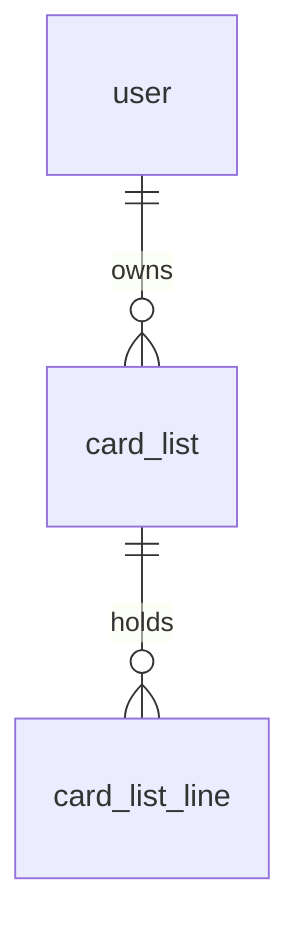

# Sharing: decks, want lists and sell lists

> Plan from this document. Each slice below carries its own shape - copy it, do not re-derive it.
> Status: confirmed by Rodrigo, 2026-10-18 - build shared decks, want lists and sell lists with attribution; Price suggestion builds on tcgcsv market prices, decided after its spike; screens picked from the mockups the same day.

## Situation

- Project: closed beta with four users; the next step is releasing it to the Pelotas Flesh and Blood group (about 47 people, per `docs/research/ip-posture.md`), and the owner wants sharing in place for that release.
- Decision: open until this session; the owner made it here.
- In flight: copies the raw "missing copy" count from the card-alternatives design (Key decision 3 there) and the planned-but-unbuilt `outbound_click_event` posture (own table, no IP, no user agent); the Phase 1c Discover page and the AI chat stay out.
- At stake: medium - a share address posted in a group chat cannot be recalled, and anonymous pages and generated images are the first surfaces showing card images outside the authenticated app (allowed by the LSS policy, re-reviewed 2026-10-18 in `docs/research/ip-posture.md`); the code areas involved have one author and low churn (five commits in 90 days in decks and in collection).

## Problem

Nothing in Rathe Arsenal can be seen without an account: `/` redirects to sign-in and every deck, list and price sits behind authentication.
When players in the group want to show a deck or ask for cards, they leave the site: they send a Fabrary link (often of only the missing cards), a photo of one or two cards they are looking for, or - when selling - a CSV with each card's price and condition, priced by hand at 4x to 8x the card's last TCGPlayer or Star City Games sale in dollars (7x is usual).
A deck edited inside Rathe Arsenal (replacements, scratch decks) has no faithful Fabrary twin, so the owner has to rebuild it elsewhere to share it.
The site gains nothing from any of these messages: the recipient never lands on it.
Unmeasured: the site has no analytics beyond error reporting, so how often these messages circulate is what the owner reported from the group, not a count.

## Success

- Worked if: 30 days after the release to the Pelotas group, at least 5 of the new accounts signed up from a share link, and at least 3 people other than the owner created a share link.
- Going wrong: in the first week, links are created but almost never opened, or opened but nobody signs up from them.
- Review: 30 days after the release to the group - Rodrigo, from the counts in [Share attribution](#share-attribution).

## Boundary

In: an owner-revocable share link for a deck, showing the whole deck or only what the owner still misses; card lists of two kinds, `want` and `sell`, independent of decks, each shareable; comparing a shared deck or list with the logged-in visitor's own collection; copying a shared deck into one's decks; copy-as-text for any list; a link preview when the address is pasted in WhatsApp, and the same image downloadable to send as a picture; attribution of sign-ups to the link that brought them; suggested sell prices from TCGplayer market prices.

Out: a referral programme with rewards - one 47-person group sees the release message directly, there is nothing to give, and `ip-posture.md` forbids gating features behind rewards or payment.
Out: in-site negotiation - messages, offers, reservations, payment; contact stays in WhatsApp, reached from a shared page through the sharer's optional WhatsApp button.
Out: public profiles, a feed, featured or searchable decks - they turn links someone chose to send into a public catalogue of people's decks and lists, which nobody asked for.
Out: a landing page at `/` - the shared page is the first impression for anyone arriving from the group.
Out: selling that changes the collection - marking a line sold never touches `collection_card`.

Unchanged: `GET /api/decks/:deckId` and the deck's readiness and snapshots; the sign-up response, which stays generic whether or not the email exists; the collection model (`collection_card` keeps card-level identity and quantity, no price or condition).

## Prior art

- Moxfield shows, on any deck, which cards the viewer owns from their collection - we take the seam: the comparison is the visitor's, computed against their own collection.
- Moxfield users report it counts copies already used in other decks - we do the same on purpose, because Rathe Arsenal's readiness already measures each deck against the whole collection, and a second rule here would contradict the deck screen.
- Deckbox pairs users' trade lists with others' wish lists - we take only the half that needs no marketplace: a visitor sees which lines of a shared list match their own collection or decks, and contact happens off-site.

## Shape

A share link is an unguessable address stored on the thing it shares - `tracked_deck` for a deck, `card_list` for a list - and the page behind it always renders the current state for anyone holding the address.
A card list is its own record with a kind, `want` or `sell`, filled from a deck or by hand and never linked back to the deck or the collection.
The door is the address format: once pasted in a group chat it must keep resolving, or keep saying "no longer available", for as long as the product exists.

The heavier alternative is a separate share-link table pointing at decks and lists, with several links per object and per-link history; it wins only if one deck or list needs more than one live address or per-recipient statistics, and nothing the owner described needs either.

## Key decisions

1. **Everything that shows card faces outside the authenticated app - shared pages and generated images - carries the Third Party Apps disclaimer and "© Legend Story Studios", and shows only the project's own wordmark.** The LSS policy permits these surfaces with no audience limit (re-reviewed 2026-10-18, `ip-posture.md` Rule 11). Today every card face is loaded straight from LSS's own bucket, so LSS controls removal at the source; generated share images are the first copies of card art the project stores, and they must be deletable on request - all of them or those showing given cards - without a deploy (`ip-posture.md` Rule 5).
2. **Share addresses are unguessable, `noindex` and listed nowhere, and the owner turns them off at will.** This protects users' decks and lists, which they chose to send to someone, from being found by anyone else; it is a privacy decision, not an IP one.
3. **A share address is permanent: `/d/<token>` for a deck and `/l/<token>` for a card list, and a dead address stays dead.** Turning sharing off or deleting the deck or list makes the address answer "no longer available", indistinguishable from an address that never existed; turning sharing on again issues a new address, so old posts never come back to life.
4. **Shared pages show the current state, never a snapshot.** An edited deck, a line marked sold, a changed price are what the next visitor sees on the same address.
5. **Public pages name the sharer by a display name the sharer chose, never by email.** `user.displayName` is the only identity a shared page reveals, plus the sharer's WhatsApp number only where the sharer saved one and left that link's "show my WhatsApp" switch on (decided by Rodrigo, 2026-10-18).
6. **A card list is independent of decks and of the collection.** Creating one from a deck copies that moment's lines; afterwards the list and the deck never sync, and selling a line never changes `collection_card`. Lines and every comparison key on the card-level `cardIdentifier` (name and pitch); printing and condition exist only on sell lines and never take part in matching.
7. **Every comparison a visitor sees is raw exact coverage against the visitor's own collection, computed on request and never stored or shown to the sharer.** "Missing" means a copy the collection does not cover exactly, the same count the deck's missing panel starts from; engine stand-ins never count. The existing readiness path asserts deck ownership, so this is a new read path over the pure engine, not a reuse of the owner's readiness.
8. **Sharing is measured in our own table, and neither the preview crawler nor the preview image is ever counted.** An open is recorded when the page asks for its data, not when the address returns HTML; a sign-up records the link's owner as referrer at sign-up time, not at email verification, without changing the sign-up response.

## Work

| Slice | Delivers | Status |
|---|---|---|
| [LSS disclaimer](#lss-disclaimer) | Every surface carries the Third Party Apps disclaimer, and every surface showing card faces carries "© Legend Story Studios" | done - PR #151 |
| [Shared deck](#shared-deck) | The owner turns a deck's share link on and off; anyone with the address sees the deck or only what the owner misses | open - 2 defaults taken |
| [Share attribution](#share-attribution) | Link creations, opens and sign-ups from links are recorded and can be counted for the review | clear |
| [Share Preview](#share-preview) | A branded image, generated per link, that WhatsApp shows when a deck or list address is pasted | open - 1 default taken |
| [Copy Deck](#copy-deck) | A logged-in visitor sees how much of a shared deck they own and copies it into their decks | clear |
| [Card list](#card-list) | The owner keeps `want` and `sell` lists, filled from a deck or by hand, and copies any list as text | open - 4 defaults taken |
| [Shared list](#shared-list) | Anyone with the address sees a card list; a logged-in visitor sees which lines match their collection or decks | clear |
| [Price suggestion](#price-suggestion) | Sell lines priced from the TCGplayer market price in dollars times the list's multiplier | open - 3 defaults taken |

Order: LSS disclaimer (first, so old and new wording are never live together) → Shared deck with Share attribution (they ship together, or the first links go uncounted) and Share Preview for decks → Copy Deck → Card list → Shared list, with Share Preview for lists.
Price suggestion ships with Card list: sell lists can be priced by hand from day one, and the suggestion needs only the daily price job.

Already handled by existing code: an anonymous visitor who chooses to sign up → the existing sign-up, verification and sign-in screens; a recipient who already has an account → the existing sign-in. Returning to the shared page afterwards is new work (sign-in always went to `/`), planned in `.specs/features/sharing-decks/design.md`.

Derivable from the repository, left to the plan: error envelope codes and their client `apiErrors` entries, rate limits on public routes, pt-BR and en-US copy, card naming and images on cards - all as the deck detail and the recommendations rail do them; the length and alphabet of tokens, as long as they are unguessable.

### LSS disclaimer

**Delivers** the disclaimer wording the LSS policy requires of Third Party Apps, and the copyright line it requires wherever card images appear, on every surface that exists today. **Status: clear.**

| State | What should happen |
|---|---|
| Any page of the authenticated shell, `/about`, the anonymous auth screens, `README.md` | The Third Party Apps wording from `ip-posture.md` "Required Disclaimer" replaces the Fan Fiction wording, in pt-BR and en-US |
| Any surface showing card faces (deck detail, library, recommendations, alternatives, scanner, swaps) | "© Legend Story Studios" is visible on the page, once |
| The shared pages and Share Preview images built later | Use the same two texts (Key decision 1) |

The current specs assert the old sentence verbatim (the footer, `/about` and the about catalog specs), so they change with the wording.

### Shared deck

**Delivers** a share link per deck that the owner turns on and off, and a page at that address showing the deck or only the owner's missing cards. **Status: open.** Holds the door (Key decision 3).

| State | What should happen | Caller sees |
|---|---|---|
| Owner shares a deck for the first time without a display name | Asked for a display name before the link is created | the display-name prompt |
| Owner turns sharing on | A token is stored on the deck | `200` with the address |
| Owner turns sharing on while it is already on | Nothing changes | `200` with the same address |
| Owner turns sharing off | The token is cleared | `204` |
| Owner turns sharing on again after turning it off | A new token; the old address stays dead | `200` with a new address |
| Anyone opens the deck address | Deck name, hero, format, the sharer's display name and the full card list with images; disclaimer and copyright line (Key decision 1); `noindex` | `200` |
| Anyone opens the missing view of the address | Only the cards the owner still misses, with quantities, as the owner's deck missing panel counts them; a copy-as-text action | `200` |
| The deck changed since the link was posted | The current deck | `200` |
| Address turned off, deck deleted, owner deleted, or never existed | No deck data | `404` `SHARE_LINK_UNAVAILABLE`, page reads "this link is no longer available" |
| Address pasted in WhatsApp | The first HTML response already carries the deck's title, description and [Share Preview](#share-preview) image, without running script | link preview |
| The sharer saved a WhatsApp number and the link's "show my WhatsApp" switch is on (the default) | A button opening a WhatsApp chat with the sharer | `200` with `contactWhatsapp` |
| No number saved, or the switch is off | No contact button | `200` with `contactWhatsapp: null` |
| Anonymous visitor wants to compare or copy | Offered sign-up or sign-in, then returned to the same address | the auth screens |

`POST /api/decks/:deckId/share` `{}` → `200` `{ url }`
`DELETE /api/decks/:deckId/share` → `204`
`GET /api/shared/decks/:token` (public) → `200` `{ name, hero, heroIdentifier, format, sharerName, contactWhatsapp, cards: [{ cardIdentifier, quantity, slot }], missing: [{ cardIdentifier, quantity }] }`
`PATCH /api/decks/:deckId/share` `{ showContact }` → `200`

Tables `tracked_deck` and `user` change; no new table.

| Column | Type | Null | References | Note |
|---|---|---|---|---|
| `tracked_deck.shareToken` | varchar | yes | | unique; null means not shared |
| `user.displayName` | varchar(40) | yes | | set the first time the user shares anything |
| `user.whatsappNumber` | varchar(16) | yes | | digits with country code; saved in the profile, optional |
| `tracked_deck.shareShowsContact` | boolean | no | | default true; the link's "show my WhatsApp" switch |

```mermaid
sequenceDiagram
  participant W as WhatsApp or browser
  participant H as Share page route (outside /api)
  participant A as Shared deck API
  participant DB
  W->>H: GET /d/<token>
  H->>DB: read deck by token
  alt no deck for this token
    H-->>W: app shell with generic title and site image, noindex
  else
    H-->>W: app shell with this deck's title, description and preview image address, noindex
  end
  Note over W,H: crawlers stop here; nothing is counted
  W->>A: GET /api/shared/decks/<token>
  A->>DB: read deck, its cards and the owner's collection
  alt no deck for this token
    A-->>W: 404 SHARE_LINK_UNAVAILABLE
  else
    A->>DB: record opened (Share attribution)
    A-->>W: 200 deck, missing
  end
```

The static fallback answers every path outside `/api` with the plain app shell today; the share paths have to be taken out of it, or the preview never sees the deck's tags.

Alternatives considered: missing cards visible only on a separate token - wins if owners want to share a deck without revealing what they lack; nothing in the interview asked for it.

1. Display name asked at the first share, editable in Settings - default, the owner did not answer this one.
2. The owner's missing cards are visible to anyone holding the deck address, through its missing view - default.

Contact, picked by Rodrigo on 2026-10-18: alternative B of `.design/mockups/sharing/contact/` (a WhatsApp action in a fixed bottom bar on phone and a pill beside the sharer's name on desktop; an inline number field in the sharing card when no number is saved; a "Contato" panel in Settings). The same placement applies to shared lists.

Screens, picked by Rodrigo on 2026-10-18: alternative B of `.design/mockups/sharing/deck/shared-deck-b-{phone,desktop}` (comparison and invitation at the top, compact card list, missing view in a side panel or bottom sheet) and of `.design/mockups/sharing/deck/share-control-b-{phone,desktop}` (an always-visible sharing card with a switch on the deck detail).

### Share attribution

**Delivers** a record of every link created, opened and turned into a sign-up, and a report that answers Success. **Status: clear.**

| State | What should happen | Caller sees |
|---|---|---|
| Owner turns a share link on | `created` recorded with the owner | nothing new |
| A shared page loads its data | `opened` recorded, with the visitor when logged in | nothing new |
| The owner opens their own link | Not recorded | nothing new |
| The preview crawler fetches the address or the preview image | Not recorded (Key decision 8) | |
| Anonymous visitor signs up from a shared page | The link's owner stored as referrer with the link's kind; `signed_up` recorded at sign-up | the same generic sign-up response as today |
| Sign-up from an address that died meanwhile | Sign-up proceeds without a referrer | the same generic sign-up response |
| Existing user signs in from a shared page | No attribution | nothing new |
| Owner reviews the bet | A report prints, for a period: distinct users who created links, opens, sign-ups from links, by kind | the report |

`POST /api/auth/sign-up` gains an optional `shareToken` in its body; its response does not change.

Table `share_event`; `user` changes.

| Column | Type | Null | References | Note |
|---|---|---|---|---|
| `id` | bigserial | no | | |
| `kind` | varchar(16) | no | | `created` \| `opened` \| `signed_up` |
| `targetKind` | varchar(8) | no | | `deck` \| `list` |
| `targetId` | int | no | | `tracked_deck.id` or `card_list.id`; no foreign key, so events outlive what they measured |
| `ownerUserId` | uuid | no | `user.id` | on delete cascade |
| `actorUserId` | uuid | yes | `user.id` | the visitor or the new account; on delete set null |
| `occurredAt` | timestamptz | no | | default now; indexed with `kind` |
| `user.referredByUserId` | uuid | yes | `user.id` | on delete set null |
| `user.referredVia` | varchar(8) | yes | | `deck` \| `want` \| `sell` |

No IP address, user agent or referrer URL is stored, as the planned `outbound_click_event` intended.

### Share Preview

**Delivers** an image the server generates for each live share link - our wordmark, what the deck or list holds, a few card faces - used as the link preview when the address is pasted in WhatsApp, and downloadable by the owner to send as a picture. **Status: open.**

| State | What should happen | Caller sees |
|---|---|---|
| Deck address pasted | Image with the deck name, hero and format, the sharer's display name, the hero's card face and a few of the deck's cards, the wordmark and "© Legend Story Studios" | link preview |
| `want` list address pasted | Image with the list name, "looking for", the number of cards, the first card faces with "+N" for the rest, the sharer, the wordmark and the copyright line | link preview |
| `sell` list address pasted | As `want`, with "selling", and the total price when the list has one | link preview |
| The deck or list changed | The next request for the image reflects the current content; previews WhatsApp already cached in a chat keep the old image | |
| Address dead or unknown | The site's generic image, with no card data | `200` generic image |
| LSS asks for card art to be removed | Stored images showing those cards, or all stored images, are deleted on request without a deploy, and new ones are generated without them (Key decision 1) | image without card art |
| The preview image is fetched | Not counted (Key decision 8) | |
| Owner downloads the image from the share control | The same image as the preview, saved as a file named after the deck or list; it carries the share address as text so a forwarded picture still leads to the site | a file download |
| Owner downloads while sharing is off | Not offered: the image exists only for a live link, because it carries the address | the action is hidden |

`GET /api/shared/decks/:token/image` (public) → `200` JPEG
`GET /api/shared/lists/:token/image` (public) → `200` JPEG
The download uses the same two routes with a `download=1` query, which only adds a download filename.

The image is at least 1200 pixels wide, no wider than 4:1, and under 600 KB, the limits Meta documents for WhatsApp link previews; a link pasted into WhatsApp and Meta's sharing debugger are the check, since Meta says previews are best effort.
The card faces come from the LSS bucket, which serves only WebP (`large/<code>.webp` answers 200 anonymously, `.png` and `.jpg` answer 403), so the generated file is our own JPEG composition, whatever WhatsApp does with WebP.

Alternatives considered: the hero's card face straight from the LSS bucket as the preview - wins only if generating images on the server proves unworkable; it shows one card, no brand and nothing of what a list holds.

1. Generated on first request and kept until the deck or list changes, or until deleted on an LSS request - default.

Image, picked by Rodrigo on 2026-10-18: alternative B, "Leque" - a fan of large card faces over a blurred backdrop, with a bottom bar for kind, sharer, title, count and price (`.design/mockups/sharing/preview/*-b.png`, in a chat in `whatsapp-b.png`). It exceeds 600 KB as PNG for most cases and stays near 40 to 120 KB as JPEG at quality 85, so the image is served as JPEG. The download action sits in the sharing card of `share-control-b`.

### Copy Deck

**Delivers** to a logged-in visitor of a shared deck how much of it their collection covers, and a copy of it in their own decks. **Status: clear.**

| State | What should happen | Caller sees |
|---|---|---|
| Logged-in visitor opens a shared deck | Their raw exact coverage of it (Key decision 7) | owned copies of total, and percent |
| The sharer opens their own shared deck | No comparison and no copy | the page without them |
| Visitor copies the deck | A new deck of theirs with the same cards, name, hero and format, status `idea`, no Fabrary origin; readiness computed as for any new deck | `201`, then their new deck's detail |
| Visitor copies the same deck twice | A second deck | `201` |
| Link turned off between loading and copying | Nothing created | `404` `SHARE_LINK_UNAVAILABLE` |

`GET /api/shared/decks/:token/coverage` → `200` `{ ownedCopies, totalCopies, percent }`
`POST /api/shared/decks/:token/copy` `{}` → `201` `{ deckId }`

The copy takes the deck list as it stands, which already includes the sharer's replacements (they live in `deck_card`); the sharer's `card_replacement` rows, swaps and tags are not copied.

Screens: the comparison and copy area is part of the picked `shared-deck-b` mockups of [Shared deck](#shared-deck).

### Card list

**Delivers** to a logged-in user `want` and `sell` lists they fill from a deck or by hand, mark lines sold, and copy as text. **Status: open.**

| State | What should happen | Caller sees |
|---|---|---|
| New `want` list from a deck | Lines are the deck's missing cards at that moment, with quantities | `201` with the list |
| New `sell` list from a deck | Lines are every card in the deck, for selling the whole deck | `201` with the list |
| New list from nothing | Empty list; cards added from the catalog, owned or not | `201` |
| Adding a card already on a `want` list | Quantities add up on the one line | `200` |
| Adding a card already on a `sell` list with the same printing and condition | Quantities add up on the one line | `200` |
| Sell line without condition or price | Allowed; the page shows nothing for what was left blank | `201` |
| Sell list with a total price | Shown as the price for the whole list, alongside any line prices | `200` |
| Line marked sold | Stays on the list, shown as sold; the collection is unchanged | `200` |
| Line unmarked | Back to available | `200` |
| The source deck changes later | The list does not change (Key decision 6) | |
| Copy as text | One line per card, `2x Name (pitch)`, plus condition and price on sell lists, plus the share address when shared; sold lines are left out | text on the clipboard |
| List deleted | Lines and share address gone | `204` |
| Another user's list | Nothing | `404` |

`GET /api/lists` → `200` `[{ id, kind, name, lineCount, shared, updatedAt }]`
`POST /api/lists` `{ kind, name, fromDeckId? }` → `201` list
`GET /api/lists/:listId` → `200` `{ id, kind, name, notes, totalPriceCents, lines: [line] }`
`PATCH /api/lists/:listId` `{ name?, notes?, totalPriceCents? }` → `200` list
`DELETE /api/lists/:listId` → `204`
`POST /api/lists/:listId/lines` `{ cardIdentifier, quantity, printing?, condition?, priceCents? }` → `201` line
`PATCH /api/lists/:listId/lines/:lineId` `{ quantity?, printing?, condition?, priceCents?, sold? }` → `200` line
`DELETE /api/lists/:listId/lines/:lineId` → `204`

Tables `card_list` and `card_list_line`; no existing table changes.

| Column | Type | Null | References | Note |
|---|---|---|---|---|
| `card_list.id` | serial | no | | |
| `card_list.userId` | uuid | no | `user.id` | on delete cascade |
| `card_list.kind` | varchar(8) | no | | `want` \| `sell`; fixed at creation |
| `card_list.name` | varchar(80) | no | | |
| `card_list.notes` | text | yes | | shown on the shared page |
| `card_list.totalPriceCents` | int | yes | | BRL; `sell` only |
| `card_list.shareToken` | varchar | yes | | unique; set in [Shared list](#shared-list) |
| `card_list.shareShowsContact` | boolean | no | | default true; set in [Shared list](#shared-list) |
| `card_list.createdAt`, `updatedAt` | timestamptz | no | | |
| `card_list_line.id` | serial | no | | |
| `card_list_line.listId` | int | no | `card_list.id` | on delete cascade |
| `card_list_line.cardIdentifier` | varchar | no | | card-level, as `collection_card` |
| `card_list_line.quantity` | int | no | | 1 to 20, as the collection caps quantities |
| `card_list_line.printing` | varchar | yes | | `sell` only; a printing of the card, which decides foiling and the TCGPlayer product |
| `card_list_line.condition` | varchar(4) | yes | | `sell` only |
| `card_list_line.priceCents` | int | yes | | BRL per copy; `sell` only |
| `card_list_line.soldAt` | timestamptz | yes | | null means available |



Alternatives considered: a sale flag on `collection_card` - wins if sellers wanted the collection to drop when a card sells; the owner chose an independent list because the manual process today is a list, and syncing the two is where quantities would go wrong.

1. Conditions are `NM`, `LP`, `MP`, `HP`, `DMG` - default, the owner did not name a scale.
2. A `want` list from a deck takes the missing cards only; a `sell` list from a deck takes the whole deck - default, from the two uses the owner described.
3. A line's price is per copy, shown as "R$ 6,00 cada", because a suggested price is one card's last sale times the multiplier - default.
4. Sold lines are left out of the copied text, which lists what is still for sale - default.

Screens, picked by Rodrigo on 2026-10-18: alternative A of `.design/mockups/sharing/lists/lists-home-a-{phone,desktop}` (a new Lists tab in the main navigation, the index split into Procuro and Vendo) and alternative B of `.design/mockups/sharing/lists/list-editor-b-{phone,desktop}` (a card grid with condition and price under each card, an edit panel or sheet per line, totals and actions in a fixed bottom bar).

### Shared list

**Delivers** a share link per card list and the page behind it, with matches for a logged-in visitor. **Status: clear.**

| State | What should happen | Caller sees |
|---|---|---|
| Owner turns sharing on, on, off, on again | As in [Shared deck](#shared-deck), on the list | `200` address, `204` |
| Anyone opens a `want` list address | Sharer's display name, "looking for", lines with images and quantities, notes, copy as text; disclaimer and copyright line (Key decision 1); `noindex` | `200` |
| Anyone opens a `sell` list address | Sharer's display name, "selling", lines with printing, condition and price where filled, sold lines marked sold, total price if set, notes, copy as text; disclaimer and copyright line (Key decision 1); `noindex` | `200` |
| The sharer saved a WhatsApp number and the list's "show my WhatsApp" switch is on | A button opening a WhatsApp chat with the sharer, as on a shared deck | `200` with `contactWhatsapp` |
| Logged-in visitor on a `want` list | Each line they own at least one copy of is marked with how many they have | marks per line |
| Logged-in visitor on a `sell` list | Each available line whose card is missing in any of their non-retired decks is marked (Key decision 7) | marks per line |
| The sharer opens their own list | No matches | the page without them |
| A line sold or a price changed since posting | The current list (Key decision 4) | |
| Address dead or unknown | As in [Shared deck](#shared-deck) | `404` `SHARE_LINK_UNAVAILABLE` |
| Address pasted in WhatsApp | The first HTML response already carries the list's title, description and [Share Preview](#share-preview) image | link preview |

`POST /api/lists/:listId/share` `{}` → `200` `{ url }`
`DELETE /api/lists/:listId/share` → `204`
`GET /api/shared/lists/:token` (public) → `200` `{ kind, name, notes, sharerName, totalPriceCents, lines: [{ id, cardIdentifier, quantity, printing, condition, priceCents, sold }] }`
`GET /api/shared/lists/:token/matches` → `200` `{ lines: [{ lineId, owned, missingInDecks }] }`

Screens, picked by Rodrigo on 2026-10-18: alternative B of `.design/mockups/sharing/lists/shared-list-b-{phone,desktop}` (a card gallery with a side column for sharer, total, notes, copy and invitation; on phone the invitation is a fixed bottom bar).

### Price suggestion

**Delivers** a suggested BRL price for sell lines: the card's TCGplayer market price in dollars times the list's multiplier. **Status: open - 3 defaults taken.**

Decided by the owner: each `sell` list has a multiplier (typically 4x to 8x, default 7x); the price is `USD × multiplier`, read directly as BRL with no exchange rate, because the multiplier already includes it; any line can carry its own price instead.
Settled by the price spike (`.specs/features/price-spike/result.md`): the source is tcgcsv.com, a free daily public mirror of TCGplayer prices keyed by the TCGplayer product id the catalog already carries per printing; it covered all 82 cards of the owner's three decks.
The owner asked for TCGplayer's last sale; no allowed source provides it (TCGplayer's terms forbid scraping its sites, and tcgcsv carries no last-sale field), so the suggestion is built on `marketPrice`, which TCGplayer computes from recent sales, and is worded as market price, never as last sale.
The owner asked for Star City Games as a second source; its terms forbid automated reading of prices, so the list's source is TCGplayer only and the source choice disappears from the screen until an allowed second source exists.
Prices are read by a server job, at most once a day per set and only for sets that have a card on some sell list, as tcgcsv's guidelines ask (no calls from user-facing requests, one sync per day); one shared snapshot serves every list, so nothing is stored per user.

| State | What should happen | Caller sees |
|---|---|---|
| Line whose printing has a market price | Suggested price = market price × multiplier | "R$ 14 (mercado TCGplayer de <date>)" |
| Market price is null but mid price exists | Mid price × multiplier, marked approximate | the suggestion with an "aproximado" mark |
| No price row for the printing (88 of 440 printings in the spike) | No suggestion; the price field stays for the seller to fill | "sem sugestão" |
| Seller applies the suggestion to a line or to the whole list | The suggested value is written as the line's price | the new prices |
| Prices refresh or the seller changes the multiplier | The suggestion shown next to each line updates; prices already written stay until the seller applies again | the new suggestion beside the unchanged price |
| tcgcsv is down or a fetch fails | The previous snapshot keeps serving, with its date | the last known suggestion and its date |

Table `card_price` (shared, written only by the price job); `card_list` gains `priceMultiplier` (numeric, null means no suggestion) and no `card_list_line` column changes.

| Column | Type | Null | References | Note |
|---|---|---|---|---|
| `productId` | varchar | no | | TCGplayer product id from the catalog's printing |
| `subType` | varchar(32) | no | | edition and foiling as tcgcsv names them; unique with `productId` |
| `marketPriceCents` | int | yes | | USD cents |
| `midPriceCents` | int | yes | | USD cents |
| `fetchedAt` | timestamptz | no | | |

Decided by Rodrigo on 2026-10-18: build on tcgcsv, accepting that it republishes TCGplayer's data while TCGplayer's own terms forbid scraping TCGplayer's websites (tcgcsv itself allows server use; TCGplayer's official API needs a key no longer handed out freely). Checked the same day: tcgcsv rebuilds once a day around 20:00 UTC, and its market prices matched the prices shown on TCGplayer's product pages for 5 of 5 printings sampled (Fallen Herald normal 25.41 against 25.40 and rainbow foil 38.98 against 39.66, a day's movement; 10,000 Year Reunion normal 0.36 and rainbow foil 0.75; Bare Fangs from Armory Deck: Kayo 0.30, all equal). Two of the three product pages showed no most recent sale at all, so last sale would often be missing even where it could be read.
1. A line without a chosen printing is priced from the cheapest non-foil printing with a market price, or the cheapest printing of any finish when the card is foil-only (4 of 82 cards in the spike), and the seller can pick another - default, because the cheapest is the conservative suggestion and printings of one card differ several-fold.
2. Applying a suggestion writes the price into the line; prices do not move under a posted list until the seller applies the suggestion again - default.
3. Suggested prices are rounded to whole reais - default.

## Sources

- `.specs/features/price-spike/result.md` - tcgcsv as the price source, its guidelines, coverage of the owner's decks, and Star City Games ruled out by its terms.
- `docs/research/ip-posture.md` (re-reviewed 2026-10-18) - public pages, generated images and user-to-user lists are permitted; the Third Party Apps disclaimer, "© Legend Story Studios" wherever card images appear, takedown readiness, no feature gating behind payment or rewards.
- LSS, Terms of Use for Game and Studio Assets and IP, retrieved verbatim 2026-10-18: https://fabtcg.com/resources/terms-use-licensed-assets/
- Meta, WhatsApp link previews (image under 600 KB, at least 300 px wide, at most 4:1, best effort): https://developers.secure.facebook.com/docs/whatsapp/link-previews
- `docs/brainstorms/2026-04-08-fab-deck-readiness-flow-requirements.md` - P2P marketplace and public wishlists out of scope, which this design moves only as far as Boundary says.
- `.design/card-alternatives.md` - the raw "missing copy" count reused by Key decision 7.
- `docs/research/scraper-cost-scaling.md` - Firecrawl costs per page; no periodic full-catalog crawls.
- `docs/plans/2026-04-18-001-feat-phase-1c-discover-history-telemetry-plan.md` - the `outbound_click_event` posture copied by Share attribution.
- TCGPlayer price mirror (tcgcsv) as described by a third-party wrapper: https://apify.com/jungle_synthesizer/tcgcsv-tcgplayer-pricing-wrapper.md
- TCG Automate, Flesh and Blood prices from TCGPlayer: https://tcgautomate.com/docs/tcgs/flesh-and-blood
- Star City Games carries Flesh and Blood singles: https://articles.starcitygames.com/flesh-and-blood/star-city-games-now-carries-flesh-and-blood-singles
- Moxfield feature request on owned-card counts across decks: https://moxfield.nolt.io/2554
- Deckbox-style trade matching, as described by Draftsim: https://draftsim.com/magic-the-gathering-trading-site/
