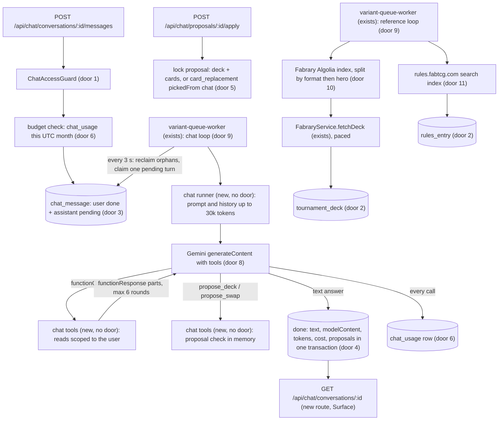
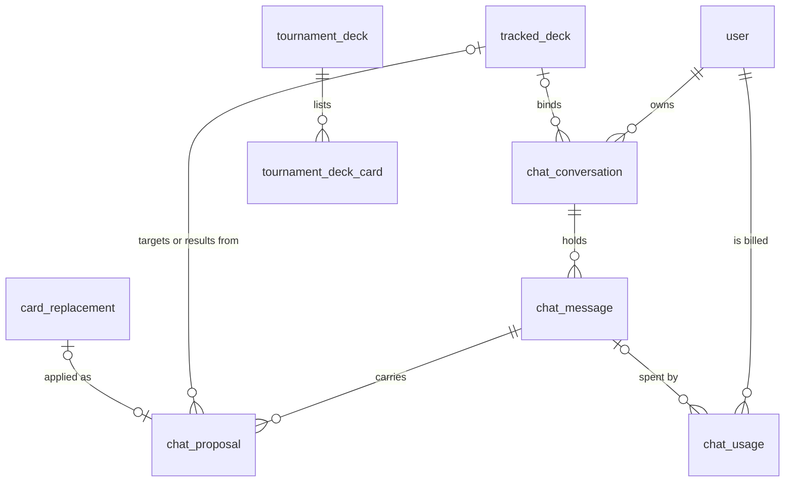

# AI chat

## Problem

The owner researches deck ideas and the competitive meta by hand: he searches Fabrary for tournament decks of a hero, reads what they run, and compares them with his own decks in his head.
That happens about twice a month, and the cause is the effort, not lack of interest: a tool that already knew his decks, collection and recommendations would make the research happen more often (design `.design/ai-chat.md`, Problem).
Two questions drive it: how others build a hero he already plays and how his deck differs, and which hero or deck to build next.
The same holds for the three friends who get access first. Nothing measures it today; the twice-a-month figure is the owner's own account.

When this ships, a user with access can hold saved conversations with a model that reads their decks, collection and latest recommendations, the card catalog with legality, a local copy of Fabrary tournament decks with placement, and the comprehensive rules; the model proposes a new deck or a card swap, and the user applies or dismisses it.
This run builds everything behind the API; the chat tab and the deck-page entry wait for the owner to pick from mockups (project `CLAUDE.md`, "UI changes"), which this run produces.

## Flow

Reuses the recommendation queue's claim, orphan reclaim and database-clock pattern (AD-011) instead of a new job runner, `decideAdoption`, the copy move, recompute and enqueue of `ReplacementsService.adopt` instead of a second swap path, `FabraryService.fetchDeck` for tournament lists instead of a second GraphQL client, the catalog legality functions (`findCardLegalityViolation`, `getCopyLimit`) for proposal validation, and the worker's `runWorkerLoops` for two more loops.

1. any `/api/chat/*` route -> global `JwtAuthGuard` (exists, now loads `chatAccess` into the current user) -> `ChatAccessGuard` (new, door 1) refuses without access before any read
2. send -> chat service (new, no door - placement) checks the conversation is the user's, that no turn of it is pending or running, and the user's spend this UTC month from `chat_usage`; stores the user message (`done`) and the assistant message (`pending`) with the request locale; out `202`
3. `variant-queue-worker` (exists) gains a chat loop (door 9): reclaims orphaned turns, claims the oldest pending assistant message, re-checks the budget, and hands it to the chat runner (new, no door - placement)
4. the runner builds the system prompt (primer, account summary of every deck, the bound deck's list), replays history (door 8), and calls Gemini 3.8 Flash with nine function declarations through a multi-turn client (new, door 8); each call writes one `chat_usage` row and refreshes `claimedAt`
5. a `functionCall` runs a read tool over our database scoped to the message's user (decks, owned copies, catalog search with legality, latest recommendations, tournament decks, rules) or a proposal tool validated in memory; results go back as `functionResponse` parts, at most 6 rounds
6. a text answer ends the turn: the message becomes `done` with `text`, `modelContent`, summed tokens and cost, and its valid proposals are inserted as `chat_proposal` rows, in one transaction (door 4); any failure ends it `failed` with a code and stores no proposal
7. read -> `GET /api/chat/conversations/:id` returns messages with proposals and live owned and missing counts through `CollectionReadService.loadOwned` (exists)
8. apply -> chat proposal service (new, no door - placement) locks the proposal; a deck proposal creates `tracked_deck` (`idea`) with its `deck_card` rows and enqueues a recommendation run; a swap runs `decideAdoption` (exists) under the deck lock, moves copies, inserts `card_replacement` with `pickedFrom = 'chat'` (door 5), recomputes readiness and enqueues a recommendation run, as adopt does
9. the reference loop (door 9) runs once a day: lists tournament decks from Fabrary's Algolia index (door 10), fetches the lists of decks not stored through `FabraryService.fetchDeck` (exists), stores `tournament_deck` and `tournament_deck_card`; then fetches the rules index (door 11) and replaces `rules_entry` when its hash changed
10. `pnpm --filter @rathe-arsenal/api chat:grant <email>` (new script) sets `user.chatAccess`; `GET /api/auth/me` (exists) returns it

## Impact

| Front | What changes |
| --- | --- |
| domain | new term: `conversation` - a saved thread owned by one user, optionally bound to one deck; lives in `apps/api/src/chat` |
| domain | new term: `turn` - one assistant message answered by the worker, `pending`, `running`, `done` or `failed` |
| domain | new term: `proposal` - a validated new deck or card swap attached to an assistant message, `pending`, `applied`, `dismissed` or `stale` |
| domain | new term: `chat usage` - one billed model call, kept even when its conversation is deleted |
| domain | existing term: `pickedFrom` gains `chat`; `buildReplacementViews` branches on `'recommendation'` to never raise the "you now have the original" prompt and now does the same for `chat`; the pick DTO keeps refusing both |
| domain | existing term: deck-list writers (card-recommendations AC 3, "exactly") gain applying a deck proposal and applying a swap proposal; both enqueue an auto recommendation run, as import and adopt do |
| auth | `ICurrentUser` gains `chatAccess`, read from the row `JwtStrategy.validate` already loads; `GET /api/auth/me` gains `chatAccess` |
| worker | `variant-queue-worker` runs four loops: variants, recommendations, chat turns, reference sync |
| external calls | Fabrary's Algolia index (`4e2ysy5y4i-dsn.algolia.net`) and `rules.fabtcg.com`, once a day from the worker; Fabrary GraphQL `getDeck` for each new tournament deck, paced |
| configuration | reuses optional `GEMINI_API_KEY`; optional `GEMINI_CHAT_THINKING_LEVEL`; model prices live in code with an effective date |
| error catalog | new codes `CHAT_ACCESS_DENIED`, `CHAT_TURN_IN_PROGRESS`, `CHAT_BUDGET_EXHAUSTED`, `PROPOSAL_NOT_PENDING`, `PROPOSAL_STALE`, `MESSAGE_NOT_RETRYABLE`, and the turn failure codes; client copy deferred to the UI slices (no client reads them yet) |
| stored data | seven new tables, a new `user` column defaulting to `false`, and a replaced CHECK on `card_replacement."pickedFrom"`; no backfill of existing rows; the first reference sync fills the two reference sources |
| prior decisions | conforms to AD-003 (codes), AD-008 (atomic writes), AD-009 (a swap is a deck change), AD-010 (the model), AD-011 (worker-only model calls); records chat access and the chat model loop as AD-013 |

## Relations

One-way constraints: at most one `pending` or `running` assistant message per conversation (door 3); `role`, message `status`, proposal `kind` and proposal `status` each limited to their values (doors 3, 4); `chat_usage` survives deleting its conversation and message (door 6); one `tournament_deck` per Fabrary deck id and one card row per (deck, card) (door 2); one `rules_entry` per rule number (door 2); `pickedFrom` limited to eight values (door 5); `user.chatAccess` defaults to false (door 1).
No columns and no types here.

## Surface

Only routes this adds or whose signature changes.

| Route | In | Out | Status |
| --- | --- | --- | --- |
| `GET /api/chat/conversations` | none | `[{ id, title, trackedDeckId, updatedAt }]` | `200`, `401`, `403`, `429` |
| `POST /api/chat/conversations` | `trackedDeckId?` | `{ id }` | `201`, `400`, `401`, `403`, `404`, `429` |
| `GET /api/chat/conversations/:id` | path | `{ id, title, trackedDeckId, messages: [{ id, role, status, text, error, proposals, createdAt }] }` | `200`, `400`, `401`, `403`, `404`, `429` |
| `POST /api/chat/conversations/:id/messages` | `text` | `{ userMessageId, assistantMessageId }` | `202`, `400`, `401`, `403`, `404`, `409`, `429` |
| `POST /api/chat/conversations/:id/messages/:messageId/retry` | path | `{ assistantMessageId }` | `202`, `400`, `401`, `403`, `404`, `409`, `429` |
| `DELETE /api/chat/conversations/:id` | path | empty | `204`, `400`, `401`, `403`, `404`, `429` |
| `GET /api/chat/usage` | none | `{ spentUsd, budgetUsd, resetsAt }` | `200`, `401`, `403`, `429` |
| `POST /api/chat/proposals/:id/apply` | path | `{ trackedDeckId }` or `{ replacementId }` | `201`, `400`, `401`, `403`, `404`, `409`, `429` |
| `POST /api/chat/proposals/:id/dismiss` | path | `{ id, status }` | `200`, `400`, `401`, `403`, `404`, `409`, `429` |
| `GET /api/auth/me` (changed) | unchanged | adds `chatAccess` | `200`, `401` |

A proposal in a message carries `{ id, kind, status, reason, payload, ownedCount, missingCount }`; `429` on send is `CHAT_BUDGET_EXHAUSTED` with `resetsAt`, and on every route the global or per-route throttle.

## Landing

| One-way door | Literal shape | Alternative rejected |
| --- | --- | --- |
| 1. Access flag | `user."chatAccess" boolean NOT NULL DEFAULT false`; `ChatAccessGuard` on every chat controller throws `403` with code `CHAT_ACCESS_DENIED`; granted only by `chat:grant <email>` | a key in `preferences` - users write it through `PATCH /users/me/settings`; a new `role` value - role is authorization for operator surfaces and a user can hold one role |
| 2. Reference tables | `tournament_deck`: `id uuid`, `fabraryUlid varchar(26) NOT NULL UNIQUE`, `name varchar(255)`, `eventName varchar(255)` null, `placement int` null, `heroIdentifier varchar(128)`, `format varchar(64)`, `deckCreatedAt timestamptz`, `syncedAt timestamptz`; index (`heroIdentifier`, `format`, `deckCreatedAt`); `tournament_deck_card`: `id uuid`, `tournamentDeckId uuid → tournament_deck.id ON DELETE CASCADE`, `cardIdentifier varchar(128)`, `quantity int NOT NULL DEFAULT 0`, `sideboardQuantity int NOT NULL DEFAULT 0`, unique (`tournamentDeckId`, `cardIdentifier`); `rules_entry`: `id uuid`, `ruleNumber varchar(32) NOT NULL UNIQUE`, `sectionNumber varchar(16)`, `sectionTitle varchar(255)`, `text text`, `url varchar(255)`, `sourceHash varchar(64)`, `fetchedAt timestamptz`, GIN index on `to_tsvector('english', "ruleNumber" \|\| ' ' \|\| "sectionTitle" \|\| ' ' \|\| "text")` | one row per rules section - the largest section is 50,024 characters (the glossary), about 12k tokens in one tool result; embeddings - the design chose keyword search, and a vector extension is a new dependency |
| 3. Turn record | `chat_message`: `role varchar(16) CHECK IN ('user','assistant')`, `status varchar(16) CHECK IN ('pending','running','done','failed')`, `text text` null, `modelContent jsonb` null, `locale varchar(8)`, `attempts int NOT NULL DEFAULT 0`, `claimedAt`, `startedAt`, `finishedAt` timestamptz null, `error varchar(32)` null, `model varchar(64)` null, `inputTokens`, `outputTokens int` null, `costUsd numeric(10,6)` null, `createdAt timestamptz NOT NULL DEFAULT now()`; partial unique index `IDX_chat_message_one_open_turn` on (`conversationId`) WHERE `status IN ('pending','running')`; claim by `FOR UPDATE SKIP LOCKED` | a job table beside the message - two rows to keep in step for one turn, and the design's state table names the message itself; a Postgres enum - adding a value means dropping the type |
| 4. Proposals stored with the answer | `chat_proposal`: `messageId uuid → chat_message.id ON DELETE CASCADE`, `kind varchar(16) CHECK IN ('deck','swap')`, `status varchar(16) CHECK IN ('pending','applied','dismissed','stale')`, `payload jsonb`, `reason text`, `trackedDeckId int → tracked_deck.id ON DELETE SET NULL` null, `cardReplacementId uuid → card_replacement.id ON DELETE SET NULL` null, `decidedAt timestamptz` null, `createdAt`; proposals are validated in memory during the turn and inserted in the transaction that marks the message `done` | inserting each proposal when the model calls the tool - a reclaimed or retried turn reruns the loop and would leave duplicate proposals from the abandoned attempt |
| 5. Chat swap origin | `CHK_card_replacement_picked_from_valid` becomes `"pickedFrom" IN ('very_close','close','other_pitch','generic','search','suggested','recommendation','chat')`, entity, `REPLACEMENT_ORIGINS` and migration; `PickReplacementDto` keeps its six pick origins | a separate swap table - a chat swap must ride the replacement lifecycle (revert, stand-in protection, `removed` on a save) as adopt does |
| 6. Spend ledger | `chat_usage`: `id uuid`, `userId uuid → user.id ON DELETE CASCADE`, `messageId uuid → chat_message.id ON DELETE SET NULL` null, `model varchar(64)`, `inputTokens int`, `outputTokens int`, `costUsd numeric(10,6)`, `createdAt timestamptz NOT NULL DEFAULT now()`, index (`userId`, `createdAt`); one row per model call, written before the response is acted on; the budget is `SUM("costUsd")` of the user's rows since the start of the current UTC month, checked at send and at claim | summing `chat_message."costUsd"` - deleting a conversation cascades its messages and would reset the user's spend and erase the cost signal the design's Success reads |
| 7. Price table | `CHAT_MODEL_PRICES = [{ model: 'gemini-3.8-flash', from: '2026-01-01', inputUsdPerMillion: 0.75, outputUsdPerMillion: 3.75 }, { model: 'gemini-3.8-flash', from: '2027-01-01', inputUsdPerMillion: 1.5, outputUsdPerMillion: 7.5 }]`; cost uses the row in force at the call's time; output includes thinking tokens | environment variables - two numbers per model per period across three services, and a missing one would price calls at zero |
| 8. Multi-turn provider contract | `POST .../models/gemini-3.8-flash:generateContent` with `systemInstruction`, `contents`, `tools: [{ functionDeclarations: [{ name, description, parametersJsonSchema }] }]`, `generationConfig.maxOutputTokens: 16000`; the model's `candidates[0].content` is stored and replayed exactly as received (thought signatures included); every `functionCall` gets a `functionResponse` with the same `name` and `id`, all of one round in one `user` content | the `@google/genai` SDK - a dependency for one endpoint the repo already calls by `fetch`; the Interactions API - stateful on Google's side, a second contract nobody here has exercised |
| 9. Two more worker loops | `runWorker` passes four steps to `runWorkerLoops`: variants, recommendations, chat turns, reference sync; the chat turn has a 480 s deadline and a 120 s per-call abort, below the 10-minute orphan window, and refreshes `claimedAt` after each call | the recommendation loop - a minute-long recommendation run would hold a chat turn (design Key decision 1); one loop for chat and reference sync - the backfill takes about 20 minutes |
| 10. Fabrary index read | `POST https://4e2ysy5y4i-dsn.algolia.net/1/indexes/*/queries` with Fabrary's public read-only key, index `public_decks`, filter `isTournament:true`; per format, one listing when its count is under 1,000, otherwise one listing per `heroIdentifier` facet value; a listing reaching 1,000 hits is logged as `tournament.sync.truncated` and its decks are still stored | one query over every tournament deck - Algolia returns at most 1,000 hits and there are 1,948 |
| 11. Rules source | `GET https://rules.fabtcg.com/en/search/search_index.json` (MkDocs search index); entries whose `location` starts with `cr/`; each paragraph that starts with a rule number becomes one `rules_entry`, glossary terms become one entry each; a fetch whose SHA-256 matches the stored `sourceHash` changes nothing | the owner saving the page in a browser (design default) - `rules.fabtcg.com` answers plain HTTP, so a manual step buys nothing; scraping the rendered pages - one request per chapter for the same text |

- Nothing else in this change is hard to reverse

## Criteria

### S1: Chat access (P1)

Only users with the flag reach the chat; the client learns the flag from `/auth/me`.

**Acceptance Criteria**

1. The API SHALL add `user.chatAccess`, false for every existing and new user
2. IF a user whose `chatAccess` is false calls any `/api/chat/*` route THEN the API SHALL return `403` with code `CHAT_ACCESS_DENIED` and read nothing else
3. WHEN a signed-in user calls `GET /api/auth/me` THEN the API SHALL include `chatAccess` with the stored value
4. WHEN the owner runs `chat:grant <email>` THEN the script SHALL set `chatAccess` true for that user and print the email, and with `--revoke` SHALL set it false; IF no user has that email THEN it SHALL exit 1 and change nothing
5. WHEN access is granted or revoked THEN the next request SHALL see the new value, with no new sign-in

**Independent test:** call a chat route as a fresh user (`403`), grant access through the script's function, call it again (`200`).

### S2: Tournament decks (P1)

A daily local copy of Fabrary's tournament decks with event, placement, date and lists.

**Acceptance Criteria**

6. WHILE `tournament_deck` is empty, or its latest `syncedAt` is more than 24 hours old, the reference loop SHALL run a tournament sync; otherwise it SHALL send no request
7. The sync SHALL list every `isTournament:true` deck per format, listing a format by hero when the format's count is 1,000 or more, so every deck id the index holds is seen once
8. WHEN a listed deck id is not stored THEN the sync SHALL fetch its list through `FabraryService.fetchDeck`, waiting at least 300 ms between fetches, and store the deck with its cards (deck quantity and inventory quantity summed per card) in one transaction
9. WHEN a listed deck id is already stored THEN the sync SHALL fetch nothing for it and set its `syncedAt` to the sync time
10. The sync SHALL parse a deck name of the form `<event> <n>st|nd|rd|th [flag]` into `eventName` and `placement`, and SHALL store any other name with both null and the raw `name` kept
11. The sync SHALL set `deckCreatedAt` from the 48-bit timestamp of the deck's ULID
12. IF one deck's fetch fails THEN the sync SHALL store nothing for that deck, log `tournament.sync.deck_failed`, and continue with the rest; the deck SHALL be fetched again on the next sync
13. IF the index request fails THEN the sync SHALL store nothing, log `tournament.sync.failed`, and try again on the next loop pass after 1 hour
14. IF a listing returns 1,000 hits THEN the sync SHALL log `tournament.sync.truncated` with the format and hero, and SHALL keep the decks it got
15. The sync SHALL keep decks that disappear from the index
16. WHEN a sync ends THEN the worker SHALL log `tournament.sync.done` with listed, fetched, failed and kept counts and the duration

**Independent test:** with a stubbed index and stubbed `fetchDeck`, run one sync on an empty table and read decks and cards; run again and see no fetch.

### S3: Rules reference (P1)

The comprehensive rules stored as numbered entries the model can search.

**Acceptance Criteria**

17. WHILE `rules_entry` is empty or its `fetchedAt` is more than 24 hours old, the reference loop SHALL fetch the rules index once
18. WHEN the fetched index's SHA-256 differs from the stored `sourceHash` THEN the import SHALL replace every `rules_entry` in one transaction with one entry per numbered rule paragraph of the `cr/` documents and one per glossary term, each with its rule number, section number and title, plain text and page URL
19. WHEN the hash is unchanged THEN the import SHALL change only `fetchedAt`
20. IF the fetch fails or the index holds no `cr/` entry THEN the import SHALL keep the stored entries and log `rules.sync.failed`
21. WHEN the model searches the rules with a query THEN the tool SHALL return at most 8 entries ranked by text match, an exact rule number first, each with rule number, section title, text cut at 1,500 characters and URL
22. WHEN no entry matches THEN the tool SHALL return an empty list with `found: false`, and the system instruction SHALL tell the model to say it could not confirm the rule
23. WHEN an import replaces entries THEN the worker SHALL log `rules.sync.done` with the entry count and the hash

**Independent test:** import a fixture index, search "go again" and "1.3.2", read the entries; import the same file and see only `fetchedAt` move.

### S4: Conversation (P1)

Saved conversations whose turns the worker answers with tools, within the budget.

**Acceptance Criteria**

24. WHEN a user with access lists conversations THEN the API SHALL return `200` with their conversations as `id`, `title`, `trackedDeckId`, `updatedAt`, newest `updatedAt` first, and `[]` when they have none
25. WHEN a user creates a conversation with no body THEN the API SHALL return `201` with its `id`; with `trackedDeckId` of their own deck it SHALL bind it; IF the deck is missing or another user's THEN it SHALL return `404`
26. WHEN a user sends `text` of 1 to 4,000 characters THEN the API SHALL store a `user` message `done` and an `assistant` message `pending` with the request locale, set the conversation title to the first message's text cut at 80 characters when it has none, bump `updatedAt`, and return `202` with both ids
27. IF the conversation already has a `pending` or `running` message THEN send SHALL return `409` with code `CHAT_TURN_IN_PROGRESS` and store nothing
28. IF the user's spend this UTC month is at or above US$5 THEN send SHALL return `429` with code `CHAT_BUDGET_EXHAUSTED` and `resetsAt` at the start of next UTC month, and store nothing
29. IF `text` is empty, only whitespace, or longer than 4,000 characters THEN send SHALL return `400` and store nothing
30. WHEN the user reads a conversation THEN the API SHALL return its messages oldest first with `role`, `status`, `text`, `error` and `proposals`
31. WHEN the user retries a `failed` assistant message THEN the API SHALL set it back to `pending` with `error` null and return `202`; IF the message is not `failed` THEN it SHALL return `409` with code `MESSAGE_NOT_RETRYABLE`; the budget and in-progress refusals of AC 27 and AC 28 SHALL apply
32. WHEN the user deletes a conversation THEN the API SHALL remove it, its messages and its proposals, keep its `chat_usage` rows and any deck or replacement it produced, and return `204`
33. IF the conversation does not exist or is another user's THEN every conversation route SHALL return `404`
34. WHEN the bound deck is deleted THEN the conversation SHALL stay with `trackedDeckId` null
35. WHEN the user reads usage THEN the API SHALL return `spentUsd` as the sum of their `chat_usage` cost since the start of the current UTC month, `budgetUsd` 5, and `resetsAt`
36. The worker SHALL claim the oldest `pending` assistant message, setting `running`, `claimedAt`, `startedAt` and `attempts` plus 1
37. IF at claim the user's spend this UTC month is at or above the budget THEN the worker SHALL end the turn `failed` with code `BUDGET_EXHAUSTED` and call no model
38. IF `GEMINI_API_KEY` is absent or blank THEN the worker SHALL end the turn `failed` with code `NO_API_KEY` and send no request
39. The system instruction SHALL hold the game primer, the answer language from the message's locale, the rule to cite rule numbers from the rules tool, the rule that the model never changes decks itself and proposes through the proposal tools, and the account summary listing every deck of the user with id, name, hero, format, status and readiness percent; for a bound conversation it SHALL also list that deck's cards by slot
40. The request SHALL declare exactly nine tools: `get_deck`, `get_owned_copies`, `search_cards`, `get_recommendations`, `search_tournament_decks`, `get_tournament_deck`, `search_rules`, `propose_deck`, `propose_swap`
41. The read tools SHALL answer only from the message owner's data and shared reference data; a `deckId` of another user's deck SHALL answer `{ error: "DECK_NOT_FOUND" }`
42. The tools SHALL bound its input (strings at most 200 characters, lists at most 50 entries, limits at most 20) and its result at most 12,000 characters, answering `{ error: "INVALID_ARGUMENTS" }` to out-of-bounds input
43. The request's `contents` SHALL be the conversation's earlier `done` turns in order, each user message as one `user` text content and each assistant turn as its stored `modelContent`, dropping whole oldest exchanges until the estimate (characters divided by 4) is at most 30,000 tokens, and always ending with the current user message
44. WHEN the model answers with `functionCall` parts THEN the worker SHALL append the model's content exactly as received, run every call, and append one `user` content with one `functionResponse` per call carrying the call's `name` and `id`, then call the model again
45. WHEN the model answers with text and no `functionCall` THEN the worker SHALL end the turn `done` with that text (thought parts excluded), the turn's `modelContent`, `model`, summed `inputTokens`, `outputTokens` and `costUsd`, and its valid proposals, in one transaction
46. The worker SHALL write one `chat_usage` row per model call with its tokens and its cost priced from the price row in force, `outputTokens` being candidate plus thought tokens, before acting on the answer
47. IF a turn would need a seventh model call THEN the worker SHALL end it `failed` with code `TOO_MANY_TOOL_ROUNDS`
48. IF the provider answers `429` THEN the turn SHALL end `failed` with code `RATE_LIMITED`; `500`, `503` or `504` with `PROVIDER_UNAVAILABLE`; any other non-2xx or a request that fails before a response with `PROVIDER_ERROR`
49. IF one call has not answered in 120 seconds THEN the worker SHALL abort it and end the turn `failed` with `MODEL_TIMEOUT`; IF the turn has run for 480 seconds THEN it SHALL end `failed` with `TURN_TIMEOUT`
50. IF the answer carries `promptFeedback.blockReason` or a `finishReason` other than `STOP`, `MAX_TOKENS`, `MALFORMED_FUNCTION_CALL`, `TOO_MANY_TOOL_CALLS` and `MISSING_THOUGHT_SIGNATURE` THEN the turn SHALL end `failed` with `MODEL_REFUSED`; `MAX_TOKENS` with `MODEL_TRUNCATED`; `MALFORMED_FUNCTION_CALL` or a call to an undeclared function with `MODEL_BAD_TOOL_CALL`; `TOO_MANY_TOOL_CALLS` with `TOO_MANY_TOOL_ROUNDS`; `MISSING_THOUGHT_SIGNATURE` with `HISTORY_REJECTED`; a `STOP` with no text and no call with `MODEL_EMPTY`
51. WHEN a turn ends `failed` THEN its `chat_usage` rows SHALL stay, no proposal SHALL be stored, and the user message SHALL stay
52. WHEN a `running` turn's `claimedAt` is more than 10 minutes old THEN the worker SHALL set it back to `pending`, or end it `failed` with `WORKER_LOST` when it already has 3 attempts
53. WHEN a model call returns THEN the worker SHALL set the turn's `claimedAt` to now
54. The worker SHALL drain chat turns in a loop of its own, so a recommendation run in progress never delays a chat turn
55. The worker SHALL log `chat.turn.claimed`, `chat.turn.tool` (with tool name and duration), `chat.turn.done` (with rounds, proposal count, tokens, cost and duration) and `chat.turn.failed` (with code and attempts), and the API SHALL log `chat.message.sent` with conversation and user ids
56. The send and retry routes SHALL allow 20 requests per minute per client

**Independent test:** in an e2e test, create a conversation, send a message, drain once with a stubbed Gemini that calls `get_deck` then answers, and read the done message, its usage row and cost.

### S5: Chat proposal (P1)

Validated proposals of a new deck or a swap, applied or dismissed by the user.

**Acceptance Criteria**

57. WHEN the model calls `propose_deck` with a name of 1 to 120 characters, a hero, a format, at most 80 card rows and a reason THEN the worker SHALL accept it only when the hero is a Hero card legal in that format, every card exists in the catalog with no legality violation for that hero and format, each card's slot is `weapon` for a Weapon card, `equipment` for an Equipment card and `mainboard` otherwise, and no card exceeds its copy limit; it SHALL answer `{ ok: true }` and keep the proposal for the end of the turn
58. WHEN the model calls `propose_swap` with a deck of the user, an original card, a slot, a replacement card and a reason THEN the worker SHALL accept it only when `decideAdoption` returns a move for that deck as it is now
59. IF a proposal fails validation THEN the tool SHALL answer `{ ok: false, error: <code>, detail }` with codes `HERO_INVALID`, `CARD_UNKNOWN`, `CARD_ILLEGAL`, `SLOT_MISMATCH`, `COPY_LIMIT`, `DECK_NOT_FOUND`, `NOTHING_TO_REPLACE` or `REPLACEMENT_ILLEGAL`, and SHALL keep nothing
60. WHEN a turn ends `done` with accepted proposals THEN the worker SHALL store each as `pending`, attached to the message, with its reason; a swap SHALL carry its deck as `trackedDeckId`
61. WHEN the user reads a conversation THEN each deck proposal SHALL carry `ownedCount` as copies covered by the collection and `missingCount` as copies not covered, and each swap proposal `ownedCount` 1 when the user owns a free copy of the replacement and 0 otherwise, read live
62. WHEN the user applies a `pending` deck proposal THEN the API SHALL, in one transaction, mark it `applied` with `decidedAt`, create a `tracked_deck` with the proposal's name, hero, format, status `idea` and no Fabrary id, insert its `deck_card` rows, set the proposal's `trackedDeckId`, and enqueue an auto recommendation run; after commit it SHALL store a readiness snapshot; it SHALL return `201` with `trackedDeckId`
63. WHEN the user applies a `pending` swap proposal THEN the API SHALL, in one transaction holding the deck lock, move the copies `decideAdoption` decides, insert a `card_replacement` with `pickedFrom: chat` and `status: active`, mark the proposal `applied` with its `cardReplacementId`, recompute readiness and enqueue an auto recommendation run, and return `201` with `replacementId`
64. IF the proposal is not `pending` THEN apply SHALL return `409` with code `PROPOSAL_NOT_PENDING` and create nothing
65. IF a swap's deck is gone, or `decideAdoption` now refuses it, or a deck proposal no longer validates THEN apply SHALL mark the proposal `stale`, create nothing, and return `409` with code `PROPOSAL_STALE`
66. WHEN two applies of one proposal run at once THEN exactly one SHALL return `201` and one deck or one replacement SHALL exist
67. WHEN the user dismisses a `pending` proposal THEN the API SHALL mark it `dismissed` with `decidedAt` and return `200`; IF it is not `pending` THEN `409` `PROPOSAL_NOT_PENDING`
68. IF the proposal does not exist or belongs to another user's conversation THEN apply and dismiss SHALL return `404`
69. WHILE a chat swap's replacement is active the deck detail SHALL send it with `originalOwned: false`
70. WHEN a chat swap is reverted THEN its copies SHALL return as for an adopted recommendation
71. The alternatives pick route SHALL refuse `pickedFrom: chat` with `400`
72. The API SHALL log `chat.proposal.applied` and `chat.proposal.dismissed` with proposal id, kind and user id, and `chat.proposal.stale` with the reason

**Independent test:** store a deck and a swap proposal through a stubbed turn, apply both, read the new deck and the replacement; apply again and get `409`.

## Out of scope

| Excluded | Why |
| --- | --- |
| The chat tab, conversation list, thread and proposal cards | design slice `Chat screen` is status `design`; this run delivers mockups for the owner to pick |
| The "talk about this deck" entry on the deck page | design slice `Deck chat entry`, same rule |
| Client copy for the new error codes | no client reads them until the screens exist; lands with the UI slices (AD-003) |
| The model editing decks without the user applying | design Boundary |
| Charging for the feature | `docs/research/ip-posture.md` rules 1 and 3 |
| Hero win rates from Talishar | needs a key through Metafy (design Boundary) |
| Tournament Rules and Policy, Penalty and Procedure Guide | design Boundary names the comprehensive rules; the same index carries both, a one-line widening later |
| Official coverage spike | blocks nothing (design Work index); not run here |
| Streaming answers | design Shape: polling is the decided shape |
| Opening to all users, a second model, YouTube | design Boundary |

## Assumptions

| Assumption | Chosen default | Rationale | Confirmed? |
| --- | --- | --- | --- |
| Profile | `standard` | matches card-recommendations; a paid model loop is where fault injection pays; the repo declares none | n |
| Rules source | fetched by the worker from `rules.fabtcg.com/en/search/search_index.json`, daily, replaced only on a new hash | the owner approved fetching it by command in session on 2026-10-11 after seeing that the site answers `curl`; running it daily removes the manual step | y |
| Rules granularity | one entry per numbered rule paragraph and per glossary term | a whole section reaches 50k characters; an entry fits a tool result | n |
| Provider failures inside a turn | no automatic retry; the turn fails with a code and the user retries | a chat user waiting on a poll sees a failure faster than a backoff of minutes; recommendations retry because nobody waits on them | n |
| Budget race | checked at send and at claim; a turn already running when the cap is crossed finishes | one pending turn per conversation, so concurrent sends from several conversations can each pass; the overshoot is bounded by the turns running at that moment, each at most 6 calls | n |
| Applying a proposal enqueues a recommendation run | yes, for both kinds | a deck proposal is a new deck list like an import, a swap is a deck change like adopt (card-recommendations AC 3) | n |
| Thinking level | model default, overridable by `GEMINI_CHAT_THINKING_LEVEL` | the recommendations precedent; cost is read from `chat_usage` after the first week | n |
| Chat access in the worker | access is checked on routes only; a turn already queued runs after a revoke | the worker has no request; revoking stops new sends at once | n |
| Deleted conversations lose their proposals | as the design says; the `chat.proposal.*` log events keep the signal | the design's state table removes proposals with the conversation | n |
| Tournament sync cadence when the index fails | retry after 1 hour | daily is the design default; an hour keeps a failing source from being hit every 3 seconds | n |

**Open questions:**

| # | Kind | Question | Until answered |
| --- | --- | --- | --- |
| 1 | blocks go-live | Does Gemini 3.8 Flash accept this multi-turn function-calling shape with replayed thought signatures? No live call is made in this run | the client is proven against a stubbed `fetch`; `chat:probe` makes one real two-round turn with the owner's key |
| 2 | blocks go-live | the migration on production, `GEMINI_API_KEY` on the worker service, and `chat:grant` for the owner and three friends | nobody can use the chat |
| 3 | open | Does Fabrary object to a daily read of its tournament index? Terms are silent (`docs/research/phase-1b-compliance-log.md`) | the sync runs; stop if asked |

## Observable

| Surface | Decision | Landing |
| --- | --- | --- |
| screen: chat tab and deck entry | every state | n/a - status `design`, mockups only in this run |
| API `GET /api/chat/conversations` | response shape and empty state | AC 24 |
| API `POST /api/chat/conversations` | response and errors | AC 25, AC 33 |
| API `GET /api/chat/conversations/:id` | response shape | AC 30, AC 61 |
| API send | response, error shape and codes | AC 26-AC 29 |
| API retry | response and codes | AC 31 |
| API delete | response and what survives | AC 32 |
| API usage | response shape | AC 35 |
| API apply and dismiss | response and codes | AC 62-AC 68 |
| all `/api/chat/*` | who may call it | AC 2 - access flag; AC 33, AC 68 - ownership `404` |
| all `/api/chat/*` | rate limits | existing - global throttler 120/min; AC 56 for send and retry |
| all `/api/chat/*` | versioning | n/a - consumed only by this web app, deployed in the same service |
| API `GET /api/auth/me` | added field | AC 3 |
| command `chat:grant` | output, flags, exit codes | AC 4 |
| scheduled task: tournament sync | output and failure halfway | AC 12, AC 13, AC 16 |
| scheduled task: rules import | output and failure | AC 20, AC 23 |
| worker chat loop | output and failure | AC 55 |
| collection: tournament decks | duplicates, the name that does not fit | AC 9 (one per id), AC 10 (unparsed name kept) |
| collection: rules entries | ordering, the exception | AC 21 (rank, exact number first), AC 22 (none found) |
| copy: system instruction | tone, what the model does next | AC 39 |

## Sources

- `.design/ai-chat.md` - the confirmed design: Key decisions 1-7, slice states, table shapes and defaults (binding)
- `.specs/STATE.md` AD-003, AD-008 to AD-012 - error codes, atomic writes, swaps as deck changes, the model and the worker
- https://ai.google.dev/api/generate-content - `Part.thoughtSignature`, `FunctionCall.id`, `FunctionResponse.id`, `FunctionDeclaration.parametersJsonSchema`, the `FinishReason` enum (read 2026-10-11)
