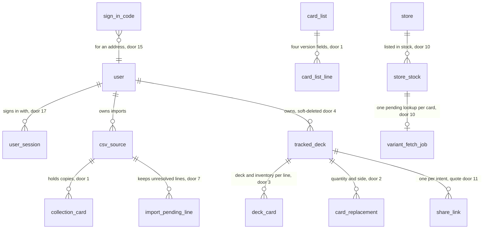

# Persona rethink: the seven journeys of the 2026-10-21 audit, in one spec

## Problem

The persona QA audit of 2026-10-21 (`docs/audit/personas-2026-10-21/`, 59 findings, 7 simulated personas) walked each persona's main job through the app and found that most of them do not finish, or finish with a wrong answer.
The evidence is simulation built from research, not user evidence; the audit and the seven design documents quote the code lines behind each finding.
The audience is now the whole Brazilian market (owner, 2026-10-21), not the Pelotas group the app was sized for.

- **Getting an account** (journey 1): a phone visitor sees a bare form with no word on what the app does; a typo or a short password reaches the server and comes back as "Algo deu errado"; every failed try spends a 3-per-hour limit shared by everyone on a store's Wi-Fi; an expired confirmation link is a dead end, and the resend route exists but nothing calls it; e-mail addresses are case-sensitive, so "Bia@gmail.com" makes a second account.
- **Getting cards in** (journey 2): a beginner with an Armory Deck has about 100 taps ahead; a pasted list is not read at all; a spreadsheet drops rows without saying which; importing a friend's Fabrary deck fills the importer's collection with cards they do not own; nothing records which version of a card a copy is.
- **Building a deck** (journey 3): the rules in the code are out of date (Blitz allows 2 copies, the rule is 1 since 9 March 2026; Silver Age's pool is 52, the rule is 55), copies are counted per row instead of per card across the pool, legality stops at the first problem, the editor shows the saved verdict instead of the draft, there is no inventory, no way to get the list out, and a deleted deck is gone 4.8 seconds later even if the page closes.
- **Closing the deck** (journey 4): prices exist only after the owner presses a button, an unpriced card reads "Indisponível na Cúpula DT", the panel counts in three units, "Já tenho" adds one copy per tap, and the group ask sends every missing copy, including cards the store sells for R$ 0,20.
- **Selling and trading** (journey 5): nothing computes the copies a player does not need; a sell line can list cards the player does not have; the sell message has no version, total or closing line; a buyer or a friend on a shared list has no way to say what they want or can offer; a sold card keeps counting in the collection.
- **The Tutor** (journey 6): it gets the copy rule wrong, its rules search finds almost nothing, deck prices never come back, it refuses a one-copy swap, and its proposals never say how many copies move.
- **Words and access** (journey 7): two cards with the same name are told apart by color alone, alternative reasons contradict themselves, headings follow three language rules, "troca" outside a deck reads as trading cards, the deck page has two `<main>` landmarks, and no game word is explained anywhere.

When this ships, each persona's main job finishes inside the app with a right answer: an account from one e-mail field, cards in from a box, a list or a link, a deck checked against the current rules with every problem at once, a real total after owned copies, a group ask with only what the store lacks, spare copies sold or offered with an honest message, a Tutor that counts copies right, and every game word one tap from a plain explanation.

**How to read this file.**
The seven approved design documents and their chosen screens are the binding sources (`## Sources`): they carry the exact copy of every state, and this file does not copy their tables.
Criteria here state the behaviour and quote only the strings a test asserts.
Where two sources disagree, three rules decide, in order: a "Changed by a later journey" note beats the row it amends; a round-3 screen beats a round-2 screen of the same state; Dona Marta (P6) is disregarded (owner, 2026-10-23), so no criterion serves a parent.
The 30-day success targets in each document are targets, not criteria; the log lines and `share_event` kinds that make them countable are criteria, and the targets land on the observability dimension in `checks.md`.

## Flow

Reuses the shared engine package for every legality and readiness answer (browser and server), `decideAdoption` for every swap and pick, the worker's `runWorkerLoops` for every scheduled job, the existing share-link resolution for the new intent, and `CsvParserService` as the base of the one reader; nothing below adds a second implementation of any of them.

Deck rules and readiness:

1. a deck's cards, inventory and format -> `computeDeckLegality` (exists, rewritten by S3) - every check runs, copies counted per card across deck, inventory, weapons and equipment, hero not in the pool; returns every problem with its card, count and limit
2. `DecksService` (exists) - recomputes legality on every read as today; reads `RULE_CHANGES` (door 9) for the dated notice; skips soft-deleted decks (door 4)
3. the deck editor (exists) - runs the same `computeDeckLegality` in the browser on the draft
4. `computeEffectiveReadiness` (exists) - counts deck and inventory copies (door 3) against the whole collection, by name and pitch only; versions are ignored
5. out: the deck page, the home card (stage and verdict), the Tutor's `get_deck`, and the shared deck page read the same result

Getting cards in:

1. pasted text or a CSV file -> `CsvParserService` (exists, extended by S12) - one reader; each line becomes a card, a question, or a pending line
2. `SourcesService` (exists) - creates one import (`csv_source`, kinds widened by door 6) with its copies in `collection_card` (door 1) and its unresolved lines in `import_pending_line` (door 7)
3. a ready-made product -> the product decklists kept in the repository (new, no door - placement per conventions) -> the same import path, with each card's printing
4. a Fabrary link anywhere in pasted text -> `DecksImportService` (exists) and `FabraryService` (exists) - the deck with its inventory (door 3); the cards enter the collection only on an explicit "Sim"
5. out: the Library, readiness and the "Importações" list read `collection_card` summed per card

Closing the deck:

1. the owner opens `/decks/:deckId/missing` -> `GET /api/decks/:deckId/missing` -> `ShoppingLineService` (exists, rewritten by S16) - one store state per needed card from `store_stock` (door 10)
2. a card the store lists with no fresh price -> `variant_fetch_job` keyed by card (door 10) -> the worker's existing variant drain, each Firecrawl call counted in `firecrawl_usage` (door 10)
3. the worker's availability step (door 5) - runs the existing URL sync every `STORE_AVAILABILITY_PASS_DAYS` and stamps `listedInStockAt`
4. "Já tenho" -> `PUT /api/collection/owned` -> `CollectionService` (exists) - sets the manual-source quantity in one statement (door 1)
5. "Usar em 2" -> `POST /api/decks/:deckId/replacements` -> `decideAdoption` (exists) - moves the given quantity from the given side (door 2)
6. out: the group page and the quote page (door 11) read the stored states and never queue a lookup

Spare copies, selling and trading:

1. the collection, the player's holding decks and `user.spareRule` (door 12) -> the spare function (new, no door - placement per conventions) - one count per card and version, never stored
2. the "Sobrando" page, the trade view of a want list, the group page and the Tutor's spare tool all call it
3. a sell draft -> `ListLinesService` (exists) - sell lines carry the four version fields (door 1)
4. "Vendida" with "Sim, tirar N da coleção" -> `CollectionService` (exists) - removes copies by version, then copies with no version
5. "Quero estas", "Oferecer", "Ver mensagem e enviar" -> `ShareEventsService` (exists) - records `buy`, `offer`, `quote_sent` (door 11)

The Tutor:

1. a turn -> `ChatToolsService` (exists) - `get_deck` returns `computeDeckLegality`'s full result and each card's copy limit; `get_prices` accepts `{deckId, cardIdentifiers: []}`; `search_rules` falls back to an OR query; `search_cards` matches type, class and talent
2. `propose_swap` -> `chat_proposal` (exists) with quantity, side and the missing count before and after (door 13)
3. apply -> `decideAdoption` (exists) - the same quantity-and-side path as the alternatives sheet (door 2)

Accounts:

1. one e-mail field -> `AuthService` (exists, rewritten by S30 to S35) - lowercased address (door 14); Turnstile token checked (door 16) on sign-up and code requests
2. a new address -> an account at once, optional password (door 14), the return page stored on the user (door 14)
3. a code request -> `sign_in_code` (door 15) -> `EmailService` (exists) sends the code and its button
4. any sign-in -> a server-side session in an httpOnly cookie (door 17) read by `JwtAuthGuard` (exists, replaced by door 17) and `OptionalJwtAuthGuard` (exists, replaced by door 17)
5. creating a share link -> refused while `emailVerifiedAt` is empty

Housekeeping:

1. the worker (`runWorkerLoops`, exists) gains one housekeeping step (door 5) - purges users deleted 30 days ago, decks soft-deleted 30 days ago, expired sign-in codes and ended sessions

Words and access:

1. every card name where the same name exists in another pitch -> the one pitch-name helper (`cardName` in `apps/web/src/lib/card-name.ts`, new in S2; it replaces `withPitch` and the four pitch-word maps)
2. game words -> a new i18n namespace of explanations (new, no door - placement per conventions) -> the "?" sheet and the public `/termos` page
3. out: the locale test and the axe scan in CI (doors 18 and 19) fail the build on a dash, a banned word or a serious accessibility issue

## Impact

| Front | What changes |
| --- | --- |
| domain | `Faltam` now means only copies the player does not own; the deck's size has its own wording ("31 de 40 cartas no deck · coloque mais 9"). Today's deck page, home card and shopping panel use "falta" for size too |
| domain | `problema` now means a rule problem only; the size is never counted as one. The editor's "Incompleto" verdict and `deck.legality.category` readers (home tile, deck header, Tutor `get_deck`) branch on it |
| domain | `legal` / `incomplete` / `illegal`: `incomplete` is returned only when the size is the sole problem. Today the first failing step decides, so `incomplete` can hide a rule problem; every reader of `category` (home counts, `DeckStatusStrip`, `LegalityBadge`, the Tutor) sees more `illegal` decks |
| domain | new term `inventory`: cards in the card pool outside the starting deck, per deck line. Readiness, the missing list, the shopping list, the shared missing link, want lists from a deck, the shared copy, the Tutor and spare copies count it; the Library does not |
| domain | new term `spare` ("sobrando"): copies a player owns beyond what holding decks use, under the player's rule; only decks marked `building`, `ready` or `active` hold copies |
| domain | new term `store state`: `priced`, `store_lacks`, `not_on_site`, `looking_up`, `no_price`; replaces the "Indisponível" reading of a card never looked up |
| domain | new term `import kind`: `csv`, `paste`, `product`, `fabrary`, `manual`. Today `csv_source.kind` is `csv` or `manual`, and Fabrary imports are `csv` with a `sourceUrl`; the sources list, the Library filter and the purge read it |
| domain | `deleted deck`: a deck with `deletedAt` set. Every deck read skips it: readiness, the home, `SharedDeckLookup.findLive` (AD-015 checks only the owner today), spare copies, the Tutor, recommendations, the worker's job drains |
| domain | `verified`: an empty `emailVerifiedAt` no longer blocks sign-in or the API; it blocks creating share links only. `AuthService.signIn` and the web's "Verifique seu e-mail" path branch on it today |
| domain | `session`: today a 7-day JWT in `localStorage` with no server sign-out. The two HTTP wrappers of AD-004 (`lib/auth-fetch.ts`, `lib/api-client.ts`), `AuthProvider`, `api/shared-decks.ts`, `JwtStrategy`, `JwtAuthGuard` and `OptionalJwtAuthGuard` (25 files use the two guards) read it; the Playwright storage state (`tests/support/global-setup.ts`), `scripts/fixture/fixture-seed.ts`, the API e2e tests and `docs/dev-fixtures.md` send it as `Authorization: Bearer` |
| domain | `card name`: everywhere the same name exists with another pitch, the name carries the pitch as a word. Aria-labels in `deckDetail.ts`, `MarkOwnedButton`, the missing panel, shopping rows, decklist, editor, Library and shared tiles change |
| stored data | `user.email`: lowercased and trimmed in a migration; if two rows collide after lowercasing, the migration aborts and lists the user ids, and nothing is changed (no merge rule exists to apply) |
| stored data | `collection_card`: four version columns added with the empty-string sentinel on every existing row; the unique index is rebuilt on the seven columns. Existing rows cannot collide (each held one row per user, card and source) |
| stored data | `card_list_line.printing`: each existing key `collectorCode[.edition][.foiling]` is split into the four fields by the migration; a key the parser cannot read keeps its collector code and empty edition and finish, and the migration logs it |
| stored data | `deck_card`: inventory quantity added, 0 on every existing row. Old Fabrary imports get no backfill: the `sideboardQuantity` they received was dropped and is not stored anywhere |
| stored data | saved Blitz decks with 2-ofs, Silver Age decks between 52 and 55, and decks whose weapons or equipment break a rule flip their verdict on the next read; legality is not stored, so nothing is migrated |
| stored data | `variant_fetch_job`: becomes per card; pending and running per-deck rows are dropped at deploy (the next owner list open queues the per-card lookups) |
| stored data | `csv_source.kind`: rows with kind `csv` and a Fabrary `sourceUrl` move to `fabrary` |
| stored data | removing `/forgot-password` and `/reset-password`: reset links already sent stop working; the sign-in screen offers the code instead |
| stored data | existing JWTs: refused after deploy, so every signed-in player signs in once more |
| stored data | the verification link lifetime goes from 24 hours to 7 days for links sent after deploy; links already sent keep their stored expiry |
| existing behaviour | AD-008's increment statement names the old three-column conflict target; it is superseded (AD-016) |
| existing behaviour | AD-009's "a pick moves the original's missing copies" becomes "moves the quantity given, from the side given" (AD-017); omitted, the quantity is today's |

## Relations

One-way constraints:

- `collection_card` unique on user, card, import, printing code, edition, finish and condition, every version column not null with `''` for unknown (door 1).
- `import_pending_line` cascades from its import (door 7).
- `deck_card`: at most one row per deck, card and slot, deck plus inventory quantity above 0 (door 3).
- `card_replacement.side` not null, `deck` or `inventory` (door 2).
- `variant_fetch_job`: at most one `pending` row per card (door 10).
- `sign_in_code`: at most one live code per address (door 15).
- `user.email` unique on the lowercased value (door 14).
- `user_session` token hash unique (door 17).
- `firecrawl_usage` one row per month (door 10).

No columns and no types here.

## Surface

Routes this adds, removes, or whose signature changes. `/api` is the prefix.

| Route | In | Out | Status |
| --- | --- | --- | --- |
| `POST /api/auth/start` | `email`, `turnstileToken` | `next`: `new`, `password` or `code` | `200`, `400`, `429` |
| `POST /api/auth/sign-up` | `email`, `password?`, `turnstileToken`, `shareToken?`, `returnPath?` | `user`, sets the session cookie | `201`, `400`, `409`, `429` |
| `POST /api/auth/sign-in` | `email`, `password` | `user`, sets the session cookie | `200`, `401`, `429` |
| `POST /api/auth/codes` | `email`, `turnstileToken` | `expiresAt` · `resendAfter` | `202`, `400`, `429` |
| `POST /api/auth/codes/verify` | `email`, `code` | `user` · `returnPath`, sets the session cookie | `200`, `400`, `401`, `410`, `429` |
| `POST /api/auth/codes/redeem` | `token` (the e-mail button) | `user` · `returnPath`, sets the session cookie | `200`, `401`, `410` |
| `POST /api/auth/sign-out` | the session cookie | nothing, clears the cookie | `204`, `401` |
| `POST /api/auth/verify-email` | `token` | `returnPath` · `verified` | `200`, `410` |
| `POST /api/auth/resend-verification` | the session cookie | nothing | `202`, `401`, `429` |
| `PATCH /api/auth/me/email` | `email` (only while unconfirmed) | `user` | `200`, `400`, `401`, `409` |
| `PUT /api/users/me/password` | `password` | nothing | `204`, `400`, `401` |
| `POST /api/auth/forgot-password`, `POST /api/auth/reset-password` | removed | nothing | `404` |
| `POST /api/decks/:deckId/share`, `POST /api/lists/:listId/share` | as today; `intent` accepts `quote` for decks | the link | `201`, `400`, `403`, `404` |
| `POST /api/collection/imports/read` | `text` or a file | `lines` with outcome, `columns` | `200`, `400`, `413` |
| `POST /api/collection/imports` | `kind`, `name`, `ready` lines, `pending` lines | `source` · `pendingCount` | `201`, `400`, `409` |
| `GET /api/collection/pending` | nothing | pending lines by import | `200`, `401` |
| `PATCH /api/collection/pending/:id` | `cardIdentifier`, `quantity`, version fields | `copy` | `200`, `400`, `404` |
| `DELETE /api/collection/pending/:id` | nothing | nothing | `204`, `404` |
| `GET /api/products` | `q` | products with hero, format, card count | `200` |
| `POST /api/products/:productKey/import` | `addCards`, `createDeck`, `confirmRepeat?` | `source?` · `deckId?` | `201`, `404`, `409` |
| `POST /api/decks/import` | `text` (any text holding a Fabrary link), `ownsCards` (required, no default) | `deckId` · `source?` | `201`, `400`, `404`, `502` |
| `PATCH /api/collection/sources/:id/versions` | `edition?`, `finish?`, `condition?` | `applied` · `skipped` | `200`, `400`, `404` |
| `PATCH /api/collection/cards/:cardIdentifier/versions` | `from` version, `to` version, `quantity` | the card's copies by version | `200`, `400`, `404` |
| `POST /api/collection/cards/batch` | as today, each card with `printingCode?`, `edition?`, `finish?` | as today | `200`, `400` |
| `POST /api/collection/cards/decrement` | as today, plus `sourceId` and version | as today | `200`, `400`, `404` |
| `PUT /api/collection/owned` | `deckId`, `cardIdentifier`, `ownedTotal` | `ownedTotal` · `previousManualQuantity` · `snapshot` | `200`, `400`, `404` |
| `PUT /api/decks/:deckId` | composition rows with `inventoryQuantity` | the deck with full legality | `200`, `400`, `404` |
| `DELETE /api/decks/:deckId` | nothing | `deletedAt` | `200`, `404` |
| `GET /api/decks/deleted` | nothing | deleted decks with `deletedAt`, `purgeAt` | `200`, `401` |
| `POST /api/decks/:deckId/restore` | nothing | the deck | `200`, `404` |
| `DELETE /api/decks/:deckId/permanent` | nothing | nothing | `204`, `404` |
| `POST /api/decks/:deckId/duplicate` | nothing | `deckId` | `201`, `404` |
| `GET /api/decks/:deckId/missing` | nothing | `summary`, `lines` (each with `deckNeeded`, `inventoryNeeded`, `state`) | `200`, `404` |
| `POST /api/decks/:deckId/fetch-variants` | removed | nothing | `404` |
| `POST /api/decks/:deckId/replacements` | as today, plus `quantity?`, `side?` | the replacement | `201`, `400`, `404`, `409` |
| `GET /api/shared/decks/:token` | nothing | per intent: `deck` with inventory, `missing` with store states and spare, `quote` with `needed` only | `200`, `404` |
| `POST /api/shared/decks/:token/copy` | `variant`: `original` or `as_built` (required when the deck has active replacements) | `deckId` | `201`, `400`, `404` |
| `POST /api/shared/:kind/:token/events` | `kind`: `offer`, `quote_sent` or `buy` | nothing | `204`, `400`, `404` |
| `GET /api/shared/lists/:token` | nothing | as today; want lists add per line `owned`, `spare`, `spareReason` for a signed-in visitor | `200`, `404` |
| `GET /api/collection/spare` | nothing | `needsRule` with the count per rule, or rows per card and version | `200`, `401` |
| `PUT /api/users/me/spare-rule` | `rule` | the rule | `200`, `400` |
| `PATCH /api/users/me/share-closing-line` | `text` | the text | `200`, `400` |
| `PATCH /api/users/me/sell-closing-line` | `text` | the text | `200`, `400` |
| `POST /api/lists/:listId/lines` | as today, version as four fields instead of `printing` | the line | `201`, `400`, `404` |
| `POST /api/lists/:listId/lines/:lineId/sold` | `quantity`, `removeFromCollection`, `sourceId?` | the lines after the split · `removed` | `200`, `400`, `404`, `409` |
| `GET /api/admin/stores/:slug/credits` | nothing | the month's credits used, budget, `lookupsStopped` | `200`, `403` |
| `GET /api/chat/conversations/:id` | as today | swap proposals add `quantity`, `side`, `missingBefore`, `missingAfter` | `200`, `400`, `404` |
| `/termos` (public web page) | `q?`, `#word` | the glossary | `200` |
| `/entrar` (public web page) | `token?` (the e-mail button's single-use token, signs in on arrival) | the one-field start; `/` renders the same page for a signed-out visitor; `/sign-in` and `/sign-up` redirect to it, `/forgot-password` and `/reset-password` are removed | `200` |
| `/entrar` (public web page), added by S32 | `next?` (an in-app path; anything else is dropped) | a protected page opened signed out redirects here with `?next=<that page>`, and a sign-in on the page goes back to it (AC 240); a signed-out visitor who tapped "Sair" is sent here with no `next`; rejected: remembering the page in `localStorage` like `ra.shareReturn`, because a stale entry would send a later, unrelated sign-in to an old page | `200` |
| `GET /api/decks/:deckId` (and the `PUT` that returns the deck) | as today | each replacement gains `originalPitch` (1 to 3, or null) so the web can name the original with its pitch | `200`, `404` |
| `GET /api/shared/decks/:token/coverage` | nothing | as today, plus `collectionEmpty` (true when the visitor owns no copy at all) so a new account on a shared deck is told how to put cards in (AC 225); the web asking the Library list instead was rejected, it loads every card to answer one yes or no | `200`, `401`, `404` |

## Landing

| One-way door | Literal shape | Alternative rejected |
| --- | --- | --- |
| 1. version of a copy (collection and sell lines) | `collection_card` and `card_list_line` gain `printingCode`, `edition`, `finish`, `condition`, all `varchar not null default ''`; `''` means "Não sei"; `finish` in `('', 'none', 'rainbow', 'cold', 'gold')` (`none` is "Sem foil"), `edition` in `('', 'first', 'unlimited', 'alpha')`, `condition` in `('', 'NM', 'LP', 'MP', 'HP', 'DMG')`; `collection_card` unique on `("userId","cardIdentifier","sourceId","printingCode","edition","finish","condition")`; increments use `ON CONFLICT` on that key (AD-016) | nullable columns with `NULLS NOT DISTINCT` - needs Postgres 15 and production's version is not verified from here; plain nullable columns - Postgres treats NULLs as distinct, so `ON CONFLICT` never fires and every increment inserts a duplicate; the sell lines' single `printing` key - cannot store "Sem foil" without a printing |
| 2. a pick or a swap moves a quantity from a side | `card_replacement.quantity` (exists) is the copies moved, now set by the caller (1 to the copies still needed, or the copies over the limit); new `card_replacement.side varchar not null default 'deck'` in `('deck', 'inventory')`; `decideAdoption` takes `{quantity?, side?}`, omitted means today's behaviour (AD-017) | every-copy swaps with the Tutor refusing one-copy fixes (F34); a stand-in that always moves all copies (F17) |
| 3. inventory per deck line | `deck_card.inventoryQuantity int not null default 0`; check `quantity >= 0 AND "inventoryQuantity" >= 0 AND quantity + "inventoryQuantity" > 0`; the Fabrary import stores `sideboardQuantity` there (AD-018) | a new `slot` value `inventory` - one card gets two rows and every reader has to merge them |
| 4. soft delete of decks, 30 days | `tracked_deck.deletedAt timestamptz null`; every deck read filters `"deletedAt" IS NULL`, `SharedDeckLookup.findLive` included; the housekeeping step hard-deletes rows older than 30 days with today's cascades (AD-019) | today's hard delete behind a 4.8-second timer - the deck is lost when the page closes (F57) |
| 5. scheduled work runs in the worker | one `housekeeping` step added to `runWorkerLoops` in `stores/variant-queue-worker.ts`, plus the availability-pass step; each step claims its work with a lock so a second worker cannot double-run it; a unit test asserts the steps are registered (AD-020) | `setInterval` in the API like `PriceSyncScheduler` - it runs once per API instance; the Railway dashboard cron - not in the repository, which is how the user purge stayed unscheduled |
| 6. import kinds | `CHK_csv_source_kind_valid` becomes `kind IN ('csv', 'paste', 'product', 'fabrary', 'manual')`; `csv_source.productKey varchar null` for ready-made decks | keeping Fabrary imports as `csv` with a URL - the "Importações" list and the ownership log cannot tell them apart |
| 7. lines kept "Para resolver" | new table `import_pending_line` (`sourceId` FK `ON DELETE CASCADE`, `userId`, `lineNumber`, `originalText`, `reason`, `suggestedCardIdentifier null`) | a browser draft - lost on another device, and the banner could not count it |
| 8. ready-made decklists | one JSON file per product under the repository's catalog data, `{ key, name, kind: 'armory' or 'blitz' or 'silver_age', format, hero, cards: [{ cardIdentifier, printingCode, quantity }] }`, written only by `pnpm products:import <url>` | fetching Fabrary at onboarding - an outside dependency on the first screen a beginner sees |
| 9. curated rule changes | `RULE_CHANGES` in `packages/engine/src/legality/rules.ts`: `[{ format, effectiveDate: 'YYYY-MM-DD', summaryKey, sourceUrl }]`, first entry Blitz `2026-03-09` with the official change-log URL; nothing else may print a rule date (AD-025) | inferring the date from card data - the data holds none |
| 10. store answers under a monthly budget | `store_stock."listedInStockAt" timestamptz null`; `store."lastAvailabilityPassAt" timestamptz null`; table `firecrawl_usage (month char(7) primary key, credits int not null)` incremented with one atomic `INSERT ... ON CONFLICT (month) DO UPDATE SET credits = firecrawl_usage.credits + EXCLUDED.credits`; `variant_fetch_job` gets `cardIdentifier` instead of `deckId`, with a partial unique index on `("cardIdentifier") WHERE status = 'pending'` (AD-022) | per-deck jobs - the same card is looked up once per deck and per user; counting credits from the provider dashboard - nothing in the app could stop at the budget |
| 11. the `quote` intent and new event kinds | `CHK_share_link_intent_valid` adds `'quote'`; `CHK_share_event_intent_valid` adds `'quote'`; `CHK_share_event_kind_valid` adds `'offer', 'quote_sent', 'buy'`; `CHK_user_referred_via_valid` adds `'quote'`, all in one migration; a `quote` address resolves only to the quote page (AD-023) | a query flag on the `missing` address - a store owner who receives it once would see the store prices the quote page must hide |
| 12. the spare rule | `user."spareRule" varchar(16) null`, check `IN ('within_format', 'any_deck', 'per_deck')`, null until the player answers; `user."sellClosingLine" varchar(140) null`; `user."shareClosingLine" varchar(140) null` (AD-024) | a per-device setting - the same player would see two spare counts on two phones |
| 13. a swap proposal stores what it moves and its effect | the `chat_proposal.payload` of kind `swap` gains `quantity`, `side`, `missingBefore`, `missingAfter`, computed with the engine at validation; the proposal goes `stale` when the deck changes, as today | computing the effect on every render - the number would change under the player |
| 14. accounts: lowercased e-mail, optional password, unconfirmed accounts work, return page on the server | migration lowercases `user.email` (aborts on a collision); `user."passwordHash"` nullable; `emailVerifiedAt` empty blocks only share-link creation (`403` `EMAIL_NOT_CONFIRMED`); `user."signupReturnPath" varchar(200) null`, a path inside the app only (AD-021) | removing passwords - the owner kept them for those who find it faster; deleting unconfirmed accounts after some days - the owner declined it; the browser's `ra.shareReturn` alone - lost on another device |
| 15. sign-in codes | table `sign_in_code (id, email, codeHash, buttonTokenHash, expiresAt, attempts, consumedAt)`; six digits, 15 minutes, 5 tries, partial unique on `(email) WHERE "consumedAt" IS NULL`, so a new request replaces the live code; the per-address limit is counted from these rows (AD-021) | a magic link only - it fails when the e-mail is opened on another device than the app |
| 16. Cloudflare Turnstile | a new runtime dependency on `https://challenges.cloudflare.com/turnstile/v0/siteverify`; `TURNSTILE_SECRET_KEY` (API) and `VITE_TURNSTILE_SITE_KEY` (web), optional in the environment schema; when absent, verification is skipped with a logged warning (AD-021) | a tighter per-IP limit alone - it locks out a store's Wi-Fi and carriers' shared addresses, the problem F01 found |
| 17. a session the server can end, in an httpOnly cookie | owner's pick, 2026-10-23. Table `user_session (id, userId, tokenHash unique, createdAt, lastSeenAt, revokedAt)`; an opaque 32-byte token the API sets as cookie `ra_session` with `HttpOnly; SameSite=Lax; Path=/api; Max-Age=34560000` (400 days, the longest Chrome keeps a cookie), plus `Secure` when `NODE_ENV=production`, sent again when `lastSeenAt` is more than a day old; no response body carries the token, and player routes read no `Authorization` header; every `POST`, `PUT`, `PATCH` and `DELETE` whose `Origin` header is present and differs from the origin of `APP_BASE_URL` answers `403` `ORIGIN_REJECTED`; the cookie is read with `cookie-parser` (a new runtime dependency of `apps/api`), and both the parser and the origin check are mounted in `configureHttpApp`, which `main.ts` and the API e2e bootstraps already share; the logger already redacts `req.headers.cookie` and `res.headers["set-cookie"]`; `JwtAuthGuard` and `OptionalJwtAuthGuard` look the hash up; sign-out, a deleted account and a password change revoke rows; the web removes the `rathe-arsenal:jwt` key on load and the two wrappers of AD-004 and `api/shared-decks.ts` stop setting `Authorization`; the Playwright setup keeps the cookie in its storage state, and the API e2e tests, `scripts/fixture/fixture-seed.ts` and `docs/dev-fixtures.md` send it as a `Cookie` header. Production is same-origin (the API serves the web app) and dev goes through Vite's `/api` proxy, so the browser sends the cookie with no CORS change (AD-021) | an opaque token in `localStorage` sent as `Authorization: Bearer` - the smaller change, but a script injected into the page can read it; accepting both the cookie and a Bearer token - the token would have to come back in a response body, where a page script can read it; a JWT that simply lives longer - no sign-out can end it |
| 18. new dev dependency for the accessibility scan | `@axe-core/playwright` in `apps/web` dev dependencies, run inside the existing Playwright suite | a separate accessibility job - a second browser setup in CI for the same pages |
| 19. the Playwright suite runs in CI | CI runs no Playwright today (`.github/workflows/ci.yml` has engine, web and API unit jobs and the API e2e job only). A new job `web-e2e` in `ci.yml`: the `postgres:16` service and the environment of the API e2e job, Chromium installed with `playwright install --with-deps chromium`, the API built, migrated and started, the web dev server started, both waited for, then `playwright test --project=e2e-chromium`; it blocks a merge like the other jobs; `global-setup.ts` seeds the fixture user as it does locally | Playwright's `webServer` option - `playwright.config.ts` leaves it out on purpose so a local run reuses the owner's `pnpm dev`; keeping the scan local - the gate would depend on someone running it |

- Nothing else in this change is hard to reverse: the reader's rules, the copy, the screens, the spare function's placement, the glossary namespace and the product files' folder are settled in the diff.

## Criteria

Grouped by slice, in build order: words and gates first (so every later slice is gated by them), then the rules engine every other journey reads, then journeys 2, 4, 5, 6, 1 and the rest of 7.
Each slice's last criterion binds its screens and copy to the named design section; the Verifier opens it at profile `ui`.

### S1: Locale and accessibility gates in CI (P1)

The build fails on a dash or a banned word in pt-BR copy, and on a serious accessibility issue on the main pages.

**Acceptance Criteria**

1. WHEN CI runs THEN the locale test SHALL fail on any pt-BR locale value containing an em dash (U+2014) or an en dash (U+2013)
2. WHEN CI runs THEN the locale test SHALL fail on "troca" or "trocar" in a value of the `home`, `auth` or `onboarding` namespaces, and on the literals "Manual entries" and "Attack Actions" in any pt-BR value
3. WHEN CI runs THEN the Playwright suite SHALL scan with axe every page on its scan list and fail on any issue of impact `serious` or `critical`; S1 starts the list with the pages that exist today (home, deck page, Library, shared deck page, sign-in), and each later slice adds the page it builds (the missing list, "Sobrando", the quote page, `/termos`, the one-field start)
4. WHEN S1 lands THEN the test SHALL pass on the current catalog: S1 itself rewrites every value the test bans (the "troca" strings of `home.ts`, `auth.ts` and `onboarding.ts`, "Manual entries", "Attack Actions", the em dashes) and fixes every serious or critical issue the first scan finds
5. The automatic deck name SHALL use a plain hyphen, "Rhinar - Blitz", and no pt-BR locale value SHALL contain an em dash, "R$ —" included

**Independent test:** add an em dash to a pt-BR value and see CI fail; remove it and see it pass.

### S2: Every card is told apart by name (P1)

Two cards with the same name and different pitch read differently in text and to a screen reader.

**Acceptance Criteria**

6. WHERE the same card name exists in more than one pitch, the system SHALL render the name with the pitch as a word, "Pack Hunt (Vermelho)", in every row, tile, list, toast and aria-label of the deck page, editor, missing list, shopping list, Library, shared pages, lists and Tutor proposals
7. The system SHALL render a card with no pitch (weapon, equipment, hero) by its name alone
8. WHEN "Já tenho" is rendered THEN its aria-label SHALL name the card, "Já tenho Pack Hunt (Vermelho)"
9. The web app SHALL define the pitch words and the number-to-word map in one module, imported by every place that names a card

**Independent test:** render the missing list with Pack Hunt (Vermelho) and (Azul) and read both aria-labels.

### S3: The rules engine knows the current rules and returns every problem (P1)

One deck check, used by the browser, the API and the Tutor, with today's official limits.

**Acceptance Criteria**

10. The engine SHALL count copies per card (name and pitch) across deck, inventory, weapons and equipment, with the limit 3 in Classic Constructed and Living Legend, 2 in Silver Age and 1 in Blitz
11. The engine SHALL limit a Legendary card to 1 in every format and a card restricted in Living Legend to 1 in Living Legend
12. The engine SHALL count the card pool as deck plus inventory plus weapons plus equipment, without the hero, against 80, 80, 52 and 55 for Classic Constructed, Living Legend, Blitz and Silver Age
13. WHEN a deck is checked THEN the engine SHALL run every check and return every problem, each with its card, count and limit, with `category` `illegal` when any rule fails, `incomplete` when only the size fails, and `legal` otherwise
14. The engine SHALL check bans, format and hero scope on every slot, and SHALL decide Silver Age legality by the catalog's `legalFormats` (Blade Dance is legal in Silver Age)
15. WHEN a hero is outside the deck's format THEN the problem SHALL carry the formats where the hero is allowed, from `legalFormats`, with no date and no history
16. IF an imported deck's format is outside the four THEN the system SHALL store the deck with that format, return `category` `unchecked` with no crash, and show "Formato não conferido"
17. WHEN a saved Blitz deck holds 2 copies of a card THEN the next read SHALL return it `illegal` with that card's problem

**Independent test:** check a Blitz deck at 31 of 40 with Pack Hunt (Vermelho) at 2 and see both problems returned.

### S4: The editor shows the draft's verdict and the whole checklist (P1)

Building a deck with every rule in view, on the phone.

**Acceptance Criteria**

18. WHILE the player edits a deck the editor SHALL show the verdict computed in the browser from the draft, never the saved verdict
19. WHEN a card is at its limit (deck plus inventory) THEN its "+" SHALL be disabled with the reason, "Máximo 1 no Blitz", "Máximo 1: carta lendária" or "Máximo 1 em Living Legend: carta restrita"
20. WHEN a row is over the limit THEN the row SHALL show "2 cópias · o Blitz permite 1 · tire 1"
21. The bottom bar SHALL read "31 de 40 cartas · 1 problema" while scrolling, and "32 de 40 cartas · nenhum problema" when only the size is left
22. WHEN the bar is tapped THEN a sheet at about 45% of the height SHALL list every check (green right, red wrong with "Ir para a carta", neutral size) and the "Para fechar" steps with the arithmetic done, and SHALL close only by its handle or "Fechar"
23. WHEN the server data changes while the player has not edited THEN the draft SHALL reset to it and nothing SHALL be written to `localStorage`
24. The draft SHALL hold one row per card and slot, also for a partly owned card
25. WHEN "Cancelar" is tapped on a just-created deck with no cards THEN the deck SHALL be discarded and the player returned to where they came from
26. WHEN the format changes on a deck whose name is still the automatic one THEN the name SHALL follow ("Rhinar - Silver Age")
27. WHEN a deck with problems is saved THEN it SHALL be saved as is, and no copy SHALL promise that cards are removed
28. The "Ver no Fabrary" link SHALL point to `fabrary.net`, the address the parser accepts
29. The editor screens SHALL match `.design/deck-building.md` "Editor and the rules checklist" and `r3-editor-phone`, `r3-checklist-phone`, with copy rules 1 to 9 of that document

**Independent test:** in a Blitz deck, raise Pack Hunt (Vermelho) to 2 in the draft and see the verdict, the row line, the disabled "+" and the sheet change before saving.

### S5: The inventory (P1)

A deck holds cards outside the starting deck, and every count says which side a copy is on.

**Acceptance Criteria**

30. The editor SHALL show two steppers per card, "No deck" and "No inventário", and a header "Deck 60 · Inventário 15 · Card pool 80 de 80" with the plain line for card pool and inventory once
31. WHEN copies across deck and inventory exceed the limit THEN the row SHALL read "3 no deck e 1 no inventário, 4 no total. O Classic Constructed permite 3 · tire 1" and both "+" SHALL be disabled
32. The row menu SHALL offer "Mover 1 para o inventário" and "Mover todas (3) para o inventário", and the reverse
33. WHEN a Fabrary deck is imported THEN its `sideboardQuantity` SHALL be stored as the inventory quantity
34. The missing count SHALL include inventory copies and split them in words, "Faltam 7 cópias (4 do deck, 3 do inventário)", on the deck page, the missing list (filters "Todas", "Do deck", "Do inventário"), the shopping list, the group ask and the quote
35. The inventory screens SHALL match `.design/deck-building.md` "Inventory" and "Missing cards with the inventory" (`r3-inventory-desktop`, `r2-missing-desktop` with copy rule 6's inventory line)

**Independent test:** import a Fabrary deck with an inventory and see 15 inventory copies counted in the pool and in "Faltam".

### S6: The stage and the verdict on the home card (P1)

A rule problem never hides behind the player's own stage label.

**Acceptance Criteria**

36. WHEN a deck has no rule problem THEN the home card SHALL show the stage chip, with the size when short ("Montando · 31 de 40 cartas")
37. WHEN a deck has a rule problem THEN the home card SHALL show a red chip with the verdict only ("Não vale no Blitz"), a red cause line ("8 cartas com 2 cópias") and a grey line "Etapa: Jogando · 40 cartas"
38. The cause line SHALL list at most two kinds of problem joined by " · ", then "e mais N", in the singular when N is 1, and SHALL never contain "jogar" or "pronto"
39. The verdict SHALL never write the stage; the stage SHALL stay editable by the player
40. The home card and the deck header SHALL match `.design/deck-building.md` "The stage and the verdict" and `r3-stage-a-phone`

**Independent test:** a Blitz deck at stage Jogando with eight 2-ofs shows the red chip, the cause line and the grey stage line.

### S7: Getting the list out (P2)

Copy the list for the group or for another app, duplicate a deck, read it as text.

**Acceptance Criteria**

41. The deck page header SHALL show "Copiar lista" and "Duplicar" as visible actions, with "Excluir deck" only inside "⋯"
42. WHEN "Copiar lista" is tapped THEN a sheet SHALL offer the tabs "Para o grupo" and "Para Fabrary ou Talishar", none chosen, with the full text previewed before "Copiar"
43. The "Para o grupo" text SHALL carry headed sections Herói, Arma, Equipamentos, "Deck (60 cartas)" and "Inventário (15 cartas, fora do deck)"
44. The other tab's text SHALL use English card names, one line per card as "3x Pack Hunt (Red)", grouped Hero, Weapon, Equipment, Deck and Inventory, until the owner's hand check of the GEM text (open question 3) says otherwise
45. IF the pool breaks a rule THEN the sheet SHALL show a warning above the preview that does not block copying ("Dá para copiar mesmo assim.")
46. WHEN "Duplicar" is tapped THEN the system SHALL create "<name> (cópia)" with the same cards and inventory at stage Ideia and open it
47. The "Lista" view SHALL show text grouped Herói, Arma, Equipamentos, Deck, Inventário, one line per card ("3x Pack Hunt (Vermelho) · custo 2 · Ação") with its problem and "faltam N"
48. The shared deck page SHALL offer the same "Copiar lista" sheet without an account
49. The screens SHALL match `.design/deck-building.md` "Getting the list out" (`r3-deck-actions-desktop`, `r2-export-desktop`, `r3-export-group-desktop`, `r2-list-view-desktop`)

**Independent test:** copy a Classic Constructed deck with an inventory as "Para o grupo" and paste it.

### S8: A deleted deck can come back for 30 days (P1)

Delete never loses a deck by accident.

**Acceptance Criteria**

50. WHEN a deck is deleted from the home or from "Excluir deck" THEN it SHALL leave the list at once and a toast "<name> foi para Excluídos recentemente · Desfazer" SHALL stay until the next action
51. The home SHALL show "Excluídos recentemente (N) · ficam 30 dias" while deleted decks exist, and the list SHALL offer "Restaurar" and "Excluir de vez" per deck
52. WHEN "Restaurar" is tapped THEN the deck SHALL come back with its cards, inventory, replacements, tags and share links
53. WHEN "Excluir de vez" is confirmed once THEN the deck SHALL be deleted with today's cascades
54. WHEN a deck has been deleted for 30 days THEN the housekeeping step SHALL delete it for good
55. WHILE a deck is deleted the system SHALL leave it out of readiness, home counts, spare copies, the Tutor, recommendations and job drains, and its share addresses SHALL answer `404` `SHARE_LINK_UNAVAILABLE`
56. IF the player leaves the home while a delete is pending THEN the delete SHALL still be recorded, as the toast said
57. The screens SHALL match `.design/deck-building.md` "Delete safety" (`r2-delete-toast-phone`, `r2-deleted-list-phone`)

**Independent test:** delete a shared deck, open its link (404), restore it, open the link again (200).

### S9: Starting a deck with the hero, and a hero outside the format (P2)

The hero comes first; a hero outside a format says where it plays and switches in one tap.

**Acceptance Criteria**

58. WHEN the player starts a new deck THEN the system SHALL offer "Comprei um deck pronto", "Tenho um link do Fabrary" and "Começar do zero"
59. The hero search SHALL show each result's art and formats, none highlighted, with the "jovem" line once
60. WHEN a hero is picked THEN only that hero's formats SHALL be offered, none selected, and "Começar a montar" SHALL stay disabled until one is chosen
61. WHEN a deck's hero is outside its format THEN the page SHALL list each problem in plain words, the result in each other format before any tap, and "Mudar para <format>" with "As cartas do deck não mudam, só o formato em que ele é conferido."
62. WHEN the switch is tapped THEN the format SHALL change and the toast SHALL read "Formato mudado para <format> · Desfazer"
63. IF no format makes the deck valid THEN the page SHALL list the problems per format and offer no switch
64. The shared deck page SHALL show the verdict block for the deck's own format and "Conferir em outro formato:" chips, none chosen, whose result never changes the block above
65. The screens SHALL match `.design/deck-building.md` "New deck: hero first", "Hero outside the format" and "Legality on the shared deck page" (`r2-new-deck-hero-phone`, `r2-new-deck-format-phone`, `r2-retired-hero-desktop`, `r3-retired-hero-switched-desktop`, `r3-shared-phone`)

**Independent test:** open a Classic Constructed deck with a hero that plays only Living Legend and switch it.

### S10: A rule changed under a saved deck (P2)

The player learns why a deck stopped being valid, with the date, and fixes it in one tap.

**Acceptance Criteria**

66. WHEN a deck breaks a rule covered by a `RULE_CHANGES` entry THEN the deck page SHALL show "Desde 9 de março de 2026, o Blitz permite 1 cópia de cada carta (antes eram 2). 8 cartas deste deck têm 2." with "ver o anúncio" linking to the entry's source
67. WHEN "Deixar 1 de cada" is tapped THEN one copy of each of those cards SHALL leave the deck, the toast SHALL read "8 cópias tiradas do deck · Desfazer", and the cards SHALL stay in the collection
68. IF a deck breaks a rule with no curated entry THEN the page SHALL show the verdict and the cause with no date and no "antes eram"
69. The system SHALL print a rule date only from a `RULE_CHANGES` entry
70. The notice SHALL be shown until the deck has no problem from that change, and SHALL send nothing outside the app
71. The screens SHALL match `.design/deck-building.md` "A rule changed under a saved deck" (`r3-rule-changed-deck-phone`, `r2-one-each-phone` with the stage rule)

**Independent test:** open a saved Blitz deck with eight 2-ofs, tap "Deixar 1 de cada", then "Desfazer".

### S11: The version of each copy (P2)

A copy may say which printing, edition, finish and condition it is; nothing is guessed.

**Acceptance Criteria**

72. The system SHALL store a copy's version as four optional fields, printing code, edition, finish and condition, with "Não sei" for an unknown and "Sem foil" as a known finish
73. The system SHALL count copies for readiness and the Library by name and pitch, summing every version
74. The system SHALL show a copy with no version in grey as "sem versão informada", with no badge, count or call to action
75. WHEN the player applies "Marcar de uma vez" in "Versões desta importação" THEN only copies with no version SHALL change, the button SHALL read "Aplicar às N cópias sem versão", and cards with no printing in the chosen finish or edition SHALL be skipped and listed
76. WHEN the player opens one card THEN its copies SHALL be grouped by version with "Mudar versão", and the picker SHALL offer only the printings, editions and finishes that exist for that card, with nothing pre-selected
77. WHEN the scanner reads a collector code THEN the copy SHALL be recorded with that printing code, asking the edition only when the code exists in more than one edition and "É foil?" only when it exists in a foil finish
78. IF a version names a printing the card does not have THEN the write SHALL be refused with `400`
79. WHEN "−" is tapped on a card with copies in more than one import or version THEN the picker SHALL open inside the screen on a phone
80. The screens SHALL match `.design/collection-in.md` "Versions" (`r3-version-bulk-phone`, `r3-version-card-phone`, `r3-imports-phone`)

**Independent test:** import a Kayo Armory Deck, mark the import "Sem foil · NM", and see foil product cards skipped and listed.

### S12: One reader for lists and spreadsheets, and nothing dropped (P1)

Every line of a paste or a file ends added, asked, or kept "Para resolver".

**Acceptance Criteria**

81. The reader SHALL read pitch in English, Portuguese or as a number ("(Red)", "vermelho", "(3)"), and SHALL show how an ambiguous token was read ("'(3)' lido como Azul")
82. WHEN a line names a card printed in several colors with no color and no color column THEN the line SHALL ask "Qual cor?" with the three colors and "Não sei"
83. WHEN a line is one typo away from exactly one card THEN the reader SHALL offer "Você quis dizer <card>?" with its image and count it only after "Usar esta"
84. WHEN a line matches no card THEN the reader SHALL show "Não achamos '<text>'" with an edit field and "Procurar"
85. The reader SHALL read Portuguese and English headers in any order (`nome`, `quantidade`, `cor`, `versão`, `estado`), a comma inside a known card name without quotes with a note, and SHALL say "Lemos as colunas <names>"
86. IF a file cannot be read at all THEN the system SHALL show a localized error with what to check and create no import
87. WHEN "Adicionar as N prontas" is tapped THEN the ready lines SHALL become one import and every unresolved line SHALL be stored "Para resolver" with its import, line number and original text
88. WHILE "Para resolver" lines exist the collection SHALL show "N linhas de <import> para resolver · Resolver", counting down as lines are resolved or deleted
89. WHEN an import is removed THEN its "Para resolver" lines SHALL go with it
90. The sum of added, asked and kept lines SHALL equal the lines read for every import, and a quantity above 20 SHALL be capped at 20 with a note
91. The screens SHALL match `.design/collection-in.md` "Reader and report" (`r3-list-phone`, `r3-report-phone`, `r3-pending-phone`)

**Independent test:** paste "3x Snatch red", "Snatch (Vermelho)", "Snath (3)" and "Cartaqualquer" and see each outcome.

### S13: Ready-made decks (P1)

A beginner picks the box they bought and gets its cards and deck in one step.

**Acceptance Criteria**

92. WHEN the player searches a product ("kayo") THEN the system SHALL list matching Armory, Blitz and Silver Age products with hero image, product name and one format label
93. WHEN a product is picked THEN the system SHALL show "<Product> · N cartas", two switches on with their reasons, the collapsed card list, and the line on printings and tokens
94. WHEN "Adicionar" is tapped with both switches on THEN the system SHALL create an import named after the product with each card's printing and a deck with the product's name, hero and format
95. IF the player already imported the same product THEN the system SHALL ask "Você já adicionou <product> em <date>. Adicionar outra caixa?" and name a second import "#2"
96. The system SHALL offer only products with a stored decklist
97. WHEN `pnpm products:import <url>` runs THEN it SHALL write or update one product file, leave tokens out, and print every difference between the official list and the catalog's printings tagged with that product
98. The screens SHALL match `.design/collection-in.md` "Ready-made decks" (`r3-first-run-phone`, `r3-product-search-phone`, `r3-product-confirm-phone`)

**Independent test:** search "kayo", add the Armory Deck, and see an import and a deck of 26 cards with no Agility or Might token.

### S14: A Fabrary deck asks whose cards they are (P1)

A friend's deck never fills the importer's collection without an answer.

**Acceptance Criteria**

99. WHEN pasted text contains `fabrary.net/decks/<id>` or `fabrary.com/decks/<id>`, with or without scheme, `www`, trailing slash or words around it THEN the system SHALL use the first such link
100. WHEN the deck is found THEN the system SHALL ask "Essas cartas são suas?" with "Sim, colocar na minha coleção" and "Não, só quero comparar com o que eu tenho", none selected, and "Importar o deck" disabled until answered
101. IF the import request carries no ownership answer THEN the API SHALL answer `400` and import nothing
102. WHEN the answer is "Não" THEN only the deck SHALL be imported and the card SHALL offer "Colar a lista do que eu tenho"
103. IF the deck does not exist or is private THEN the system SHALL show "Esse deck não existe ou é privado no Fabrary."
104. IF Fabrary is unreachable THEN the system SHALL show "Não conseguimos falar com o Fabrary agora. Tente de novo em alguns minutos."
105. The onboarding import SHALL ask the same question; `seedInventory` SHALL have no default
106. The screens SHALL match `.design/collection-in.md` "Fabrary deck import" (`r3-add-phone`, `r3-fabrary-found-phone`)

**Independent test:** paste "olha esse deck www.fabrary.net/decks/<id>/" and answer "Não".

### S15: One way in, and the "Importações" list (P2)

The first screen and the add-cards screen start from what a beginner has.

**Acceptance Criteria**

107. WHEN a new account opens the app THEN it SHALL see "Como você quer começar?" with "Comprei um deck pronto" first and large, then "Tem um link ou uma lista? Colar aqui", "Enviar uma planilha (.csv)", "Fotografar ou digitar as cartas" and "Pular por agora"
108. WHEN an existing account opens "Adicionar cartas" THEN the paste box SHALL come first, then "Comprei um deck pronto", "Enviar uma planilha (.csv)", "Fotografar as cartas", "Digitar o nome"
109. The imports list SHALL be called "Importações", each with its name, copies and "para resolver" count, full names wrapping on a phone
110. The manual source SHALL be named "Entradas à mão" in every language surface, the API label included
111. The system SHALL use plural rules in every count ("0 cartas importadas")
112. The screens SHALL match `.design/collection-in.md` "Entry and imports list" (`r3-first-run-phone`, `r3-add-phone`, `r3-imports-phone`)

**Independent test:** sign up a new account and see the first-run screen.

### S16: One honest store answer per card, under a monthly budget (P1)

Every needed card is priced, known missing, or known off the site, without the owner pressing a button.

**Acceptance Criteria**

113. The system SHALL give each needed card exactly one store state: `priced`, `store_lacks`, `not_on_site`, `looking_up` or `no_price`
114. The system SHALL say the store lacks a card only in state `store_lacks`
115. WHEN the owner opens their missing list THEN the system SHALL queue one lookup for each needed card the store lists with no price or a price older than `STORE_PRICE_VALID_DAYS` (default 30), with at most one pending lookup per card across all users
116. WHEN the last completed availability pass is older than `STORE_AVAILABILITY_PASS_DAYS` (default 7) THEN the worker SHALL run the in-stock URL sync and stamp `listedInStockAt` on every row it lists
117. WHILE no pass has completed the system SHALL treat a card with a product URL as listed, never as `store_lacks`
118. IF what is left of `FIRECRAWL_MONTHLY_CREDIT_BUDGET` (default 1000) would not pay for one pass (`FIRECRAWL_CREDITS_PER_PASS`, default 150) THEN the system SHALL make no automatic lookup, mark those lines `no_price` with "sem preço agora · ver na loja", and log the warning once per month
119. The system SHALL count each Firecrawl call against the month in `firecrawl_usage`, 5 credits per product page and 1 per listing page by default, and nothing when the provider is `direct`
120. IF a lookup fails THEN the line SHALL be `no_price` and the next list open SHALL retry it no sooner than an hour later
121. WHEN a public page (group or quote) is opened THEN the system SHALL read the stored states and queue no lookup
122. The admin Settings SHALL show the month's credits used against the budget next to the URL sync button, and say when lookups have stopped
123. The system SHALL remove `POST /api/decks/:deckId/fetch-variants` and its drawer

**Independent test:** open a missing list with an unpriced card, see "buscando preço…", let the worker run, and see the price.

### S17: The owner's missing list (P1)

What is missing, the real total after owned copies and swaps, and one action per card.

**Acceptance Criteria**

124. WHEN something is missing THEN the deck page SHALL show one card "Faltam N cópias (M cartas)" with the store line and "Ver o que falta", and SHALL no longer show the old shopping panels or the "Pedir nos grupos" callout
125. The list's summary SHALL read "Falta comprar: X cópias · R$ Y na Cúpula DT" and "Já descontei A cópias que você tem e B que você troca por cartas suas."
126. The chips "Comprar na loja", "A loja não tem", "Fora do site", "Já tenho" and "No lugar" SHALL each show a copy count, and together they SHALL add up to the deck's total copies
127. The list SHALL price `notOwned` copies, so a card with an unused stand-in stays on the list with its price and the stand-in offered inline
128. WHEN "Usar" is tapped on a stand-in that covers k copies THEN exactly k copies SHALL move and the rest SHALL stay on the list
129. WHEN the owner picks a number in "Quantas você já tem?" THEN the owned total SHALL be set to it through the manual source in one statement, and the toast "<card>: você tem N · Desfazer" SHALL restore the previous manual quantity
130. The stepper SHALL disable options below what other sources already hold, with "Você tem X na sua biblioteca"
131. IF `ownedTotal` is above the deck's quantity of that card THEN `PUT /api/collection/owned` SHALL answer `400`
132. WHEN "Copiar lista de compras" is tapped THEN the `priced` rows SHALL be copied in the shopping-list text shape of `.design/close-the-deck.md` and the toast SHALL read "Lista copiada"
133. The list SHALL count in copies, with distinct cards as "(27 cartas)" where they appear
134. The screens SHALL match `.design/close-the-deck.md` "Missing list" (`r3-deck-phone`, `r3-list-phone`, `r3-list-desktop`, `r3-tenho-phone`, `r3-copy-phone`) with the inventory split of S5

**Independent test:** a 3-copy card with a stand-in covering 2: tap "Usar" and see 1 copy left priced.

### S18: The group ask (P1)

The group message asks only for what the store cannot supply, and anyone can offer a card.

**Acceptance Criteria**

135. WHEN the owner opens the share sheet THEN it SHALL offer "Mostrar o deck", "Pedir as cartas que faltam" and "Pedir orçamento a uma loja", each with its one line
136. The group message SHALL list only the copies the store cannot supply (every copy of a `store_lacks` card and the shortfall of a `priced` card), then "Também procuro: …" for `not_on_site` cards, the closing line and "Lista completa: <address>"
137. WHEN "Incluir também as X que a loja tem" is on THEN the store-side cards SHALL be added under "Na Cúpula DT tem, mas também aceito:"
138. The closing line SHALL be prefilled from the owner's last sent message with "Da última vez · confira antes de enviar", and SHALL be saved on the account when the owner sends
139. The `missing` page SHALL show "Quem tiver, fala com <sharer>" with the copies the store cannot supply, each with "Oferecer", and a collapsed "O resto dá para comprar na Cúpula DT" section with the priced rows
140. WHEN a signed-in visitor opens the `missing` page THEN each row SHALL read "Você tem N · M sobrando" from the spare function, asking the spare rule first when S20 needs it
141. WHEN "Oferecer" is tapped THEN WhatsApp SHALL open to the sharer with the offer text, or, when the link shows no number, the text SHALL be copied with "Texto copiado. Cole no grupo onde você viu o pedido."
142. The owner SHALL see no "Oferecer" and no "Você tem" on their own page
143. The `missing` link preview SHALL count copies and never show the store section
144. The screens SHALL match `.design/close-the-deck.md` "Group ask" (`r3-share-phone`, `r3-message-phone`, `r3-group-phone`, `r3-group-friend-phone`, `r3-offer-phone`) with the journey 3 and journey 5 notes of "Changed by a later journey"

**Independent test:** a deck missing a R$ 0,20 card the store has and a card it lacks: the message lists only the second.

### S19: A store quote (P2)

A third address where another store marks what it has and its price, with no sign of Cúpula DT.

**Acceptance Criteria**

145. WHEN the owner picks "Pedir orçamento a uma loja" THEN a `quote` address SHALL be created or reused and offered with "Oi! Pode me passar um orçamento destas cartas? <address>"
146. The `quote` page SHALL list every needed card with "precisa de N", a "Tenho" stepper from 0 to N, a price field in reais and an optional note up to 60 characters
147. The `quote` page, its API answer and its link preview SHALL carry no Cúpula DT name, price, link or total
148. The system SHALL never send what the store owner types to the API; only `quote_sent` SHALL be recorded, without content
149. WHEN the store owner comes back on the same device THEN the draft SHALL be restored from local storage for that token, or start empty when storage is unavailable
150. WHEN "Ver mensagem e enviar" is tapped THEN the preview SHALL list each row with a quantity and "Total: Q de N cópias · R$ T", then open WhatsApp to the sharer or copy the text
151. IF a visitor asks `/coverage`, `/matches` or `/copy` through a `quote` address THEN the API SHALL answer `404` `SHARE_LINK_UNAVAILABLE`
152. WHEN someone signs up from a `quote` link THEN `user.referredVia` SHALL be `quote`
153. The screens SHALL match `.design/close-the-deck.md` "Store quote" (`r3-quote-phone`)

**Independent test:** open a quote address signed out, fill two rows, and see the message with no store name.

### S20: Spare copies, one number everywhere (P1)

The copies a player does not need, counted under the player's own rule.

**Acceptance Criteria**

154. The system SHALL compute spare copies on request from the collection, the holding decks and the player's rule, and SHALL store no spare count
155. The system SHALL let only decks at stage `building`, `ready` or `active` hold copies, holding both their deck and inventory copies
156. WHEN two holding decks use the same card and no rule is stored THEN the system SHALL ask "Você passa cartas de um deck para outro?" before any spare number, each option with its count, none selected, "Continuar" disabled until one is picked
157. WHEN no two holding decks share a card THEN the system SHALL ask nothing
158. The system SHALL compute held copies as the largest use within each format summed across formats, the largest use of any deck, or the sum of every deck's use, for the rules `within_format`, `any_deck` and `per_deck`
159. WHEN a player owns a regular and a foil copy of a card a deck uses THEN the deck SHALL hold the foil first, Cold before Rainbow
160. The "Por que sobra?" sheet SHALL show "Você tem N", the deck that sets the number per format, per deck or once (by rule), the Ideia and Aposentado decks as not counting, "Sobra M", and the rule with "Mudar"
161. The "Sobrando" page, the trade view of a want list, the group page and the Tutor SHALL read the same function
162. The screens SHALL match `.design/sell-and-trade.md` "Spare copies" (`r3-library-banner-phone`, `r3-spare-rule-phone`, `r3-why-spare-phone`) with its journey 3 note

**Independent test:** two Classic Constructed decks using 3 and 2 Pack Hunt (Vermelho) with 6 owned show 3, 3 or 1 spare by rule.

### S21: Selling spare copies (P1)

Pick spare copies, see the message as it will be sent, send it.

**Acceptance Criteria**

163. The "Sobrando" page SHALL show one row per version with a stepper from 0 to its spare, every stepper at 0, the bar "Escolha o que vender", and the sort and price filters
164. WHEN "Vender" is tapped THEN the draft SHALL show the editable list name ("Vendo - <date>"), editable prices, the finish questions, the closing line field, "Incluir o total" on, and the live message preview
165. WHILE a line's card exists in foil and its finish is unknown the draft SHALL ask "Sem foil / Foil / Não sei", nothing selected, with "Sim, todas sem foil"; "Não sei" SHALL post "foil não conferido"
166. The closing line SHALL be empty the first time with a grey example, and afterwards the seller's last line in full, editable, with no "da última vez" label
167. The message SHALL follow the shape of `.design/sell-and-trade.md` "Selling spare copies", at most 30 lines then "e mais N cartas no link", with "Total: R$ X (N cartas)" counting every line
168. WHEN "Enviar" or "Copiar" is tapped THEN a sell list SHALL be created with the lines, versions and prices, shared with a link, and the closing line saved on the account
169. The store reference SHALL appear only next to rows with no version or a regular version, and "Ver na LigaFAB" only on the seller's screens
170. The price helper SHALL read "Sugerido: TCGplayer em dólar × 7. O 7 cobre o dólar e o custo de trazer a carta; mude se você cobra diferente."
171. The screens SHALL match `.design/sell-and-trade.md` "Selling spare copies" (`r3-spare-page-empty-phone`, `r3-spare-page-phone`, `r3-sell-draft-phone`, `r3-sell-draft-answered-phone`, `r3-message-phone`, `r3-lists-new-phone`)

**Independent test:** sell 2 spare copies, one with an unknown finish answered "Não sei", and read the message.

### S22: Marking a line sold (P2)

A sale asks how many, then whether the copies leave the collection.

**Acceptance Criteria**

172. WHEN "Vendida" is tapped on a line of N copies THEN the system SHALL ask "Quantas você vendeu?" from 1 to N, and split the line when fewer than N were sold
173. WHEN the sale is recorded THEN the system SHALL ask "Tirar da sua coleção também?" with "Sim, tirar N da coleção" and "Não, só marcar como vendida"
174. WHEN "Sim" is chosen THEN the copies of the same version SHALL leave the collection first, then copies with no version, and "Desfazer" SHALL put them back
175. IF the removal would leave a holding deck short THEN the question SHALL say so ("O Kayo CC vai ficar faltando 2.")
176. IF the collection holds fewer copies than sold THEN the system SHALL remove what it holds and say how many
177. WHEN the card sits in more than one import THEN the sheet SHALL ask which, inside the screen on a phone
178. The screen SHALL match `.design/sell-and-trade.md` "Marking sold" (`r3-sold-phone`)

**Independent test:** sell 1 of 3 copies, answer "Sim", and see the collection drop by 1 and "Desfazer" restore it.

### S23: Buying and offering from a shared list (P1)

A buyer says what they want; a friend offers what they can spare; both see the message before WhatsApp.

**Acceptance Criteria**

179. WHEN a signed-in visitor opens a sell list THEN rows SHALL show version, price and the deck hint ("Falta 1 no seu Rhinar CC"), with a stepper per row and nothing selected
180. WHEN the visitor chooses copies THEN the bar "Quero estas · R$ X" SHALL open an editable message with "Enviar no WhatsApp" and "Copiar texto"
181. WHEN a signed-in visitor opens a want list THEN rows SHALL read "Você tem N · M sobrando", with the reason when none is spare and a stepper on rows with spare
182. WHEN "Incluir minha lista" is on THEN the screen SHALL show the approximate value of each side, and the message SHALL never carry it
183. IF the sharer shows no number THEN the text SHALL be copied with "Texto copiado. Cole no grupo onde você viu a lista."
184. WHEN a list owner shares with no WhatsApp number saved THEN the system SHALL warn "Sem seu WhatsApp, quem abrir o link não tem como falar com você." with "Salvar e mostrar" and "Compartilhar sem contato"
185. The owner SHALL see no selection and no offer on their own list
186. The screens SHALL match `.design/sell-and-trade.md` "Buying and trading from a shared list" (`r3-buyer-phone`, `r3-buyer-message-phone`, `r3-trade-visitor-phone`, `r3-offer-message-phone`, `r3-share-contact-phone`)

**Independent test:** as a friend with spare copies, open a want list, offer 2 copies and read the message.

### S24: Saving a friend's deck with substitutions (P2)

The visitor chooses the original list or the friend's version.

**Acceptance Criteria**

187. WHEN a shared deck has active substitutions THEN each replaced row SHALL read "<card> · no lugar de <original>"
188. WHEN "Salvar nos meus decks" is tapped on such a deck THEN the system SHALL ask "Qual lista você quer salvar?" with the original and the as-built option, none selected, "Salvar" disabled until one is picked
189. WHEN the original is chosen THEN the copy SHALL hold the original cards rebuilt from the sharer's active `card_replacement` rows and their quantities and sides
190. IF a copy request for a deck with active substitutions carries no `variant` THEN the API SHALL answer `400`
191. The screen SHALL match `.design/sell-and-trade.md` "Saving a friend's deck" (`r3-saved-deck-phone`)

**Independent test:** save a friend's deck with one substitution as "A lista antes das trocas".

### S25: List and sharing fixes (P3)

Small defects found on the lists.

**Acceptance Criteria**

192. The multiplier SHALL be shown with the locale's decimal comma ("5,5"), and its error text SHALL match what the field accepts
193. WHEN a sell line lists more copies than the collection holds THEN the line SHALL show "Você tem N na coleção" in grey and the line SHALL be allowed
194. WHEN "Nova lista" is opened with kind "Vendo" THEN it SHALL offer "Vender o que sobra na sua coleção" first, then "De um deck", then "Do zero"

**Independent test:** set the multiplier to 5,5 and reload.

### S26: The Tutor answers rules, copies and prices right (P1)

The tools give the model the facts, and the prompt says how to read them.

**Acceptance Criteria**

195. The `get_deck` tool SHALL return the engine's full legality for the deck and the copy limit of each card in it
196. The system prompt SHALL state that a card is its name and pitch, so Pack Hunt (Vermelho) and Pack Hunt (Azul) are two cards with a limit each; SHALL name Cúpula DT as the store; SHALL say to search the rules in English; and SHALL ask every proposal's reason to say why the card fits
197. WHEN `search_rules` finds nothing with the all-words match THEN it SHALL fall back to an OR query ranked by relevance, and "Explique a ordem dos gatilhos ao atacar" SHALL find the combat-chain rules
198. WHEN `get_prices` receives `deckId` and an empty `cardIdentifiers` THEN it SHALL answer as for `deckId` alone, computing readiness when none is stored, never `READINESS_NOT_COMPUTED`
199. The `search_cards` tool SHALL match type, class and talent as well as name and text ("Brute weapon" finds Romping Club)
200. `get_swap_candidates` SHALL take how many copies to replace and, with none given, use the copies over the limit when the card breaks it, else every copy
201. The Tutor's spare count SHALL come from the spare function of S20, so retired and Ideia decks stop counting
202. The starter question with a hero SHALL use the bound deck's hero, or the last deck's when none is bound

**Independent test:** ask "Meu Rhinar CC está com Pack Hunt (Vermelho) a mais" and see `get_deck` report 4 copies against a limit of 3.

### S27: A swap proposal says what moves (P1)

The proposal says how many copies, from where, and what it does to the missing count.

**Acceptance Criteria**

203. The `propose_swap` tool SHALL take how many copies move and from which side, and its description SHALL say what it does
204. The proposal card SHALL read "Sai: 1 Pack Hunt (Vermelho), a cópia do inventário. Ficam 3 no deck." and "Entra: 1 <card> no inventário", with the button "Trocar 1 cópia"
205. The proposal card SHALL say "você tem 2 livres" or "você não tem nenhuma na coleção", never "você não tem" alone, and "sem preço na Cúpula DT" when the incoming card has no price
206. The proposal card SHALL show "Por que esta carta:" with the catalog comparison and "Depois da troca: faltam 8 cópias para fechar o deck (eram 7).", from the stored effect
207. WHEN the proposal is applied THEN exactly the stated quantity SHALL move from the stated side, keeping every limit, with "Troca feita no deck." and "Desfazer"
208. IF the deck changed since the answer THEN the proposal SHALL read "Esta proposta não vale mais: o deck mudou desde a resposta."
209. The screens SHALL match `.design/tutor.md` "The swap proposal says what moves" (`r2-proposal-desktop`, `r2-applied-desktop`)

**Independent test:** apply a one-copy swap on a Classic Constructed deck with Pack Hunt (Vermelho) at 3 in the deck and 1 in the inventory.

### S28: Asking the Tutor from the deck page (P2)

The question that fits the deck's state is one tap away.

**Acceptance Criteria**

210. WHERE the player has the Tutor flag, the deck's Tutor tile SHALL make its first question follow the deck's state: "Como deixo este deck válido no Blitz?" with a rule problem, "Quais cartas coloco para chegar a 40?" when only short, else "Como outros jogam o {{hero}} nos torneios?"
211. WHERE the player has the Tutor flag, each red line of the checklist SHALL carry its own question, and the size line "Perguntar ao Tutor quais N cartas colocar" with N as the "Para fechar" line counts
212. WHEN a question is tapped THEN the chat SHALL open bound to the deck with that question sent
213. The third tile question SHALL read "O que ainda impede este deck de ficar pronto?"
214. The screens SHALL match `.design/tutor.md` "Asking the Tutor from the deck page" (`b2-deck-ask-phone`, `a2-deck-ask-phone`)

**Independent test:** open a Blitz deck with a rule problem and tap the tile's first question.

### S29: The Tutor's tools are tested in CI, and the model is evaluated before a change ships (P2)

The audit's wrong answers cannot come back unnoticed.

**Acceptance Criteria**

215. The CI run SHALL include e2e cases for `get_prices` with `{deckId, cardIdentifiers: []}`, `get_deck` on a 4-copy Pack Hunt (Vermelho), a one-copy `propose_swap`, and the three starter questions against `search_rules`
216. The model eval SHALL hold scenarios for the copy rule, a one-copy swap, a deck price and the three starter questions, each failing on the audit's wrong answer
217. The model eval SHALL run by a script with a cost cap, and SHALL not run on every CI push
218. The environment schema SHALL declare `GEMINI_CHAT_THINKING_LEVEL`

**Independent test:** run the e2e suite with the old `get_prices` check and see the new case fail.

### S30: One field to start (P1)

A visitor types an e-mail and the app says what comes next.

**Acceptance Criteria**

219. WHEN `/` or `/entrar` is opened signed out THEN the page SHALL show the logo, the three-line pitch, "Seu e-mail", "Continuar" and the line on what happens next, on a phone as on a computer
220. IF the address is malformed THEN the form SHALL say "Falta o final do e-mail, por exemplo bia@gmail.com" with "Nada foi enviado ainda." and SHALL not call the server
221. WHEN the visitor arrives from a shared page THEN the page SHALL show the deck or list card with the reason and "Depois, você volta para o deck da Bia." instead of the pitch
222. WHEN the address has no account THEN the page SHALL say "Primeira vez aqui? Vamos criar sua conta com <address>." with "Errei o e-mail", "Criar conta e entrar" and "Prefiro criar uma senha"
223. WHEN "Criar conta e entrar" is tapped THEN the account SHALL be created and signed in on that device at once, with no password
224. WHEN "Prefiro criar uma senha" is tapped THEN the field SHALL open in place, empty, with "Pelo menos 10 caracteres.", and a rule message only after a submit that breaks it
225. WHEN an account is created from a shared page THEN the visitor SHALL return to that page signed in, with "Conta criada. Você voltou para o deck da Bia."
226. The system SHALL store e-mail addresses trimmed and lowercased, so "Bia@gmail.com" and "bia@gmail.com" are one account
227. The screens SHALL match `.design/account.md` "Start: one field" and "A new address" (`r3-arrive-phone`, `r2-typo-phone`, `r3-new-account-phone`, `r3-new-account-password-phone`, `r3-back-to-deck-phone`, `r3-back-to-list-phone`), with its copy rules 1 to 7

**Independent test:** type "Bia@Gmail.com " on a phone, create the account, sign out, then sign in with "bia@gmail.com".

### S31: Signing back in with a code or a password (P1)

Both ways in work; neither is a dead end.

**Acceptance Criteria**

228. WHEN the address has a password THEN the page SHALL offer the password field, "Entrar", "Entrar com um código por e-mail" and "Esqueceu a senha? Entre com um código e troque a senha em Configurações."
229. WHEN a code is requested THEN the system SHALL e-mail a six-digit code valid for 15 minutes with an "Entrar no Rathe Arsenal" button carrying a single-use token for the same sign-in
230. WHEN a new code is requested for an address THEN the previous live code SHALL stop working
231. IF a code is wrong THEN the page SHALL say "Este código não confere. Confira no e-mail.", and after 5 wrong tries the code SHALL stop working
232. IF a code has expired THEN the page SHALL say "Este código venceu. Ele vale 15 minutos." with "Mandar um código novo" and the address kept
233. IF a password is wrong, or the account has no password, or the account is deleted THEN sign-in SHALL answer `401` with "Senha incorreta." and offer "Entrar com um código"
234. The pages `/forgot-password` and `/reset-password` and their routes SHALL be removed
235. The screens SHALL match `.design/account.md` "An address with an account" (`r2-return-password-phone`, `r2-return-code-phone`, `r2-code-expired-phone`, `b4-email-phone`)

**Independent test:** request a code, request another, and see the first refused and the second accepted.

### S32: Staying in until "Sair" (P1)

A session lasts until the player signs out, and the server can end it.

**Acceptance Criteria**

236. WHEN a player signs in THEN the session SHALL last until "Sair", with no fixed expiry, and the API SHALL keep it in the `ra_session` cookie with `HttpOnly`, `SameSite=Lax`, `Path=/api`, and `Secure` in production
237. WHEN "Sair" is tapped THEN the session SHALL end on the server, the response SHALL clear the cookie, and the next request with the old token SHALL answer `401`
238. WHEN the password changes or the account is deleted THEN every session of that account SHALL end
239. IF the session ends while the player is on a page THEN a sign-in sheet SHALL open over the page and, after it, the same page SHALL come back with the draft kept
240. WHEN a protected page is opened signed out THEN, after sign-in, the player SHALL land on that page
241. The account screens SHALL say staying in once, "A conta fica aberta neste celular até você tocar em Sair. Sem senha, mandamos um código só quando você entrar de novo.", with "neste computador" on a computer
242. The API SHALL put the session token in no response body, and `document.cookie` on any page SHALL not contain `ra_session`
243. IF a `POST`, `PUT`, `PATCH` or `DELETE` arrives with an `Origin` header that differs from the origin of `APP_BASE_URL` THEN the API SHALL answer `403` `ORIGIN_REJECTED` and change nothing, and a request with no `Origin` header SHALL be judged by its session alone

**Independent test:** sign in on two devices, tap "Sair" on one, and see the other still signed in.

### S33: Confirming the e-mail, and what an unconfirmed account can do (P1)

A new account works at once; only share links wait for the confirmation.

**Acceptance Criteria**

244. WHILE `emailVerifiedAt` is empty the system SHALL allow sign-in and every API route except creating a share link
245. IF an unconfirmed account asks to create a share link THEN the API SHALL answer `403` `EMAIL_NOT_CONFIRMED` and the web SHALL open "Falta confirmar o seu e-mail" with "Mandar o link de novo", "Errei o e-mail" and "Agora não"
246. WHILE the account is unconfirmed the home SHALL show "Confirme <address> para criar links de compartilhar · Reenviar · Errei o e-mail"
247. The confirmation e-mail's button SHALL stay valid for 7 days
248. WHEN the confirmation succeeds THEN the player SHALL land on the page the account came from, stored on the account at sign-up, on any device
249. WHEN "Errei o e-mail" is used before confirming THEN the account SHALL keep its decks and cards under the new address and a new confirmation SHALL go out
250. IF the confirmation e-mail fails to send at sign-up THEN the account SHALL exist and work, and "Reenviar" SHALL send it again
251. IF the confirmation button is used after 7 days THEN the page SHALL say "Este link venceu." with "Mandar um novo" for the signed-in owner, and delete nothing
252. The screens SHALL match `.design/account.md` "A new address" (`r3-home-unconfirmed-phone`, `r2-share-blocked-phone`, `r2-confirmed-phone`)

**Independent test:** sign up, try to share (403 and the sheet), confirm from another browser, share.

### S34: Auth forms say what is wrong, and the limits are fair (P1)

A typo never reaches the server, and a store's Wi-Fi does not lock people out.

**Acceptance Criteria**

253. IF an auth form has an invalid e-mail or a password under 10 characters THEN the form SHALL say what is wrong under the field and SHALL not call the server
254. IF the server rejects a field THEN it SHALL answer with a code the web localizes ("E-mail inválido", "A senha precisa ter pelo menos 10 caracteres"), never "Algo deu errado"
255. The throttled auth routes SHALL count only requests that passed validation
256. WHERE `TURNSTILE_SECRET_KEY` is set, sign-up and code requests SHALL verify the Turnstile token and answer `400` `CAPTCHA_FAILED` when it fails
257. The system SHALL allow at most 5 code requests per address per hour (counted from `sign_in_code` rows) and at most 20 sign-ups per hour per IP
258. IF a limit is reached THEN the page SHALL say the wait in minutes and the other way in

**Independent test:** submit "bia@gmail" and see the field error with no network request.

### S35: Settings: create or change a password (P2)

A player with no password can create one; a player with one can change it.

**Acceptance Criteria**

259. The Settings page SHALL show "Senha: você tem uma senha" with "Mudar a senha", or "Senha: nenhuma" with "Criar uma senha", and "Você também pode entrar com um código por e-mail, sem senha."
260. WHEN "Mudar a senha" or "Criar uma senha" is submitted THEN the system SHALL ask only the new password and end every other session
261. The system SHALL not offer removing a password
262. The screen SHALL match `.design/account.md` "Configurações" (`r2-settings-password-phone`)

**Independent test:** on a code-only account, create a password and sign in with it.

### S36: Words that mean one thing, and one landmark (P2)

Reasons tell the truth, headings speak Portuguese, "troca" means a swap.

**Acceptance Criteria**

263. The reason of an alternative SHALL state the real relation: "mesmo pitch (vermelho)" or "pitch diferente: azul em vez de vermelho", "mesma classe (Brute)", or "carta genérica" for a Generic candidate, and SHALL never claim a class the two cards do not share
264. The alternatives payload SHALL carry the original card's classes
265. The section headings of every card list SHALL be Portuguese, from i18n keys, with one grouping rule shared by the deck page, the Library and the shared page
266. The system SHALL say, outside a deck or a proposal, "substituir" for a replacement ("quais cartas da sua coleção podem substituir as que faltam")
267. The deck page and the CSV sources page SHALL have one `<main>`, the shell's; the deck canvas SHALL be a labelled region
268. The system SHALL write a count of zero free copies as "nenhuma livre"
269. The system SHALL replace each native `title=` tooltip by the "?" sheet when it explains a word of the glossary, or by visible text
270. The pt-BR copy SHALL never give the player a gender

**Independent test:** open the alternatives of a Generic card and read each reason.

### S37: Every game word one tap from an explanation (P2)

A "?" after a word opens a plain sentence and, when it can, a line about the player's own data.

**Acceptance Criteria**

271. WHEN a word of the glossary first appears on a screen THEN a "?" SHALL follow it (20 px drawn, 44 px to tap), read as "O que é <word>?", and later appearances on that screen SHALL carry none
272. WHEN the "?" is tapped, or Enter or Space is pressed on it, THEN a bottom sheet on a phone, or a popover on a computer, SHALL show the word, its sentence, a line from the player's own data when one exists ("No seu deck: 14 vermelhas, 9 amarelas, 8 azuis."), "Ver todos os termos" and "Fechar"
273. WHEN the sheet closes by Escape, a tap outside or "Fechar" THEN focus SHALL return to the "?"
274. WHERE a word sits inside a menu option, the "?" SHALL be its own target, so tapping it never picks the option
275. The page `/termos` SHALL be public, list the 31 words of `.design/copy-and-access.md` "The explanations" with their sentences word for word in Portuguese alphabetical order, offer "Procurar uma palavra", and return to where the player came from
276. IF a search matches no word THEN the page SHALL say "Nenhuma palavra com \"<query>\". Veja a lista completa abaixo."
277. WHEN `/termos` is opened from a "?" THEN it SHALL be scrolled to that word
278. The "?" SHALL not follow "(Vermelho)", "(Amarelo)" or "(Azul)" in a card name
279. The screens SHALL match `.design/copy-and-access.md` "A "?" after a game word" and "The glossary page" (`r2-pitch-sheet-phone`, `b2-stage-retire-phone`, `r2-glossary-phone`)

**Independent test:** on a phone, tap "Pitch ?" in the deck analysis and then "Ver todos os termos".

### S38: Housekeeping on a schedule kept in the repository (P1)

Deleted accounts and decks go for good on day 30, and expired codes and sessions are cleared.

**Acceptance Criteria**

280. WHEN the worker starts THEN it SHALL register the housekeeping step and the availability-pass step in `runWorkerLoops`
281. WHEN the housekeeping step runs THEN it SHALL delete users deleted 30 days ago with every user-owned table (imports, pending lines, copies with versions, lists, decks, sessions, sign-in codes), decks soft-deleted 30 days ago, consumed or expired sign-in codes, and ended sessions
282. IF two workers run the step at once THEN each row SHALL be deleted once, through a lock claimed by one of them

**Independent test:** set a deck's `deletedAt` to 31 days ago, run one housekeeping tick, and see it gone.

### S39: The counts the reviews need (P2)

Each journey's 30-day review can be answered from logs and `share_event`.

**Acceptance Criteria**

283. WHEN an import finishes THEN the system SHALL log its kind, lines read, ready, asked and kept, with the product for a ready-made deck and the ownership answer for a Fabrary deck
284. WHEN a "Para resolver" line is resolved or deleted THEN the system SHALL log it in the same stream
285. WHEN the owner's missing list is served THEN the system SHALL log the deck id and the copies per store state
286. WHEN "Oferecer", "Ver mensagem e enviar" on a quote, or "Quero estas" is used THEN the system SHALL record `share_event` `offer`, `quote_sent` or `buy`, with the link's intent and the visitor when signed in, and nothing when the visitor is the owner
287. WHEN a sell list is created from "Sobrando", a line is marked sold, or the spare rule is set or changed THEN the system SHALL log the origin `spare`, the collection answer, or the rule and whether it was the first answer
288. The `pnpm share:report` command SHALL also print `offer`, `quote_sent` and `buy` counts by intent and list kind

**Independent test:** run `pnpm share:report` after one offer and one buy.

## Out of scope

| Excluded | Why |
| --- | --- |
| Google sign-in | owner, 2026-10-22: not for now |
| Deleting unconfirmed accounts | owner, 2026-10-22: not creating links is enough |
| Opening the Tutor to everyone | owner, 2026-10-22: it stays with the owner and the friends with the flag; decided later from `chat_usage` |
| Any surface for a parent paying (Dona Marta) | owner, 2026-10-21 and 2026-10-23: no parent opens the app |
| Building a cart at the store | the store's platform has no paste-a-list entry (journey 4) |
| More than one priced store, comparing stores | owner, 2026-10-21 |
| Matching readiness by version; a preferred printing per card | readiness keeps name and pitch (journey 2); builds on the version model later |
| Importing the Fabrary collection | the client reads one deck by link (journey 2) |
| Ready-made products other than Armory, Blitz and Silver Age decks | journey 2 boundary |
| Price per copy and "à venda" in the collection | journey 5 handles selling through lists |
| A stored trade proposal, reservations, payments, accept or reject screens | in-site negotiation stays out (`.design/sharing.md`) |
| Offering spare copies for trade from "Sobrando" | owner, 2026-10-22: trade starts only from a friend's want list |
| A store's own stock (import a store spreadsheet, lower stock on sale) | parked by journey 5 |
| Fetching LigaFAB prices | its `robots.txt` and challenge page forbid a script (journey 5) |
| Recording the sale price and the buyer | journey 5 boundary |
| A store account that remembers prices between quote links | journey 4 boundary |
| The card text in Portuguese | card text stays in English by design (journey 7) |
| Notifications outside the app for a rule change | journey 3 |

## Assumptions

| Assumption | Chosen default | Rationale | Confirmed? |
| --- | --- | --- | --- |
| Turnstile when the secret is absent | verification is skipped and a warning is logged once per hour; the per-address and per-IP limits still apply, and the API starts | refusing to start would take the whole API down on a deploy made before the keys exist; skipping keeps today's protection, and open question 2 makes the keys a go-live item | n |
| The per-address code limit | 5 code requests per address per hour; sign-up per IP raised to 20 per hour (AC 257) | the documents name the limits' kind, not their numbers; these keep a store's Wi-Fi working and a single address from being flooded | n |
| GEM in the export tab label | the tab reads "Para Fabrary ou Talishar" until the owner checks the text GEM reads, then "Para Fabrary, GEM ou Talishar" | journey 3 copy rule 8: no screen claims GEM until it is checked | n |
| Which products ship with a stored decklist | the builder loads Armory Deck: Kayo (the list verified on 2026-10-21); the owner runs `pnpm products:import` for the rest | the documents name no product list beyond Kayo, and inventing one would invent a game fact | n |
| A collision when e-mails are lowercased | the migration aborts and lists the user ids; the owner decides each pair | no merge rule exists to apply to two accounts | n |
| A `card_list_line.printing` key the migration cannot split | the collector code is kept, edition and finish stay unknown, and the line is logged | losing a known collector code is worse than losing a modifier | n |
| The "Para Fabrary ou Talishar" text before the hand check | English names, one line per card as "3x Pack Hunt (Red)", with an Inventory section | that is the text players already paste from Fabrary and FaB Bazaar (journey 2 prior art) | n |
| Journey 4's `variant_fetch_job` deck cleanup (journey 3) | not needed: the job becomes per card and holds no deck | journey 4's door makes journey 3's clear-slice row moot, by this file's precedence rule | n |
| Journey 7's `r2-shared-color-phone` "?" on a pitch word | removed; the pitch word in a card name carries no "?" (AC 278) | owner, 2026-10-23 | y |
| "Faltam 5 cópias" on shared pages | kept, under journey 3's copy rule 1 | approved with the journey 7 document on 2026-10-23 | y |
| How the session travels | an httpOnly cookie with `SameSite=Lax` and an origin check (door 17, AC 236, AC 237, AC 242, AC 243) | owner, 2026-10-23 | y |
| The address the origin check accepts | only the origin of `APP_BASE_URL`; a rejected write logs its `Origin` | the e-mail links already use `APP_BASE_URL`, so it is the address players are sent to; a second address serving the same app (the Railway domain next to a custom one) would answer `403` on every write, and this file cannot read production's configuration to rule that out | n |
| A binding screen and its document's state table disagree on copy | the document's words, the screen's arrangement; each case is listed in `checks.md` under `## Derivation notes` | the state tables were written and approved line by line, while a screen draws one example; the precedence rules above only rank screens against screens | n |
| Cloudflare siteverify cannot be reached (network error or timeout) | the request goes through and a warning is logged, as when the secret is absent | blocking would stop every sign-up and code request while Cloudflare is down; the per-address and per-IP limits still apply | n |
| Phone or computer for the staying-in line (AC 241) | under 720 px wide is a phone, where `AuthLayout` already switches | the documents name both words and no rule to choose between them | n |
| A card name that exists in only one pitch (AC 6) | the pitch is written after every pitched card's name, unique or not | one rule is simpler to read and to test than a catalog lookup per name; the criterion is met either way | n |
| `DMG` in the card picker | offered in the card picker only, as `.design/collection-in.md` Versions says, although `r3-version-card-phone` draws NM to HP | the document states the rule; the screen draws one example | n |
| An `ownedTotal` below what the player's other imports hold | `PUT /api/collection/owned` answers `400` and changes nothing | the document says the write never goes below other sources; refusing keeps the other imports untouched | n |
| The `409` of `POST /api/lists/:listId/lines/:lineId/sold` | the line is already sold | it is the only conflict the route can meet | n |
| One `deck_card` row per deck, card and slot (Relations) | validated in the API (`400` on a repeated card and slot), with no database index | no index exists today; adding one later needs duplicate rows removed first, which is a one-way door and would get its own row | n |
| Which finish a deck holds first | Cold, Rainbow, Gold, then regular (`none`), then unknown (`''`) | AC 159 orders Cold before Rainbow only; the rest follows the same rule, rarest first, with unknown last | n |
| A code after 5 wrong tries | `401` with "Este código não confere. Confira no e-mail." and no session | AC 231 names no status; the same answer as a wrong code tells nothing new to someone guessing | n |
| `turnstileToken` on `POST /api/auth/start` | accepted and not verified; verification runs on sign-up and code requests only (AC 256) | the start step only says which way in an address takes | n |
| What S1 fixes before its gates can pass | S1 rewrites every pt-BR value its locale test bans and fixes every serious or critical issue the first axe scan finds on today's pages, whatever their number | the owner's rule is that the suite is always green; the gate cannot land red and wait for later slices | n |
| Game facts in the 31 explanations | as written in `.design/copy-and-access.md` | owner checked them on 2026-10-23 | y |

**Open questions:**

| # | Kind | Question | Until answered |
| --- | --- | --- | --- |
| 1 | blocks go-live | Are SPF, DKIM and DMARC in place for `rathearsenal.com`, the sender of `Rathe Arsenal <noreply@rathearsenal.com>`? With code sign-in, the e-mail is the way in | the code sign-in cannot be switched on for real users |
| 2 | blocks go-live | The Turnstile site key and secret for production | sign-up and code requests run without the CAPTCHA, as today, with a warning in the logs (assumption above) |
| 3 | open | The exact text GEM reads on paste, checked by hand | AC 44 keeps GEM out of the label |
| 4 | open | Do staging and production share one `FIRECRAWL_API_KEY`? If so, each environment's counter undercounts the shared quota | staging runs with `SCRAPER_FETCH_PROVIDER=direct` meanwhile |
| 5 | open | The LigaFAB card link format, checked by hand | the seller's "Ver na LigaFAB" link uses the site's search page meanwhile |
| 6 | blocks go-live | The decklists of the products sold in Brazil today, loaded with `pnpm products:import` | only Kayo's Armory Deck is offered |
| 7 | blocks go-live | How an account with no password confirms deleting itself: `DELETE /api/auth/me` asks for the password today (`DeleteAccountDto`), so a code-only account cannot delete itself. A new confirmation is a visible change and needs mockups first | code-only accounts are possible from S30 on and cannot delete themselves; nothing else depends on it |

## Observable

| Surface | Decision | Landing |
| --- | --- | --- |
| screen deck editor and checklist | empty, loading, error states | existing - the deck page's loading and error states; an empty deck shows "0 de 40 cartas" (AC 21) |
| screen deck editor | destructive action confirms | AC 25, AC 27 (cancel discards only an empty new deck; save never removes cards) |
| screen home deck card | ordering and density | existing - today's order; AC 36 to 38 set the lines |
| screen deleted decks | empty state | AC 51 (the row appears only while deleted decks exist) |
| screen deleted decks | destructive action confirms | AC 53 ("Excluir de vez" asks once) |
| screen export sheet | error state | AC 45 (a rule problem warns, never blocks) |
| screen reader and report | empty, error states | AC 84, AC 86 |
| screen reader and report | duplicates | existing - the file duplicate handling (`auto`, `separate`, `replace`, `update`) on the ready lines |
| screen "Para resolver" | empty state | AC 88 (the banner disappears at zero) |
| screen ready-made decks | empty state | AC 96 (only products with a decklist are offered) |
| screen ready-made decks | duplicates | AC 95 |
| screen Fabrary import | error states | AC 103, AC 104 |
| screen versions | destructive action confirms | AC 75 (bulk marking previews before applying, only unmarked copies change) |
| screen missing list | empty state | AC 124 (no card when nothing is missing) |
| screen missing list | loading state | AC 115 ("buscando preço…" per row) |
| screen missing list | error state | AC 118, AC 120 |
| screen missing list | ordering and density | existing - journey 4's r3 screens; AC 134 binds them |
| screen group page | unauthorised | AC 142 (the owner sees no offer); anonymous visitors as today |
| screen quote page | unauthorised | AC 151 |
| screen quote page | error state | AC 149 (storage unavailable starts empty) |
| screen "Sobrando" | empty state | AC 162, AC 171 (`r3-spare-page-empty-phone`) |
| screen sold sheet | destructive action confirms | AC 173 to 176 |
| screen shared lists | unauthorised | AC 185; anonymous visitors as today |
| screen Tutor proposal | error state | AC 208 |
| screen account start | error state | AC 220, AC 231 to 233 |
| screen account start | loading state | existing - the auth forms' submitting state |
| screen unconfirmed account | unauthorised | AC 245 |
| screen session ended | unauthorised | AC 239 |
| screen glossary | empty state | AC 276 |
| copy, every screen | tone and depth | AC 1, AC 2, AC 6, AC 263 to 270, and the copy rules of each binding document |
| copy, WhatsApp texts | what the reader does next | AC 136, AC 141, AC 150, AC 167, AC 180 |
| collection of imports | grouping, naming, duplicates | AC 109, AC 110, AC 95 |
| collection of copies by version | grouping and the exception | AC 74, AC 76 |
| all new and changed `/api/*` routes | error shape and codes | existing - the error envelope with a stable `code` and a client `apiErrors.<code>` entry (AD-003) |
| all new and changed `/api/*` routes | who may call them | existing - `JwtAuthGuard` and `OwnsTrackedDeckGuard` on owner routes, `OptionalJwtAuthGuard` on shared routes, `AdminGuard` on admin routes; AC 244, AC 245; a write sent from another site: AC 243 |
| all new public routes (`/api/shared/*`, `/api/auth/*`) | rate limits | AC 255 to 258 for auth; existing - the public share routes' throttle |
| all new and changed `/api/*` routes | versioning | n/a - one web client ships with the API; no outside consumer reads these routes |
| share addresses `/d/<token>` | versioning | AC 151, AC 55 (every address handed out keeps resolving, or answers 404) |
| command `pnpm products:import` | output, exit codes | AC 97 (prints the differences; a failed fetch exits non-zero with the URL) |
| scheduled housekeeping step | output, failure halfway | AC 282; a failed tick logs and retries on the next tick |
| e-mail sign-in code | structure and what the reader does | AC 229 |

## Sources

- **Binding:** `.design/account.md` (journey 1, approved 2026-10-22) and its screens `.design/mockups/account/index-r2.html` and `index-r3.html`.
- **Binding:** `.design/collection-in.md` (journey 2, approved 2026-10-21) and `.design/mockups/collection-in/index-r3.html`.
- **Binding:** `.design/deck-building.md` (journey 3, approved 2026-10-22) and `.design/mockups/deck-building/index-r2.html` and `index-r3.html`.
- **Binding:** `.design/close-the-deck.md` (journey 4, approved 2026-10-21) and `.design/mockups/close-the-deck/index-r3.html`.
- **Binding:** `.design/sell-and-trade.md` (journey 5, approved 2026-10-22) and `.design/mockups/sell-and-trade/index-r3.html`.
- **Binding:** `.design/tutor.md` (journey 6, approved 2026-10-23) and `.design/mockups/tutor/index-r2.html`.
- **Binding:** `.design/copy-and-access.md` (journey 7, approved 2026-10-23) and `.design/mockups/copy-and-access/index-r2.html`.
- Round-1 screens that a binding document names in its designed slices (for example `a2-deck-ask-phone`, `b2-deck-ask-phone`, `b4-email-phone`, `b2-stage-retire-phone`) are binding too.
- `.design/sharing.md` "Changed by a later journey" - what journey 1 reverses in sharing.
- `docs/audit/personas-2026-10-21/` - the 59 findings each slice answers.
