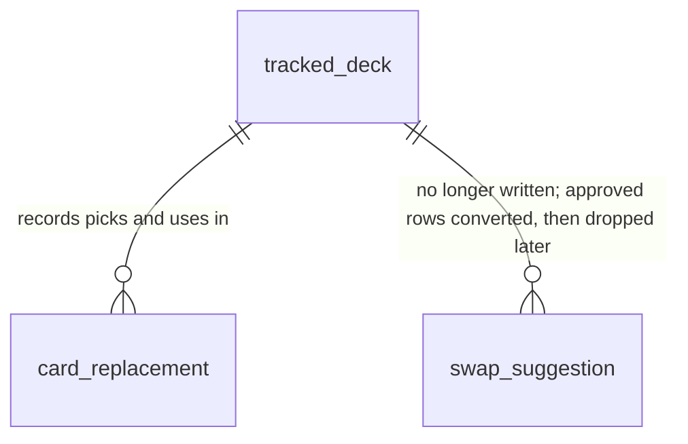

# Swaps into alternatives

## Problem

For a card the owner does not have, the site offers two separate ways to decide what plays in its place, built on the same engine scoring.
A swap is the engine's one proposal from the collection, approved or rejected on a dedicated Swaps page or in the deck's swaps panel, and counted toward readiness only once approved.
An alternative is picked from a ranked list opened from the missing-card panel, and it changes the deck.
The engine's swap is in practice the first owned card of the alternatives list, shown on another screen, with its own states (pending, approved, rejected, retired, reverted), its own reconciliation job and its own bulk actions.
The owner, after testing card alternatives and recommendations on staging, said the swaps "tentam fazer isso de uma maneira pior e duplicada" and that he no longer sees a reason to keep them as a feature.
The duplication also carries defects of its own: an approved swap stops counting when the engine's best stand-in changes (logged when alternatives were planned), and a deck import recomputes every existing deck without the owner's approvals or rejections (`decks-import.service.ts:205`), so the headline readiness can drop and rejected stand-ins can come back.
No usage figure exists; the owner is the site's only user.

When this ships there is one way to decide what plays in place of a missing card.
Each missing card in the deck's missing panel shows the best card from the collection the engine found for it, with a one-click "Usar", next to "Ver alternativas".
The status strip offers "Usar as N cartas da coleção" to take every suggestion at once.
Using a suggestion is the same deck change as picking an alternative today.
The Swaps page, the swaps panel, the approve / reject / revert / restore / outcome actions and the "modified view" banner are gone.
Swaps the owner had approved become picks, so no deck loses readiness.

## Flow

Reuses the replacement pick (`ReplacementsService`, `card_replacement`, the `tracked_deck` lock, the copy move, the recompute and the "original returns" prompt from AD-009), the engine's existing stand-in search (`findSubstitution` inside `computeEffectiveReadiness`) as the source of the suggestion, and the one-off script pattern of `backfill-swap-suggestions.ts` for the data conversion.

1. readiness recompute -> `SubstitutionService` (exists) -> `computeEffectiveReadiness` (exists) without approved or rejected sets (door 2): `substituted` entries become suggestions only; the snapshot no longer reconciles `swap_suggestion`
2. `GET /api/decks/:deckId` (exists) -> `DecksService.getDetail` (exists): each missing copy carries its suggestion from `breakdown.substituted`; the headline readiness counts the deck as it is (door 2)
3. "Usar" on one missing card -> `POST /api/decks/:deckId/replacements` (exists) with `pickedFrom: suggested` (door 1) -> `ReplacementsService.pick` (exists): same lock, copy move, `card_replacement` row and recompute as any pick
4. "Usar as N cartas da coleção" -> `POST /api/decks/:deckId/replacements/suggested` (new route, door 3) -> `ReplacementsService` (exists): under one `tracked_deck` lock, one pick per current suggestion, one recompute
5. deploy -> conversion script (new, door 4, the backfill pattern): every `approved` swap becomes an active `card_replacement` with `pickedFrom: swap` and its copies moved in `deck_card`, then that deck is recomputed
6. web: the missing panel (exists) gains the suggestion and "Usar"; the status strip (exists) gains the bulk action; the Swaps page, the swaps panel, the modified-view banner, the nav item and the swaps client go; the onboarding's first-review step offers the bulk action instead of approvals

## Impact

| Front | What changes |
| --- | --- |
| domain | retired term: `swap` (troca) - the approvable stand-in with its lifecycle; AD-005, AD-006 and AD-007 are superseded |
| domain | existing term: `stand-in` / `substituted` - meant a swap waiting for approval or approved; now means only "the best card from the collection for this missing copy", a suggestion that counts toward nothing until used |
| domain | existing term: `effectivePercent` - meant exact plus approved stand-ins over total; now equals exact over total of the deck as it is, the same value as `rawPercent`. Read today by the hero medallion, the Home tiles and averages (`DeckTile.tsx:99`, `homeGroups.ts:67, :88`), the collection write responses and the deck import response; the field is kept with the new meaning and removing the duplicate is a later cleanup |
| domain | existing term: `pickedFrom` - gains `suggested` (one-click use of the engine's suggestion) and `swap` (an approved swap converted at deploy); the pick DTO accepts `suggested`, never `swap` |
| API response | `GET /api/decks/:deckId` breakdown entries lose the `approved` flag; `fidelityPercent` and `path` keep their meaning (what the collection could reach); all consumed only by this SPA, deployed with it |
| routes | `/api/swaps` and its five actions are removed; the older 410 routes for decisions, reject-substitute, re-solve and reviews stay as they are |
| stored data | `swap_suggestion` stops being written or read; its `approved` rows are converted by the script (door 4); the table itself is dropped in a later release, after the conversion has run in production |
| shopping line | unchanged: cards with a suggestion are still listed as upgrade candidates rather than in the primary list, as pending swaps were |
| onboarding | the first-review step (`Step3FirstReview`) stops approving swaps one by one and offers using every suggestion at once, or skipping |
| prior decisions | supersedes AD-005, AD-006 and AD-007; conforms to AD-009 (a use is a pick) and AD-003 (error codes); recorded as AD-012 |

## Relations

One-way constraints: `card_replacement.pickedFrom` limited to eight values (door 1); a converted swap leaves exactly one active `card_replacement` per (deck, original card, slot) it covered (door 4).
No columns and no types here.

## Surface

| Route | In | Out | Status |
| --- | --- | --- | --- |
| `POST /api/decks/:deckId/replacements` | existing body; `pickedFrom` also accepts `suggested` | `replacement` | `201`, `400`, `401`, `404`, `409` |
| `POST /api/decks/:deckId/replacements/suggested` | no body | `replacements` (one per card used), `skipped` count | `201`, `401`, `404`, `409` |
| `GET /api/swaps` and `POST /api/swaps/:id/{approve,reject,revert,restore,outcome}` | removed | removed | `404` |

## Landing

| One-way door | Literal shape | Alternative rejected |
| --- | --- | --- |
| 1. replacement origins | `CHECK ("pickedFrom" IN ('very_close','close','other_pitch','generic','search','recommendation','suggested','swap'))`; `REPLACEMENT_PICK_ORIGINS` adds `suggested` only | one shared value for the one-click use and the converted swaps: it would make the conversion indistinguishable from the owner's own choices in `card_replacement`, the record AD-009 keeps for exactly that kind of question |
| 2. readiness without approvals | `computeEffectiveReadiness` loses `approvedIdentifiers` and `excludedIdentifiers`; `effectivePercent = exact / total`; `substituted[]` entries carry no `approved` flag | keeping approvals as an engine input with nothing feeding it: dead input that every recompute path would still have to thread, and the import path at `decks-import.service.ts:205` already shows how such an input gets forgotten |
| 3. bulk use route | `POST /api/decks/:deckId/replacements/suggested` -> `201 { replacements: IReplacement[], skipped: number }`; `409 NOTHING_TO_REPLACE` when the deck has no suggestion | looping the single pick route from the web: N requests, N recomputes and N lock waits for one click, and a partial failure leaves the deck half-converted with no single answer to show |
| 4. approved swaps become picks | one-off script `convert-approved-swaps` run once after deploy, as `backfill-swap-suggestions` is: per approved swap, under the deck lock, move `min(quantity, copies still missing)` copies to the substitute and insert `card_replacement (pickedFrom 'swap', status 'active')`; skip when nothing is missing any more; recompute the deck | discarding approved swaps: every deck that relied on them loses readiness at deploy, with no record of what the owner had accepted; a TypeORM migration: migrations cannot call the engine to recompute, and the precedent for engine-aware data work is a script |

- Nothing else in this change is hard to reverse: removing the Swaps page and panel is a code deletion, and the `swap_suggestion` table stays in place until a later release drops it.

## Criteria

### S1: one click uses the collection's best card for a missing card (P1)

The missing panel shows the suggestion and uses it as a pick.

**Acceptance Criteria**

1. WHEN a missing card has an engine suggestion THEN the missing panel row SHALL show that card's name with its pitch, labelled "da sua coleção", a "Usar" button and the existing "Ver alternativas"
2. WHEN the owner presses "Usar" on a row THEN the system SHALL send `POST /api/decks/:deckId/replacements` with the suggestion as `replacementCardIdentifier` and `pickedFrom: suggested`, and the row SHALL leave the missing panel once the deck reloads
3. WHEN a missing card has no suggestion THEN its row SHALL show only "Ver alternativas"
4. The system SHALL accept `pickedFrom: suggested` on the pick route and SHALL refuse `pickedFrom: swap` there with `400`
5. WHEN a suggestion is used THEN `card_replacement` SHALL hold an active row with `pickedFrom` `suggested`, and the deck list SHALL mark the card "no lugar de" the original as any pick does

**Independent test:** use one suggestion on the fixture's swap deck and see the mark in the deck list.

### S2: every suggestion at once (P1)

The status strip and the onboarding offer to use every suggestion in one action.

**Acceptance Criteria**

6. WHILE the deck has N ≥ 1 suggestions the status strip SHALL read "Dá para cobrir N cartas com a sua coleção" with a button "Usar as N"
7. WHEN the owner presses "Usar as N" THEN the system SHALL send one `POST /api/decks/:deckId/replacements/suggested`
8. WHEN that route runs THEN the system SHALL, under one `tracked_deck` lock, create one active `card_replacement` with `pickedFrom: suggested` per missing card that has a suggestion, move the copies as a pick does, recompute once, and answer `201` with the rows and the count of suggestions it skipped
9. IF the deck has no suggestion when the route runs THEN the system SHALL answer `409` `NOTHING_TO_REPLACE` and change nothing
10. IF a suggestion is no longer legal or no longer owned when the route runs THEN the system SHALL skip it, count it in `skipped`, and still use the others
11. WHEN two bulk requests race on one deck THEN exactly one SHALL move copies and the other SHALL find nothing left and answer `409` `NOTHING_TO_REPLACE`
12. WHEN the onboarding reaches its first-review step and the deck has suggestions THEN it SHALL offer "Usar as N cartas da coleção" and "Agora não", and SHALL show no per-card approve or reject

**Independent test:** on the swap deck, press the strip's action and see every suggested card marked in the deck list.

### S3: readiness counts the deck as it is (P1)

No number depends on an approval any more.

**Acceptance Criteria**

13. The engine SHALL compute `effectivePercent` as exact copies over total copies, the same value as `rawPercent`, for every deck
14. The engine SHALL still compute `substituted` suggestions, `fidelityPercent` and `path` from the collection exactly as it did for a deck with no approved and no rejected swaps
15. WHEN a deck import recomputes the owner's other decks THEN their headline readiness SHALL equal what a deck-page read computes for the same deck
16. The hero medallion, the Home tiles and the Home average SHALL show the deck-as-it-is readiness

**Independent test:** engine unit tests over a deck with exact copies, suggestions and missing cards.

### S4: approved swaps survive as picks (P1)

Nothing the owner accepted is lost at deploy.

**Acceptance Criteria**

17. WHEN the conversion script runs THEN every `approved` swap whose original still has missing copies SHALL become one active `card_replacement` with `pickedFrom: swap`, its copies moved to the substitute in `deck_card`
18. WHEN the conversion script runs THEN a deck's readiness after conversion SHALL be at least its `effectivePercent` before conversion
19. IF an approved swap's original has no missing copies left THEN the script SHALL skip it and change nothing for it
20. WHEN the conversion script runs a second time THEN it SHALL change nothing
21. The script SHALL log one line per converted swap and one summary with converted, skipped and failed counts, and SHALL exit non-zero if any deck failed

**Independent test:** run the script against a database seeded with approved, pending and rejected swaps.

### S5: the swap feature is gone (P1)

No screen, route or action about swaps remains.

**Acceptance Criteria**

22. The top bar and the bottom tab bar SHALL show no "Trocas" entry
23. WHEN the owner opens `/swaps` or `/reviews` THEN the site SHALL redirect to `/`
24. The deck page SHALL show no swaps panel, no "modified view" banner and no "Ver trocas" link
25. The routes `GET /api/swaps` and `POST /api/swaps/:id/{approve,reject,revert,restore,outcome}` SHALL answer `404`
26. WHEN any recompute runs THEN the system SHALL write no `swap_suggestion` row
27. The status strip SHALL read, for a complete deck, "Sua coleção cobre o deck inteiro"; for a deck with missing cards and no suggestion, "Faltam N cartas"; and with suggestions, the copy in AC 6

**Independent test:** the visual baselines and the Playwright suite with the swaps specs replaced.

## Out of scope

| Excluded | Why |
| --- | --- |
| dropping the `swap_suggestion` table | it must outlive the conversion run in production; a later release drops it in its own migration |
| removing `effectivePercent` in favour of `rawPercent` | a field rename across every response and the Home; the value is already the same after this change |
| the Gemini judging suggestions for missing cards | a separate improvement on top of the single flow; the engine's suggestion is unchanged here |
| dismissing a suggestion ("not this one") | the swaps had rejection with reasons; with "Ver alternativas" one click away, a dismiss is not part of the merge |
| post-play outcomes ("worked / did not work") | only swaps had them and nothing read them |
| the older 410 routes (decisions, reject-substitute, re-solve, reviews) | already inert; removing them is unrelated cleanup |

## Assumptions

| Assumption | Chosen default | Rationale | Confirmed? |
| --- | --- | --- | --- |
| what "Usar" does | a pick: the deck list changes, the original is remembered in `card_replacement`, and the "original returns" prompt offers going back when the card enters the collection | it is the model alternatives already use (AD-009); a pinned stand-in that keeps the imported list intact would need a new engine input and its own reconciliation, which is what is being removed | n |
| approved swaps at deploy | converted into picks with `pickedFrom: swap` | the owner keeps every deck's readiness and a record of what he had accepted | n |
| pending and rejected swaps at deploy | dropped with nothing kept; their reasons and notes are lost | pending ones reappear as suggestions on their own; rejection reasons and outcomes have no reader | n |
| the onboarding's first-review step | kept, offering "Usar as N cartas da coleção" or "Agora não" | removing the step would leave a new deck at its raw readiness with no hint that the collection can cover cards | n |
| suggestion label | "da sua coleção" under the card name, "Usar" as the button | matches the alternatives sheet's "Usar" and says why this card is offered | n |

**Open questions:**

| # | Kind | Question | Until answered |
| --- | --- | --- | --- |
| 1 | blocks | Should "Usar" change the deck list (a pick, as alternatives do), or keep the imported list and only count the card (a pinned stand-in)? | S1, S2 and S4 cannot be built; the default is a pick |
| 2 | blocks go-live | Convert the approved swaps into picks at deploy, or let them go? | the conversion script (S4) does not run in production |

## Observable

| Surface | Decision | Landing |
| --- | --- | --- |
| screen deck page · missing panel | empty state | existing - a complete deck shows no action panels, and an empty list shows the `deckDetail.missingEmpty` line |
| screen deck page · missing panel | loading state | existing - the deck page skeleton; "Usar" disables while its request runs, as the alternatives sheet's buttons do |
| screen deck page · missing panel | error state | existing - a refused pick shows the localized `NOTHING_TO_REPLACE` / `REPLACEMENT_ILLEGAL` message, as the alternatives sheet does |
| screen deck page · missing panel | unauthorised state | existing - the deck route redirects to sign-in |
| screen deck page · missing panel | density and ordering | existing - the panel's current order; the suggestion adds one line per row (AC 1) |
| screen deck page · missing panel | destructive action confirms | existing - a use is undone from the deck list's "Desfazer", as any pick |
| screen deck page · status strip | copy per state | AC 6, AC 27 |
| screen deck page · status strip | error state | AC 9, AC 10 |
| screen onboarding · first review | empty state | existing - with no suggestion the step shows its "looking good" variant, as it does today with no swaps (`Step3FirstReview.tsx:160`) |
| screen Swaps page | removal | AC 22, AC 23 |
| API `POST /api/decks/:deckId/replacements/suggested` | response shape | AC 8 |
| API `POST /api/decks/:deckId/replacements/suggested` | error shape and codes | AC 9, AC 11 |
| API `POST /api/decks/:deckId/replacements/suggested` | who may call it | existing - `OwnsTrackedDeckGuard`, as the pick route |
| API `POST /api/decks/:deckId/replacements/suggested` | rate limits | existing - the global throttle, as the pick route |
| API `/api/swaps*` | removal and versioning | AC 25 - consumed only by this SPA, deployed with it |
| command `convert-approved-swaps` | output and exit codes | AC 21 |
| command `convert-approved-swaps` | failing halfway | AC 20 - each deck converts in its own transaction, and a rerun converts only what is left |

## Sources

- The owner's request on 2026-10-11 after testing staging: "a parte de swaps não faz mais sentido ... as recomendações fazem isso muito melhor ... de uma maneira pior e duplicada"; the merge into alternatives was proposed in reply and he asked for this plan.
- `.specs/STATE.md` AD-005, AD-006, AD-007 (superseded) and AD-009 (conformed to).
- `.design/card-alternatives.md` - the pick model, the "original returns" prompt, and the swap-lifecycle defects it logged as separate work.
